<div align="center">
  

# Arroxy — Δωρεάν Ανοιχτού Κώδικα Λήψη YouTube (+ 2000 ιστοτόπους) με ενσωματωμένο πρόγραμμα περιήγησης για Windows, macOS & Linux

**Built-in browser · Members-only & age-restricted · 4K · 60fps · HDR · Dolby audio · Part of a video · Playlists · Shorts · MP3 · Subtitles · SponsorBlock · +2000 sites**

**Διαβάστε στα:** [Afaan Oromoo](README.om.md) · [Bahasa Indonesia](README.id.md) · [Deutsch](README.de.md) · [English](README.md) · [Español](README.es.md) · [Français](README.fr.md) · [Italiano](README.it.md) · [Kiswahili](README.sw.md) · [O'zbekcha](README.uz.md) · [Polski](README.pl.md) · [Português](README.pt.md) · [Tiếng Việt](README.vi.md) · [Türkçe](README.tr.md) · [አማርኛ](README.am.md) · [العربية](README.ar.md) · [اردو](README.ur.md) · [پښتو](README.ps.md) · [فارسی](README.fa.md) · [বাংলা](README.bn.md) · [हिन्दी](README.hi.md) · [ไทย](README.th.md) · [မြန်မာဘာသာ](README.my.md) · [ខ្មែរ](README.km.md) · **Ελληνικά** · [Русский](README.ru.md) · [Српски](README.sr.md) · [Українська](README.uk.md) · [中文](README.zh.md) · [日本語](README.ja.md) · [한국어](README.ko.md) · [繁體中文](README.zh-Hant.md)

[](https://github.com/antonio-orionus/Arroxy/releases/latest) [](https://github.com/antonio-orionus/Arroxy/actions/workflows/release.yml) [](https://orionus.dev/arroxy/)   

Κατεβάστε βίντεο, Shorts, μουσική, κανάλια, podcasts ή ηχητικά κομμάτια από το **YouTube και 2000+ υποστηριζόμενους ιστοτόπους** — έως 8K HDR στα 60 fps, ως MP3 / AAC / Opus ή μόνο το κομμάτι που χρειάζεστε. **Περιηγηθείτε στο YouTube ή σε οποιονδήποτε άλλον ιστότοπο μέσα στο Arroxy** στην καρτέλα Explore και κατεβάστε το βίντεο, την playlist ή το κανάλι που βλέπετε· συνδεθείτε εκεί για να κατεβάζετε ιδιωτικά βίντεο, βίντεο μόνο για μέλη και βίντεο με περιορισμό ηλικίας που βλέπει ο λογαριασμός σας. Εκτελείται τοπικά σε Windows, macOS και Linux. **Χωρίς διαφημίσεις, χωρίς bloat, χωρίς upsells.**

[**↓ Λήψη Τελευταίας Έκδοσης**](#install) &nbsp;·&nbsp; [**Ιστότοπος**](https://orionus.dev/arroxy/) &nbsp;·&nbsp; [Windows — πρώτη εκκίνηση](#windows-first-launch) · [macOS — πρώτη εκκίνηση](#macos-first-launch) · [Linux — πρώτη εκκίνηση](#linux-first-launch)

[](https://discord.gg/ueGvXwQH8y)

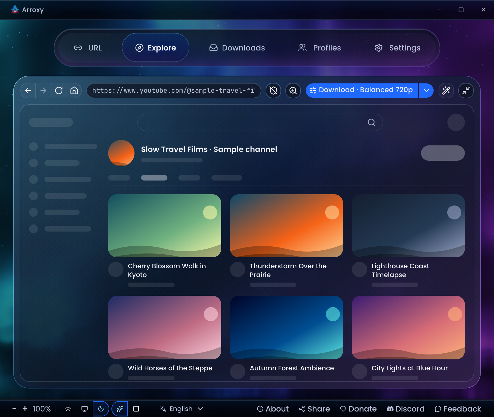

Αν το Arroxy σας εξοικονομεί χρόνο, ένα ⭐ βοηθά άλλους να το βρουν.

</div>

> **What is Arroxy?** Arroxy is a free, open-source desktop GUI that downloads videos, audio, playlists, and subtitles from YouTube and 2000+ other [yt-dlp](https://github.com/yt-dlp/yt-dlp)-supported sites. It runs on Windows 10/11, macOS 13+ (Intel + Apple Silicon), and Linux (AppImage, Flatpak, tar.gz). MIT licensed. No ads, no usage limits. Distributed via [Winget](https://winget.run/pkg/AntonioOrionus/Arroxy), [Scoop](https://github.com/antonio-orionus/scoop-bucket), [Homebrew Cask](https://github.com/antonio-orionus/homebrew-arroxy), Flatpak, AppImage, and direct download.
>
> **Key difference: a built-in browser.** Most free YouTube downloaders are thin yt-dlp wrappers: a URL box and a format menu, with no browser of their own. Arroxy has one, the **Explore tab**. You browse YouTube or any other site inside the app and download the video, playlist, or channel you're on, or right-click any link. You sign in once in Explore, and Arroxy downloads private, members-only, and age-restricted videos your account can watch, plus your Watch Later and Liked lists, with no cookie export. Sign in to other sites there too, and their downloads use that sign-in when they need it. It retries with that sign-in when YouTube asks you to confirm you're not a bot. Its built-in browser also gets the token YouTube expects before a download, so YouTube doesn't cut a download down to fewer formats. A URL-box wrapper hits all of these limits. Details: [Why Arroxy](#why-explore).
>
> _Last updated: 2026-10-19._

---

## Περιεχόμενα

- [✨ Χαρακτηριστικά](#features)
- [📥 Εγκατάσταση και πρώτη εκκίνηση](#install)
  - [Windows — πρώτη εκκίνηση](#windows-first-launch)
  - [macOS — πρώτη εκκίνηση](#macos-first-launch)
  - [Γιατί μπορεί να δείτε προειδοποίηση](#why-warning)
  - [Linux — πρώτη εκκίνηση](#linux-first-launch)
  - [Επαληθεύστε τη λήψη σας (SHA256)](#verify)
- [⚖️ Γιατί Arroxy](#why)
- [🔒 Απόρρητο](#privacy)
- [❓ Συχνές Ερωτήσεις](#faq)
- [🗺️ Χάρτης Πορείας](#roadmap)
- [💖 Υποστήριξη του Arroxy](#support)
- [🛠️ Κατασκευάστηκε με](#tech)

---

## <a id="features"></a>✨ Χαρακτηριστικά

<table align="center" width="100%">
  <tr>
    <td colspan="2" valign="top" align="center"><br/> <sub><b>Explore</b><br/>Περιηγηθείτε στο YouTube ή σε οποιονδήποτε άλλον ιστότοπο μέσα στο Arroxy και κατεβάστε τη σελίδα που βλέπετε με το ενεργό προφίλ σας</sub></td>
  </tr>
  <tr>
    <td width="50%" valign="top" align="center">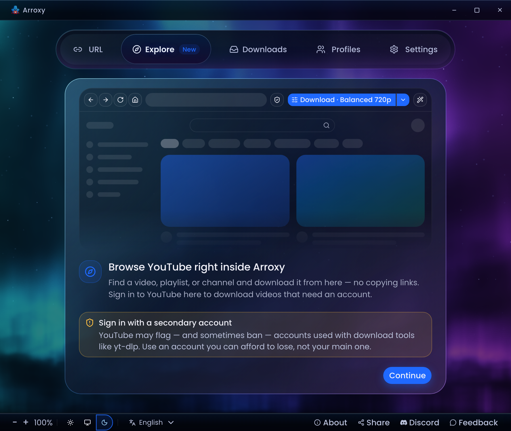<br/> <sub><b>Η πρώτη οθόνη του Explore</b><br/>Μια γρήγορη ματιά στο Explore και γιατί ένας δευτερεύων λογαριασμός είναι η ασφαλέστερη σύνδεση</sub></td>
    <td width="50%" valign="top" align="center">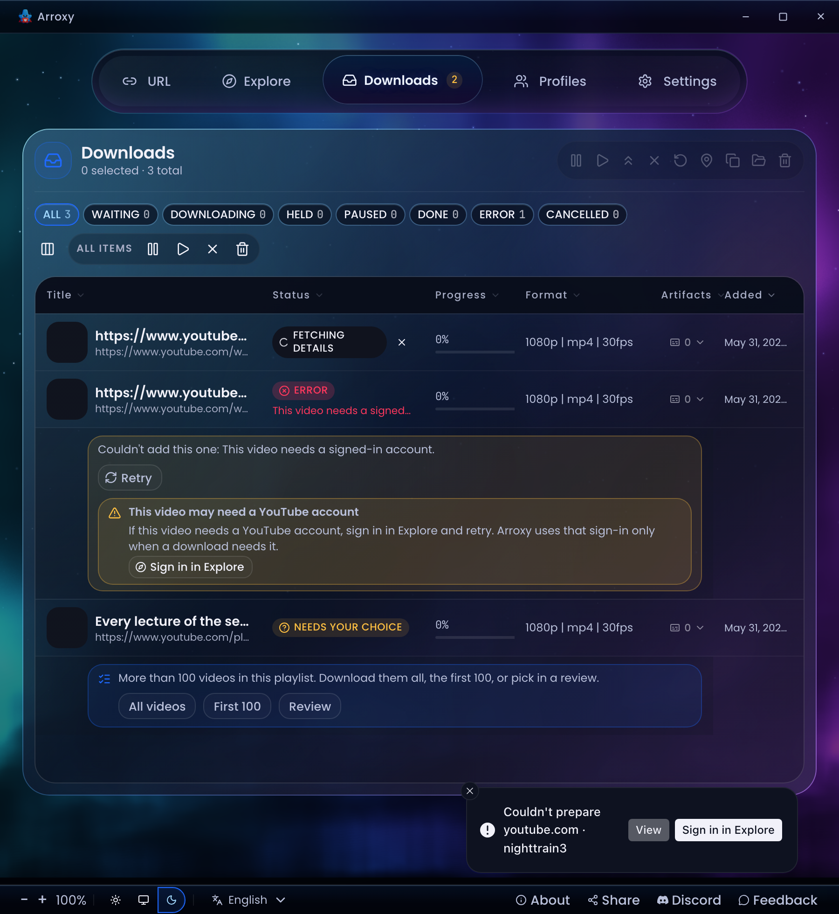<br/> <sub><b>Οι Λήψεις σας λένε τι χρειάζεται εσάς</b><br/>Οι σύνδεσμοι προετοιμάζονται στο παρασκήνιο· ένας αποτυχημένος προτείνει τη λύση, μια μεγάλη playlist περιμένει την επιλογή σας</sub></td>
  </tr>
  <tr>
    <td colspan="2" valign="top" align="center">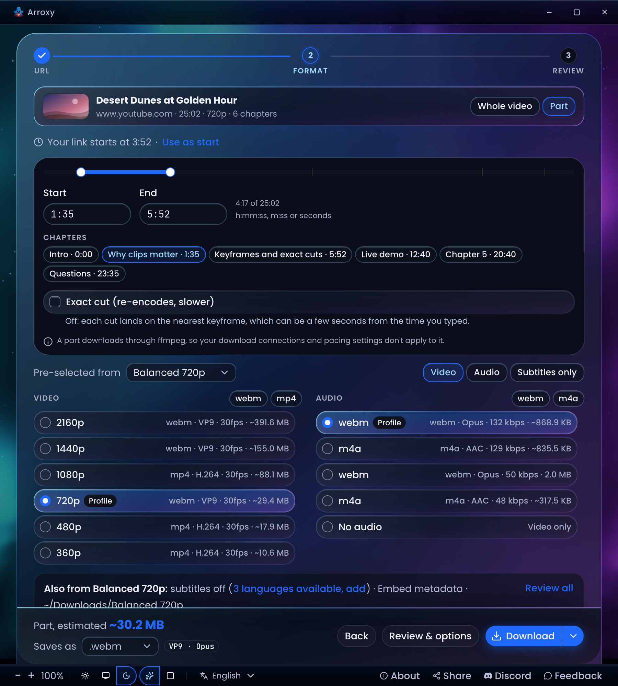<br/> <sub><b>Κατεβάστε μόνο ένα μέρος του βίντεο</b><br/>Επιλέξτε αρχή και τέλος ή ένα κεφάλαιο — το Arroxy αποθηκεύει μόνο αυτό το τμήμα</sub></td>
  </tr>
  <tr>
    <td colspan="2" valign="top" align="center">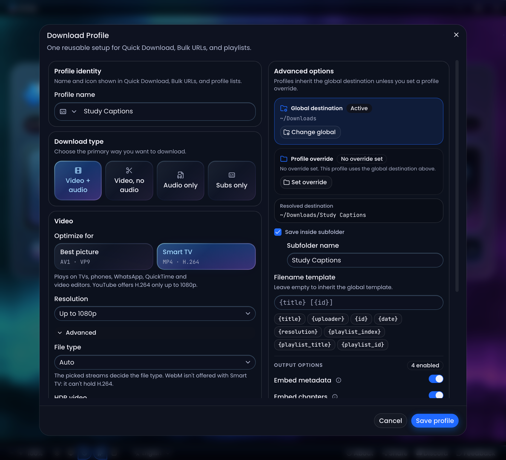<br/> <sub><b>Επεξεργαστής προφίλ</b><br/>Ρυθμίστε ένα προφίλ: τύπο αρχείου, ανάλυση, υπότιτλους, προορισμό, πρότυπο ονόματος αρχείου και άλλα</sub></td>
  </tr>
  <tr>
    <td colspan="2" valign="top" align="center">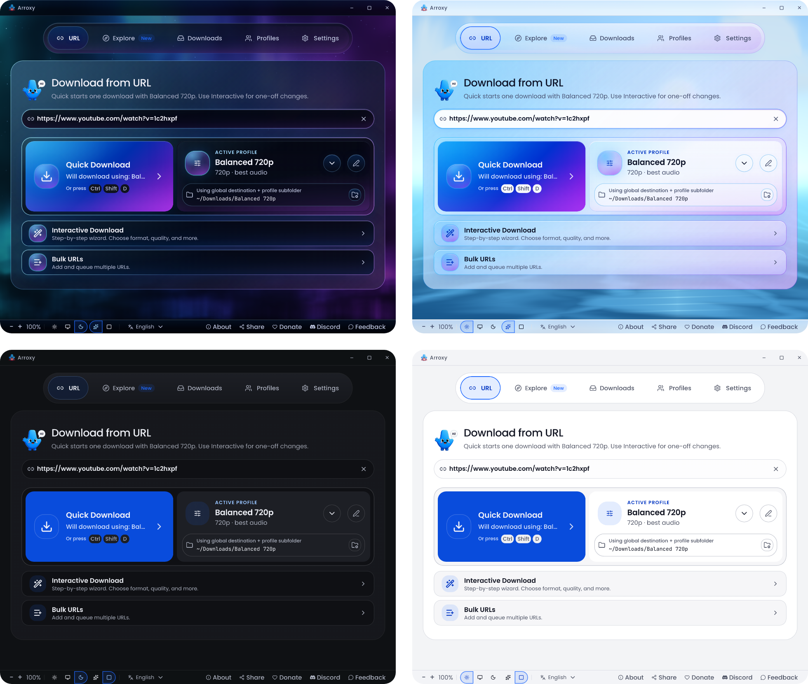<br/><sub><b>Σκούρο ή φωτεινό, γυαλί ή απλό</b><br/>Τέσσερις εμφανίσεις: γυάλινα πάνελ πάνω από κινούμενο ουρανό ή ήρεμες συμπαγείς επιφάνειες, και οι δύο σε σκούρο και φωτεινό</sub></td>
  </tr>
  <tr>
    <td colspan="2" valign="top" align="center"><picture><source media="(prefers-color-scheme: dark)" srcset="build/Global-hotkey-dark.png" />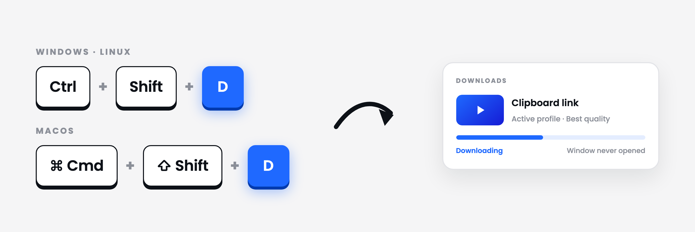</picture><br/><sub><b>Καθολική συντόμευση λήψης</b><br/>Αντίγραψε έναν σύνδεσμο οπουδήποτε, πάτα μία φορά — μπαίνει στην ουρά και ξεκινά η λήψη</sub></td>
  </tr>
  <tr>
    <td colspan="2" valign="top" align="center">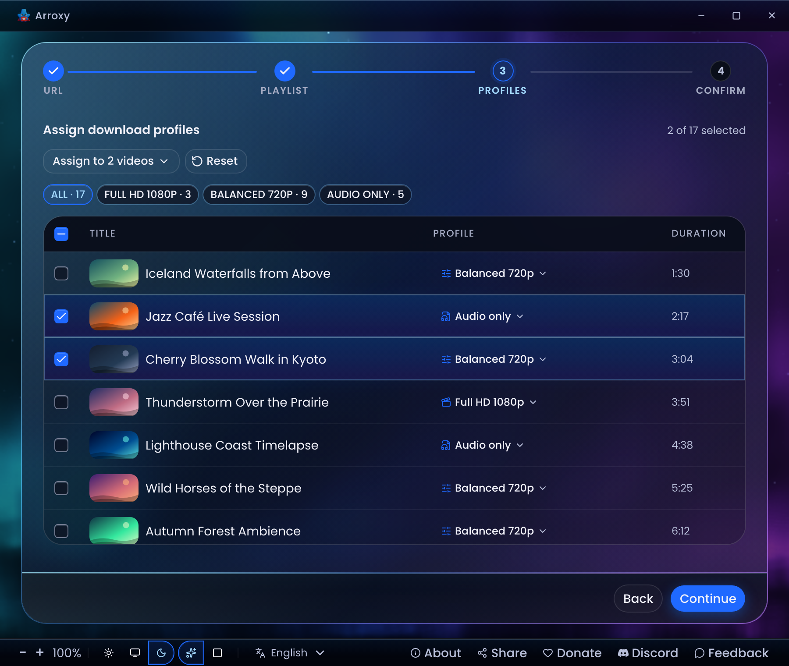<br/><sub><b>Προφίλ ανά βίντεο σε playlist</b><br/>Δώστε σε κάθε βίντεο το δικό του προφίλ — άλλα σε 4K, τα υπόλοιπα ως MP3</sub></td>
  </tr>
  <tr>
    <td width="50%" valign="top" align="center">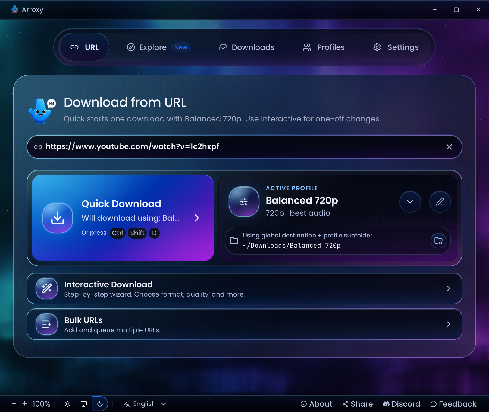<br/><sub><b>Αρχική Γρήγορης λήψης</b><br/>Επικολλήστε ένα URL και κατεβάστε το αμέσως με το ενεργό προφίλ σας</sub></td>
    <td width="50%" valign="top" align="center">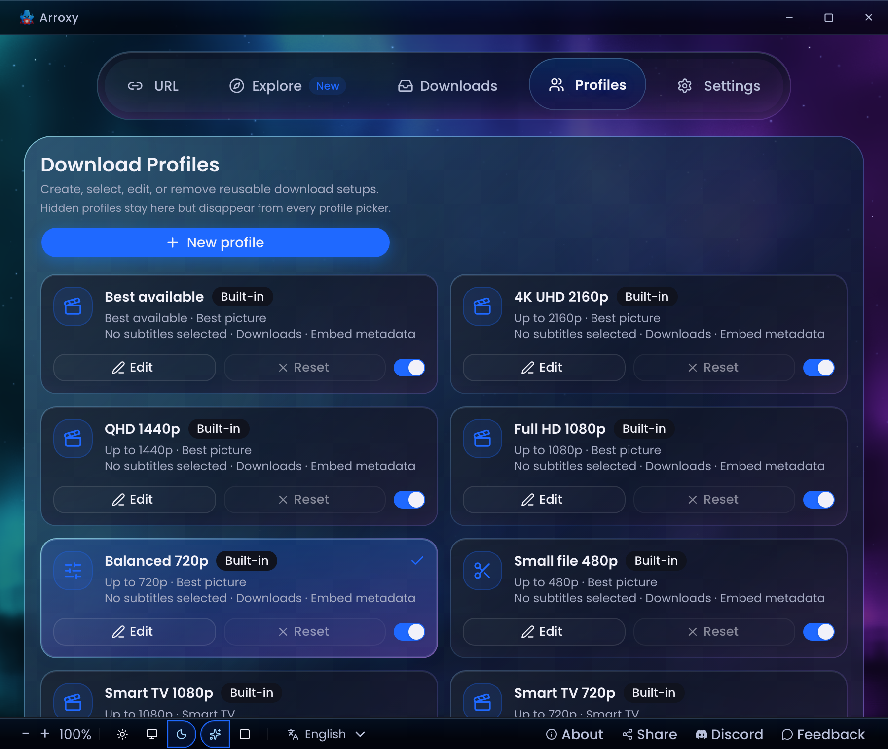<br/><sub><b>Επαναχρησιμοποιήσιμα προφίλ λήψης</b><br/>Αποθηκεύστε μορφή, ποιότητα και έξοδο ως προεπιλογές — επαναχρησιμοποιήστε σε κάθε λήψη</sub></td>
  </tr>
  <tr>
    <td width="50%" valign="top" align="center">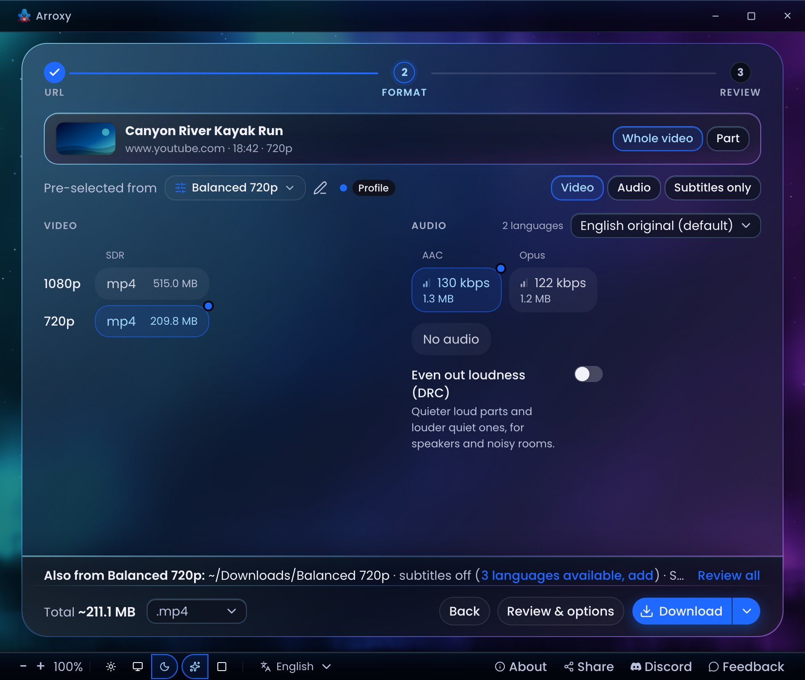<br/><sub><b>Πολύγλωσσα κομμάτια ήχου</b><br/>Επιλέξτε την ακριβή γλώσσα ήχου που διαθέτει το βίντεο</sub></td>
    <td width="50%" valign="top" align="center">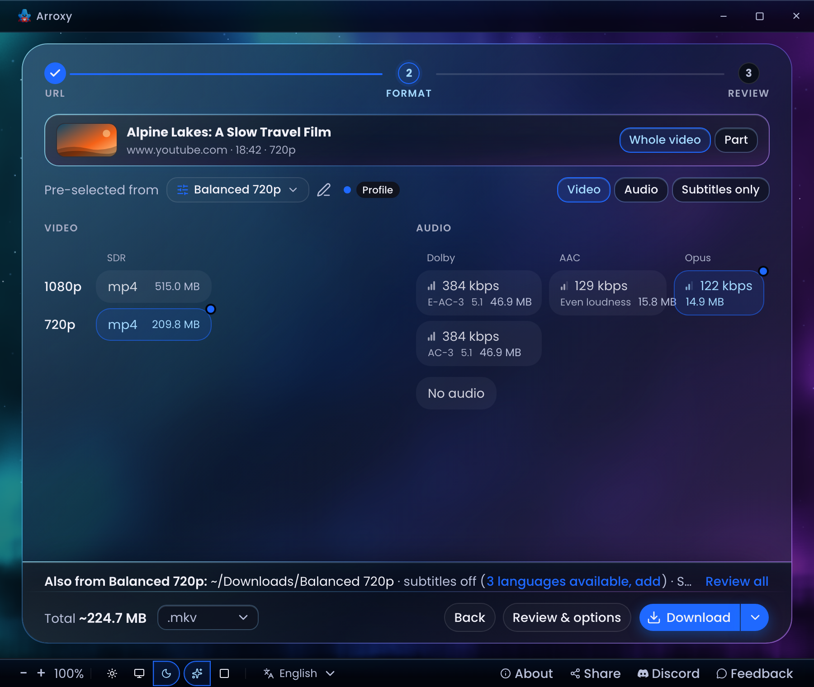<br/><sub><b>Ήχος Surround / Dolby</b><br/>Τα κομμάτια 5.1 και Dolby εντοπίζονται και διατηρούνται</sub></td>
  </tr>
  <tr>
    <td width="50%" valign="top" align="center">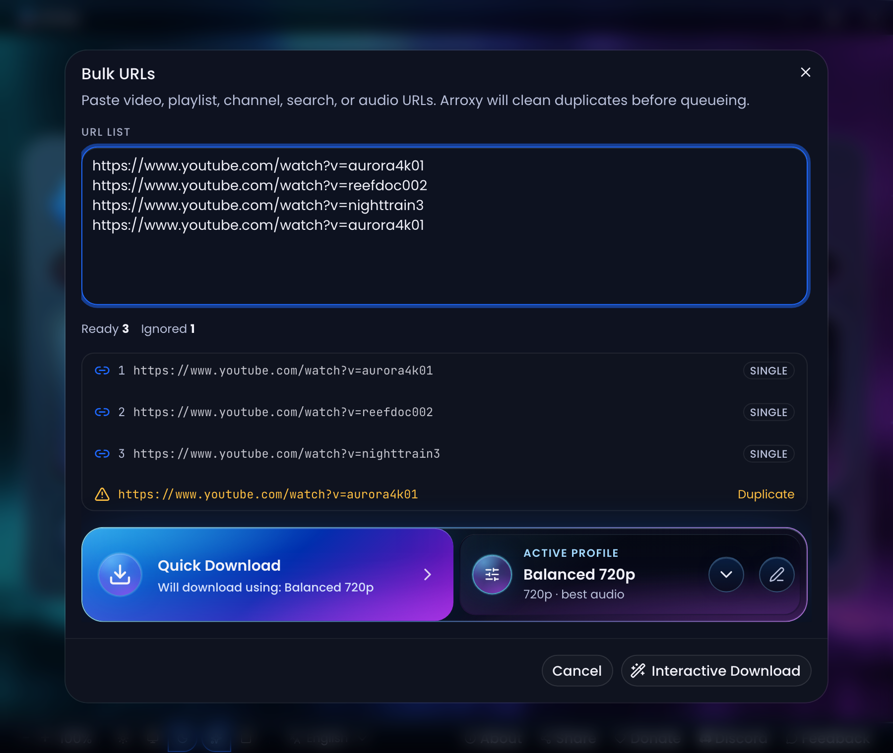<br/><sub><b>Λειτουργία μαζικών URL</b><br/>Επικολλήστε μια λίστα, αυτόματη αφαίρεση διπλότυπων, βάλτε τα όλα στην ουρά μαζί</sub></td>
    <td width="50%" valign="top" align="center">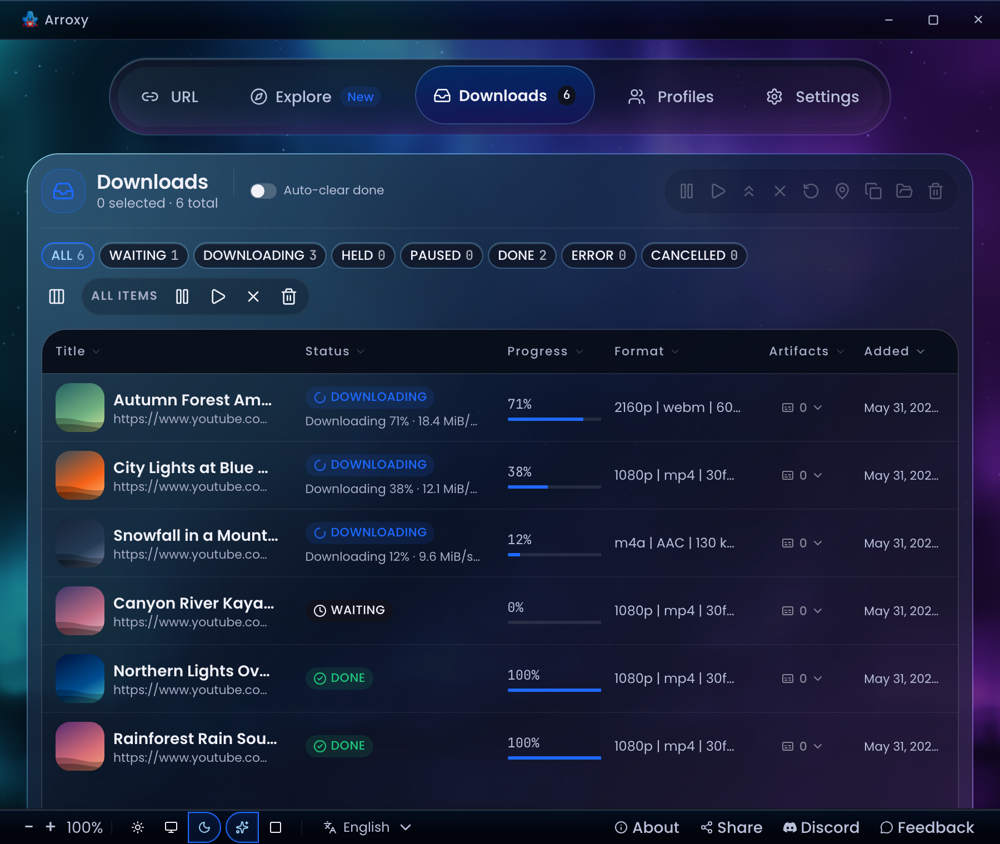<br/><sub><b>Παράλληλη ουρά λήψεων</b><br/>Πολλές λήψεις ταυτόχρονα με ζωντανή πρόοδο</sub></td>
  </tr>
</table>

<details open>
<summary><strong>🧭 Explore: περιήγηση στον ιστό μέσα στο Arroxy</strong></summary>

- **Καρτέλα Explore** — περιηγηθείτε στο YouTube ή σε οποιονδήποτε άλλον ιστότοπο μέσα στο Arroxy και κατεβάστε ό,τι βρείτε χωρίς αντιγραφή συνδέσμων. Το **Λήψη · *το προφίλ σας*** βάζει στην ουρά το βίντεο, την playlist ή το κανάλι που βλέπετε· το βέλος δίπλα αλλάζει προφίλ και η μαγική ράβδος ανοίγει τη λήψη βήμα προς βήμα για επιλογή μορφών, υποτίτλων και άλλων
- **Λήψη με δεξί κλικ** — κάντε δεξί κλικ σε οποιονδήποτε σύνδεσμο βίντεο, playlist ή καναλιού στο Explore για να τον κατεβάσετε με το προφίλ σας, να διαλέξετε άλλο προφίλ από το **Λήψη με**, να ανοίξετε τη λήψη βήμα προς βήμα ή να αντιγράψετε τον σύνδεσμο. Δεν χρειάζεται να ανοίξετε πρώτα κάθε βίντεο
- **Συμπαγής διάταξη** — με ένα κλικ στη γραμμή εργαλείων του Explore, οι καρτέλες του Arroxy μετακινούνται εκεί και η σελίδα αποκτά περισσότερο χώρο
- **Γραμμή διευθύνσεων** — πληκτρολογήστε για αναζήτηση στο YouTube ή εισαγάγετε οποιαδήποτε διεύθυνση ιστού για να ανοίξει ο ιστότοπος
- **Λήψεις που χρειάζονται λογαριασμό** — συνδεθείτε μία φορά στο Explore και το Arroxy μπορεί να κατεβάζει ιδιωτικά βίντεο και βίντεο μόνο για μέλη που βλέπει ο λογαριασμός σας, βίντεο με περιορισμό ηλικίας αν ο λογαριασμός έχει επαληθευτεί ηλικιακά, καθώς και τις λίστες «Παρακολούθηση αργότερα» και «Μου αρέσουν». Συνδεθείτε εκεί και σε άλλους ιστότοπους, και οι λήψεις τους θα χρησιμοποιούν αυτή τη σύνδεση όταν τη χρειάζονται. Το Arroxy εξακολουθεί να κατεβάζει πρώτα χωρίς σύνδεση και χρησιμοποιεί τη σύνδεσή σας στο Explore μόνο όταν μια λήψη αποτυγχάνει με τρόπο που μπορεί να διορθώσει ένας λογαριασμός. Όταν το YouTube ζητά να επιβεβαιώσετε ότι δεν είστε ρομπότ, το Arroxy δοκιμάζει επίσης τη σύνδεσή σας στο Explore
- **Χρησιμοποιήστε δευτερεύοντα λογαριασμό** — η πρώτη οθόνη του Explore εξηγεί γιατί: η λήψη με λογαριασμό ενέχει κάποιο ρίσκο περιορισμού αυτού του λογαριασμού. Αποσυνδεθείτε από το Explore μέσα από τις Ρυθμίσεις όποτε θέλετε να ξεχαστούν οι συνδέσεις σας
- **Φραγή διαφημίσεων** — απενεργοποιημένη από προεπιλογή. Ένα κλικ στην ασπίδα στη γραμμή εργαλείων του Explore μπλοκάρει διαφημίσεις και ιχνηλάτες στις σελίδες του, χωρίς να επηρεάζει τις λήψεις. Το YouTube μπορεί να αντιδράσει στη φραγή διαφημίσεων για συνδεδεμένους λογαριασμούς

</details>

<details>
<summary><strong>🎞️ Ποιότητα & μορφές</strong></summary>

- Έως **8K (4320p)**, 4K UHD (2160p), 1440p, 1080p, 720p, 480p, 360p
- **Υψηλός ρυθμός καρέ και HDR** διατηρούνται ως έχουν — 60 fps, HDR10
- **Ήχος** — εξαγωγή μόνο ήχου σε MP3, M4A/AAC, Opus ή WAV. Στις διαδραστικές λήψεις, επίλεξε τα εγγενή κομμάτια surround/Dolby της πηγής (AC-3, E-AC-3, 5.1, DRC) όταν είναι διαθέσιμα, ή όρισε μια καθολική προεπιλογή **Προτίμηση surround / Dolby**
- **Προφίλ με στόχο** — *Καλύτερη εικόνα* (AV1 · VP9) ή *Έξυπνη TV* (MP4 · H.264), αποθηκευμένα ως Αυτόματο, MP4, MKV ή WebM χωρίς επανακωδικοποίηση. Το HDR είναι *Αυτόματο* (μόνο όταν η οθόνη σας μπορεί να το εμφανίσει), *SDR* ή *HDR*
- **Κάθε codec σε κάθε ανάλυση** — η λήψη βήμα προς βήμα εμφανίζει AV1, VP9 και H.264 δίπλα δίπλα σε κάθε ανάλυση, ώστε να διαλέξετε αυτό που αναπαράγει η τηλεόρασή σας ή το πρόγραμμα επεξεργασίας σας
- **Μάθετε τι είναι πραγματικά μια ροή** — επισημαίνονται οι αναλύσεις που το YouTube μεγέθυνε με τεχνητή νοημοσύνη, οι γλώσσες ήχου με μεταγλώττιση από τεχνητή νοημοσύνη, οι ροές με βελτιωμένο bitrate, τα βίντεο 360° και τα κατεστραμμένα αντίγραφα ή όσα έχουν υδατογράφημα. Τα προφίλ παραλείπουν τις ροές που μεγεθύνθηκαν με τεχνητή νοημοσύνη, εκτός αν τις επιτρέψετε

</details>

<details>
<summary><strong>🛡️ Απόρρητο & έλεγχος</strong></summary>

- 100% τοπική επεξεργασία — οι λήψεις πηγαίνουν απευθείας από το YouTube στον δίσκο σας
- Χωρίς σύνδεση, χωρίς cookies, χωρίς συνδεδεμένο λογαριασμό Google
- Αρχεία αποθηκευμένα απευθείας στον φάκελο που επιλέγετε

</details>

<details>
<summary><strong>⚡ Ροή εργασίας</strong></summary>

- **Καθολική συντόμευση λήψης** — αντίγραψε έναν σύνδεσμο σε οποιαδήποτε εφαρμογή και πάτησε `Ctrl+Shift+D` (`Cmd+Shift+D` σε macOS)· το Arroxy τον βάζει στην ουρά με το ενεργό σου προφίλ χωρίς να ανοίξει το παράθυρο, και μια ειδοποίηση το επιβεβαιώνει. Ενεργή από προεπιλογή, με δυνατότητα αλλαγής
- **Ευέλικτοι τρόποι εκκίνησης** — διάλεξε καθοδηγούμενη μεμονωμένη λήψη, επιλογέα playlist/καναλιού, μαζική επικόλληση URL, Quick Download με αποθηκευμένες προεπιλογές ή περιήγηση και λήψη από το Explore
- **Κεντρική ουρά λήψεων** — κάθε μεμονωμένη, playlist, μαζική ή γρήγορη εργασία καταλήγει σε ένα σημείο για πρόοδο, παύση, συνέχιση, ακύρωση, επανάληψη και έλεγχο προτεραιότητας
- **Παρακολούθηση πρόχειρου** — αντιγράψτε έναν σύνδεσμο βίντεο και θα συμπληρώσει το πεδίο URL όταν επιστρέψετε στο Arroxy, με **Αναίρεση** αν δεν το θέλατε. Όσο το Arroxy είναι απασχολημένο, ο σύνδεσμος περιμένει μέχρι να επιστρέψετε στην καρτέλα «URL» (απενεργοποιείται στις Ρυθμίσεις)
- **Αυτόματη εκκαθάριση URL** — αφαιρεί παραμέτρους παρακολούθησης (`si`, `pp`, `utm_*`, `fbclid`, `gclid`) και ξετυλίγει συνδέσμους `youtube.com/redirect`
- **Λειτουργία δίσκου** — το κλείσιμο του παραθύρου διατηρεί τις λήψεις στο παρασκήνιο
- **31 γλώσσες** — εντοπίζει αυτόματα τη γλώσσα συστήματος, με αλλαγή οποιαδήποτε στιγμή
- **Συγχρονισμός playlist** — ξανασαρώνει μια playlist σε σχέση με έναν τοπικό φάκελο για να παραλείψει ήδη κατεβασμένα βίντεο· δημιουργεί ένα αρχείο playlist `.m3u` που ενημερώνεται καθώς κατεβαίνει κάθε βίντεο
- **Έλεγχοι ταχύτητας και ρυθμού** — περιόρισε το bandwidth λήψης, όρισε πόσα μέρη ενός βίντεο κατεβαίνουν ταυτόχρονα και πρόσθεσε καθυστερήσεις αιτημάτων με προεπιλογές (*Ανενεργό · Ισορροπημένο · Προσεκτικό · Προσαρμοσμένο*)
- **Πρότυπα ονομάτων αρχείων** — ονομάστε τις λήψεις όπως θέλετε με `{title}`, `{uploader}`, `{id}`, `{date}`, `{resolution}` και `{playlist_index}`, καθολικά ή ανά προφίλ λήψης
- **Ταυτόχρονες λήψεις και αυτόματη επανάληψη** — διάλεξε πόσες λήψεις της ουράς τρέχουν ταυτόχρονα και άσε το Arroxy να επαναλάβει μια λήψη που συνάντησε πρόβλημα δικτύου ή διακομιστή, περιμένοντας περισσότερο πριν από κάθε προσπάθεια
- **Προφίλ ανά βίντεο σε playlist** — αναθέστε σε κάθε βίντεο μιας playlist το δικό του προφίλ λήψης αντί για μία ρύθμιση για ολόκληρη τη λίστα, ώστε ένα πέρασμα να αρχειοθετεί κάποια σε πλήρη ποιότητα και να παίρνει τα υπόλοιπα ως MP3
- **Το Quick Download λειτουργεί στο παρασκήνιο** — ο σύνδεσμος εμφανίζεται αμέσως στις Λήψεις και προετοιμάζεται εκεί, μια ειδοποίηση με **Προβολή** το επιβεβαιώνει και το πεδίο URL καθαρίζει για τον επόμενο σύνδεσμο. Ξεκινήστε όσους θέλετε ενώ προετοιμάζονται οι προηγούμενοι
- **Οι Λήψεις σας λένε τι χρειάζεται εσάς** — αν το Arroxy δεν μπορεί να διαβάσει έναν σύνδεσμο, η γραμμή του εξηγεί γιατί και προτείνει τη λύση: Επανάληψη, ενεργοποίηση cookies ή σύνδεση στο Explore. Με τα cookies απενεργοποιημένα, το **Σύνδεση με Explore** τον ξαναδοκιμάζει για εσάς μόλις συνδεθείτε. Μια playlist μεγαλύτερη από το όριο φόρτωσης περιμένει στη γραμμή της να επιλέξετε ολόκληρη, τα πρώτα στοιχεία ή έλεγχο. Η καρτέλα Λήψεις μετρά τις γραμμές που σας περιμένουν
- **Λήψη μόνο ενός τμήματος του βίντεο** — διάλεξε αρχή και τέλος ή ένα κεφάλαιο στην οθόνη Μορφής και το Arroxy αποθηκεύει μόνο αυτό το εύρος, με όνομα που περιέχει το εύρος μετά το αναγνωριστικό του βίντεο. Οι κοπές καταλήγουν στο πλησιέστερο keyframe· ενεργοποίησε την ακριβή κοπή για επανακωδικοποίηση
- **Αυτόματη αφαίρεση ολοκληρωμένων λήψεων** — προαιρετικό: μια ολοκληρωμένη λήψη φεύγει από τη λίστα 5 δευτερόλεπτα αργότερα. Τα αρχεία της μένουν στον δίσκο και οι αποτυχημένες λήψεις παραμένουν στη λίστα
- **Μέγεθος και Λείπει στις Λήψεις** — μια στήλη **Μέγεθος** με δυνατότητα ταξινόμησης δείχνει πόσο χώρο καταλαμβάνει κάθε λήψη, και το **Λείπει** επισημαίνει αρχεία που μετακινήθηκαν ή διαγράφηκαν εκτός Arroxy
- **Aurora ή Μινιμαλιστικό, σκούρο ή ανοιχτό** — γυάλινα πάνελ πάνω από έναν κινούμενο ουρανό ή ήσυχες συμπαγείς επιφάνειες· αλλάξτε από το υποσέλιδο. Οι υπολογιστές χωρίς επιτάχυνση γραφικών παίρνουν αυτόματα το Μινιμαλιστικό
- **Γραμμή μενού του Mac** — στο macOS ανοίξτε τις Ρυθμίσεις (`Cmd+,`), ορίστε το όριο ταχύτητας λήψης, αλλάξτε στιλ και θέμα, και ανοίξτε τα αρχεία καταγραφής ή αποθηκεύστε ένα αρχείο διαγνωστικών από τη γραμμή μενού
- **Αλλάξτε ένα προφίλ από οποιαδήποτε λήψη** — προσαρμόστε μια λήψη και μετά ενημερώστε το προφίλ από το οποίο ξεκίνησε (με προεπισκόπηση των αλλαγών) ή αποθηκεύστε τις ρυθμίσεις ως νέο προφίλ. Όταν αλλάζετε προφίλ, το Arroxy ρωτά αν θα κρατήσετε τις τροποποιήσεις σας

</details>

<details>
<summary><strong>📝 Υπότιτλοι & μετεπεξεργασία</strong></summary>

- **Υπότιτλοι** σε SRT, VTT ή ASS — χειροκίνητοι ή αυτόματα δημιουργημένοι, σε οποιαδήποτε διαθέσιμη γλώσσα
- Αποθήκευση δίπλα στο βίντεο, ενσωμάτωση σε `.mkv`, ή οργάνωση σε υποφάκελο `Subtitles/`
- **Παρτίδες μόνο υποτίτλων** — επικολλήστε μια λίστα URL ή ανοίξτε μια λίστα αναπαραγωγής, επιλέξτε Υπότιτλοι και πάρτε μόνο τα αρχεία υποτίτλων για κάθε βίντεο
- **SponsorBlock** — παράλειψη ή επισήμανση κεφαλαίου για χορηγούς, εισαγωγές, εξόδους, αυτο-προωθήσεις
- **Ενσωματωμένα μεταδεδομένα** — τίτλος, ημερομηνία μεταφόρτωσης, κανάλι, περιγραφή, μικρογραφία και δείκτες κεφαλαίων γραμμένα στο αρχείο

</details>

<details>
<summary><strong>🌐 YouTube + 2000 ιστοτόποι</strong></summary>

- **YouTube, πλήρως** — βίντεο, Shorts, κανάλια, playlists, YouTube Music και podcasts χειρίζονται ως πρωτεύουσες πηγές
- **2000+ άλλοι ιστοτόποι** μέσω yt-dlp — Twitch, TikTok, Dailymotion, VK, SoundCloud, Bandcamp, Bilibili, archive.org, Streamable και πολλοί άλλοι
- **Μόνο ήχος και υπότιτλοι** λειτουργούν σε κάθε υποστηριζόμενο ιστοτόπο, όχι μόνο στο YouTube
- Αν ένας ιστοτόπος αλλάξει, το yt-dlp παρέχει διορθώσεις εβδομαδιαία και το Arroxy ενημερώνει αυτόματα το εκτελέσιμο κατά την εκκίνηση

</details>

---

## <a id="install"></a>📥 Εγκατάσταση και πρώτη εκκίνηση

**Windows**

```bash
winget install AntonioOrionus.Arroxy
```

**macOS**

```bash
brew install --cask antonio-orionus/arroxy/arroxy
```

**Linux**

AppImage:

```bash
curl -fsSL https://raw.githubusercontent.com/antonio-orionus/Arroxy/main/scripts/install.sh | sh
```

Flatpak:

```bash
curl -fsSL https://raw.githubusercontent.com/antonio-orionus/Arroxy/main/scripts/install.sh | sh -s -- --flatpak
```

Οι εκδόσεις είναι μόνο x86_64. Χωρίς `curl`; Αντικαταστήστε το `curl -fsSL` με `wget -qO-`.

| Πλατφόρμα | Μορφή |
| --- | --- |
| Windows | [](https://github.com/antonio-orionus/Arroxy/releases/latest/download/Arroxy-win-x64-Setup.exe) [](https://github.com/antonio-orionus/Arroxy/releases/latest/download/Arroxy-win-x64-Portable.exe) |
| macOS | [](https://github.com/antonio-orionus/Arroxy/releases/latest/download/Arroxy-mac-arm64.dmg) [](https://github.com/antonio-orionus/Arroxy/releases/latest/download/Arroxy-mac-x64.dmg) |
| Linux | [](https://github.com/antonio-orionus/Arroxy/releases/latest/download/Arroxy-linux-x64.AppImage) [](https://github.com/antonio-orionus/Arroxy/releases/latest/download/Arroxy-linux-x64.flatpak) [](https://github.com/antonio-orionus/Arroxy/releases/latest/download/Arroxy-linux-x64.tar.gz) |
| Verify | [](https://github.com/antonio-orionus/Arroxy/releases/latest/download/SHA256SUMS) |

[**Αποκτήστε την τελευταία έκδοση →**](https://github.com/antonio-orionus/Arroxy/releases/latest)

<details>
<summary><strong><a id="windows-first-launch"></a>🪟 Windows — πρώτη εκκίνηση</strong></summary>

Κατά την πρώτη εκκίνηση μπορεί να δείτε **"Windows protected your PC"** ή **"Unknown publisher."** Αυτό ισχύει τόσο για το `Arroxy-win-x64-Setup.exe` όσο και για το `Arroxy-win-x64-Portable.exe`. Το Arroxy είναι δωρεάν και ανοιχτού κώδικα και τα Windows builds δεν είναι υπογεγραμμένα με επί πληρωμή πιστοποιητικό, γι' αυτό το SmartScreen τα επισημαίνει. Αυτό **δεν** σημαίνει αυτόματα ότι το Arroxy είναι επικίνδυνο. Για να συνεχίσετε:

<div align="center">
  
  
</div>

1. Κάντε κλικ στο **More info**.
2. Κάντε κλικ στο **Run anyway**.

#### Αν το Windows Defender επισημάνει ή αφαιρέσει το αρχείο

Τα ευρετικά του Defender επισημαίνουν μερικές φορές ανυπόγραφα NSIS installers και Electron portables ως ύποπτα. Αν ο Defender βάλει σε καραντίνα το `Arroxy-win-x64-Setup.exe` ή το `Arroxy-win-x64-Portable.exe`, επαναφέρετέ το από **Windows Security → Virus & threat protection → Protection history**, και στη συνέχεια προσθέστε το εκτελέσιμο αρχείο του Arroxy ως επιτρεπόμενο στοιχείο στο **Manage settings → Add or remove exclusions**. Όπως και με το SmartScreen, η αιτία είναι η έλλειψη υπογραφής εκδότη, όχι εντοπισμός κακόβουλου λογισμικού.

> Κατεβάστε το Arroxy μόνο από την επίσημη σελίδα GitHub Releases. Αν το αρχείο προήλθε από άλλη ιστοσελίδα ή σας το έστειλε κάποιος, διαγράψτε το και κατεβάστε αντίγραφο από την επίσημη πηγή. Ο πηγαίος κώδικας είναι δημόσιος, οπότε μπορείτε να τον ελέγξετε ή να φτιάξετε το Arroxy μόνοι σας αν προτιμάτε.

Προτιμάτε το Scoop; `scoop bucket add arroxy https://github.com/antonio-orionus/scoop-bucket && scoop install arroxy`

</details>

<details>
<summary><strong><a id="macos-first-launch"></a>🍎 macOS — πρώτη εκκίνηση</strong></summary>

Το Arroxy δεν έχει ακόμα υπογραφεί ψηφιακά για macOS, οπότε το Gatekeeper μπορεί να εμφανίσει το τρομακτικό μήνυμα *"Arroxy.app is damaged and can't be opened"* μετά την εγκατάσταση από το DMG. Αυτό σημαίνει ότι το macOS έθεσε σε quarantine μια μη υπογεγραμμένη εφαρμογή· δεν σημαίνει ότι τα αρχεία της εφαρμογής είναι πραγματικά κατεστραμμένα. Στα τρέχοντα macOS, η αξιόπιστη λύση είναι το Terminal:

<div align="center">
  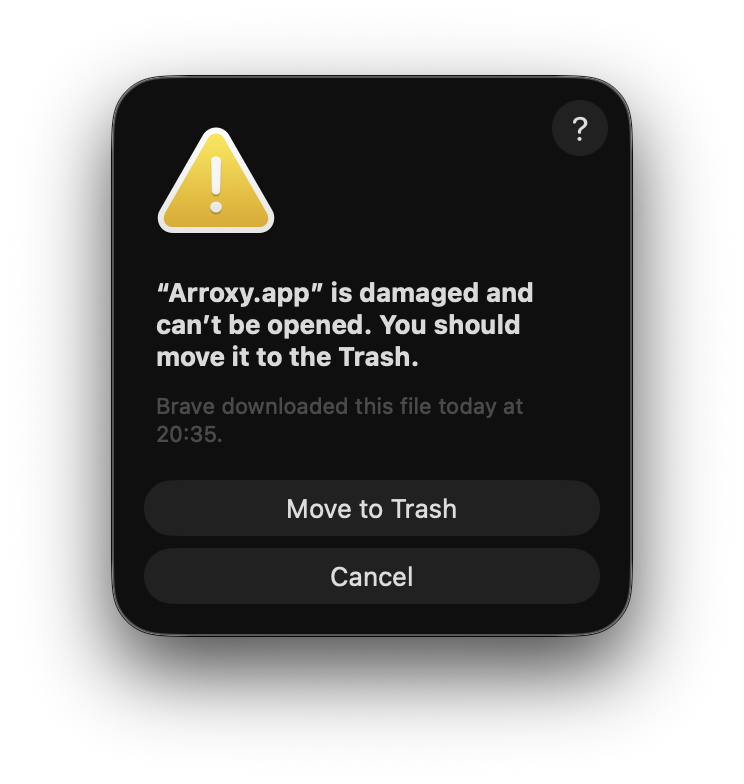
</div>

1. Σύρετε το `Arroxy.app` από το τοποθετημένο DMG στον φάκελο `/Applications`.
2. Ανοίξτε το Terminal και εκτελέστε αυτές τις δύο εντολές:

```bash
xattr -dr com.apple.quarantine /Applications/Arroxy.app
open /Applications/Arroxy.app
```

Η πρώτη εντολή αφαιρεί το χαρακτηριστικό quarantine από το εγκατεστημένο αντίγραφο του Arroxy. Η δεύτερη ξεκινά την εφαρμογή. Το `sudo` μπορεί να ζητήσει τον κωδικό του Mac σας· το Terminal δεν εμφανίζει χαρακτήρες όσο τον πληκτρολογείτε.

**Apple Silicon έναντι Intel:** σε Mac με επεξεργαστή M-series (M1 / M2 / M3 / M4), κατεβάστε το DMG `arm64`. Σε Intel Mac, κατεβάστε το DMG `x64`. Η εκτέλεση του λάθος build λειτουργεί μέσω Rosetta αλλά είναι αισθητά πιο αργή.

> Τα builds για macOS παράγονται μέσω CI σε Apple Silicon και Intel runners. Αν αντιμετωπίσετε προβλήματα, παρακαλώ [ανοίξτε ένα ζήτημα](../../issues) — τα σχόλια χρηστών macOS διαμορφώνουν ενεργά τον κύκλο δοκιμών macOS.

</details>

<details>
<summary><strong><a id="why-warning"></a>⚠️ Γιατί μπορεί να δείτε προειδοποίηση</strong></summary>

Το Arroxy είναι ανοιχτού κώδικα και αδειοδοτημένο με MIT. Τα builds για Windows και macOS **δεν υπογράφονται ψηφιακά** — τα πιστοποιητικά Apple Developer ID και Windows EV code-signing κοστίζουν εκατοντάδες δολάρια το χρόνο, που ένα indie project πληρώνει από την τσέπη του. Χωρίς αυτές τις υπογραφές, το Windows SmartScreen και το macOS Gatekeeper θα σας προειδοποιήσουν κατά την πρώτη εκκίνηση. Οι προειδοποιήσεις σημαίνουν *ότι το OS σας δεν αναγνωρίζει τον εκδότη* — δεν σημαίνουν ότι το Arroxy είναι κακόβουλο λογισμικό.

Τρεις τρόποι να επαληθεύσετε το Arroxy μόνοι σας, με αυξανόμενη αυστηρότητα:

- **Διαβάστε τον πηγαίο κώδικα.** Κάθε γραμμή βρίσκεται στο [GitHub](https://github.com/antonio-orionus/Arroxy) και μπορείτε να [κατασκευάσετε από τον πηγαίο κώδικα](#tech).
- **Ελέγξτε το SHA256.** Αντιστοιχίστε το αρχείο σας με το δημοσιευμένο [`SHA256SUMS`](../../releases/latest) — δείτε παρακάτω [Επαληθεύστε τη λήψη σας](#verify).
- **Εκτελέστε σάρωση τρίτου.** Ανεβάστε το αρχείο στο [VirusTotal](https://www.virustotal.com).

</details>

<details>
<summary><strong><a id="linux-first-launch"></a>🐧 Linux — πρώτη εκκίνηση</strong></summary>

Τα AppImage εκτελούνται απευθείας — χωρίς εγκατάσταση. Απλά πρέπει να επισημάνετε το αρχείο ως εκτελέσιμο.

**Διαχειριστής αρχείων:** δεξί κλικ στο `.AppImage` → **Ιδιότητες** → **Δικαιώματα** → ενεργοποιήστε **Να επιτρέπεται η εκτέλεση αρχείου ως πρόγραμμα**, στη συνέχεια διπλό κλικ.

**Terminal:**

```bash
chmod +x Arroxy-linux-x64.AppImage
./Arroxy-linux-x64.AppImage
```

Αν η εκκίνηση εξακολουθεί να αποτυγχάνει, τρέξτε το χωρίς προσάρτηση — δεν χρειάζεται πακέτο FUSE:

```bash
./Arroxy-linux-x64.AppImage --appimage-extract-and-run
```

**Προαιρετική ενσωμάτωση επιφάνειας εργασίας:** εγκαταστήστε μία φορά το [AppImageLauncher](https://github.com/TheAssassin/AppImageLauncher) και κάθε AppImage που κάνετε διπλό κλικ καταχωρείται αυτόματα στο μενού εκκίνησής σας — δεν χρειάζεται χειροκίνητο αρχείο `.desktop`.

**Απλό αρχείο tar (χωρίς FUSE, χωρίς εγκατάσταση):**

Η έκδοση `.tar.gz` είναι η ίδια εφαρμογή χωρίς το περίβλημα AppImage — αποσυμπιέστε την οπουδήποτε και τρέξτε την. Χωρίς πρόγραμμα εγκατάστασης και χωρίς πακέτο FUSE.

```bash
tar xzf Arroxy-linux-x64.tar.gz
./Arroxy-linux-x64/arroxy
```

**Τα αρχεία Linux στη σελίδα εκδόσεων είναι μόνο x86_64.** Σε μηχανήματα ARM64 (Raspberry Pi, Asahi Linux) το Flatpak εγκαθίσταται αλλά αποτυγχάνει στην εκκίνηση με `bwrap: execvp ldconfig: Exec format error`.

</details>

<details>
<summary><strong><a id="verify"></a>🔐 Επαληθεύστε τη λήψη σας (SHA256)</strong></summary>

Κάθε έκδοση δημοσιεύει ένα αρχείο `SHA256SUMS` μαζί με τα δυαδικά αρχεία. Για να ελέγξετε ότι η λήψη σας δεν έχει αλλοιωθεί ή τροποποιηθεί κατά τη μεταφορά, κάντε hash το αρχείο σας τοπικά και αντιστοιχίστε τη γραμμή στο `SHA256SUMS`. Ανοίξτε τη σελίδα τελευταίας έκδοσης → **Assets** → κατεβάστε το `SHA256SUMS`.

**Windows (PowerShell ή Command Prompt):**

```powershell
certutil -hashfile Arroxy-win-x64-Setup.exe SHA256
```

**macOS (Terminal):**

```bash
shasum -a 256 Arroxy-mac-arm64.dmg
```

**Linux (Terminal):**

```bash
sha256sum Arroxy-linux-x64.AppImage
```

Θέλετε σάρωση κακόβουλου λογισμικού από τρίτο; Ανεβάστε το αρχείο στο [VirusTotal](https://www.virustotal.com). Μερικές ευρετικές σημαίες από μικρές μηχανές είναι φυσιολογικές για ανυπόγραφες εφαρμογές Electron· εκτεταμένες εντοπίσεις από μεγάλες μηχανές θα ήταν πραγματική ανησυχία.

</details>

<details>
<summary><strong>📦 Windows: Πρόγραμμα εγκατάστασης vs Φορητό</strong></summary>

|               | NSIS Installer | Φορητό `.exe` |
| ------------- | :----------------------: | :---------------------: |
| Απαιτείται εγκατάσταση | Ναι  | Όχι — εκτέλεση από οπουδήποτε  |
| Αυτόματες ενημερώσεις | ✅ εντός εφαρμογής  | ❌ χειροκίνητη λήψη  |
| Ταχύτητα εκκίνησης | ✅ ταχύτερη  | ⚠️ πιο αργή κρύα εκκίνηση  |
| Προσθήκη στο μενού Έναρξης |            ✅            |           ❌            |
| Εύκολη απεγκατάσταση |            ✅            | ❌ διαγράψτε το αρχείο  |

**Σύσταση:** χρησιμοποιήστε το πρόγραμμα εγκατάστασης NSIS για αυτόματες ενημερώσεις και ταχύτερη εκκίνηση. Χρησιμοποιήστε το φορητό `.exe` για επιλογή χωρίς εγκατάσταση και χωρίς μητρώο.

</details>

---

## <a id="why"></a>⚖️ Γιατί Arroxy

Σύγκριση δίπλα-δίπλα με τις πιο κοινές εναλλακτικές λύσεις:

|            | Arroxy | Typical free yt-dlp GUI | 4K Video Downloader | JDownloader | Y2Mate / online converters | Browser extensions |
| ---------- | :----: | :---------------------: | :-----------------: | :---------: | :------------------------: | :----------------: |
| Ενσωματωμένο πρόγραμμα περιήγησης (περιήγηση, σύνδεση, λήψη) |   ✅   |           ❌            |         ⚠️          |     ❌      |             ❌             |        N/A         |
| Ιδιωτικά βίντεο, βίντεο μόνο για μέλη και με περιορισμό ηλικίας χωρίς εξαγωγή cookies |   ✅   |           ⚠️            |         ⚠️          |     ⚠️      |             ❌             |         ⚠️         |
| Δωρεάν, χωρίς premium επίπεδο |   ✅   |           ✅            |         ⚠️          |     ✅      |             ⚠️             |         ⚠️         |
| Ανοιχτού κώδικα |   ✅   |           ✅            |         ❌          |     ❌      |             ❌             |         ⚠️         |
| Μόνο τοπική επεξεργασία |   ✅   |           ✅            |         ✅          |     ✅      |             ❌             |         ✅         |
| Χωρίς όρια χρήσης |   ✅   |           ✅            |         ⚠️          |     ✅      |             🚫             |         ⚠️         |
| Εφαρμογή επιφάνειας εργασίας για πολλαπλές πλατφόρμες |   ✅   |           ⚠️            |         ✅          |     ✅      |            N/A             |         ❌         |
| Υπότιτλοι + SponsorBlock |   ✅   |           ⚠️            |         ⚠️          |     ❌      |             ❌             |         ❌         |

⚠️ = εν μέρει ή μόνο σε επί πληρωμή έκδοση. Η σύνδεση μέσα στην εφαρμογή για ιδιωτικά βίντεο στο 4K Video Downloader είναι επί πληρωμή λειτουργία· τα περισσότερα δωρεάν GUI για το yt-dlp δέχονται μόνο αρχείο cookies ή διαβάζουν τα cookies του προγράμματος περιήγησής σας.

Το Arroxy φτιάχτηκε για ένα πράγμα: ένα καθαρό τοπικό αρχείο, είτε επικολλήσετε ένα URL είτε βρείτε το βίντεο στο Explore. Χωρίς upsells, χωρίς συλλογή δεδομένων.

### <a id="why-explore"></a>🧭 Τι δεν μπορεί να κάνει ένα απλό wrapper του yt-dlp: η καρτέλα Explore

Τα περισσότερα δωρεάν προγράμματα λήψης από το YouTube είναι ένα πεδίο URL πάνω από το yt-dlp. Το Arroxy χρησιμοποιεί κι αυτό το yt-dlp, αλλά έχει επίσης το **Explore**, ένα πρόγραμμα περιήγησης ενσωματωμένο στην εφαρμογή, που ανοίγει το YouTube ή οποιονδήποτε άλλον ιστότοπο. Το Explore ξεπερνά περιορισμούς που ένα πεδίο URL δεν μπορεί:

- **Βίντεο που χρειάζονται λογαριασμό, χωρίς εξαγωγή cookies** — ιδιωτικά βίντεο, βίντεο μόνο για μέλη και βίντεο με περιορισμό ηλικίας (σε λογαριασμό με επαληθευμένη ηλικία), καθώς και οι λίστες σας «Παρακολούθηση αργότερα» και «Μου αρέσουν», και βίντεο πίσω από σύνδεση σε άλλους ιστότοπους. Ένα απλό wrapper χρειάζεται εξαγωγή cookies.txt ή πρέπει να διαβάσει τα cookies του προγράμματος περιήγησής σας, κάτι που ο Chrome στα Windows πλέον μπλοκάρει. Στο Arroxy συνδέεστε μία φορά στο Explore και αναλαμβάνει τα υπόλοιπα
- **«Συνδεθείτε για να επιβεβαιώσετε ότι δεν είστε ρομπότ»** — όταν το YouTube το ζητά, το Arroxy ξαναδοκιμάζει τη λήψη με τη σύνδεσή σας στο Explore αντί να αποτύχει
- **Το token λήψης του YouTube** — το ενσωματωμένο πρόγραμμα περιήγησης του Arroxy παίρνει το token που περιμένει το YouTube πριν από μια λήψη. Χωρίς αυτό, το YouTube μπορεί να δώσει λιγότερες μορφές και χαμηλότερη ποιότητα από αυτή που ζητήσατε
- **Χωρίς αντιγραφή συνδέσμων** — βρείτε ένα βίντεο, μια playlist ή ένα κανάλι στο Explore και κατεβάστε το με ένα κλικ, ή κάντε δεξί κλικ σε οποιονδήποτε σύνδεσμο της σελίδας
- **Φραγή διαφημίσεων όταν τη θέλετε** — ένα κλικ στην ασπίδα μπλοκάρει διαφημίσεις και ιχνηλάτες στις σελίδες του Explore

---

## <a id="privacy"></a>🔒 Απόρρητο

Οι λήψεις γίνονται απευθείας μέσω [yt-dlp](https://github.com/yt-dlp/yt-dlp) από το YouTube στον φάκελο που επιλέγετε — τίποτα δεν δρομολογείται μέσω τρίτου διακομιστή. Το ιστορικό παρακολούθησης, το ιστορικό λήψεων, τα URL και τα περιεχόμενα αρχείων παραμένουν στη συσκευή σας.

Χωρίς τηλεμετρία — μόνο ένα ανώνυμο σήμα την ημέρα: έκδοση εφαρμογής, OS, γλώσσα, κανάλι εγκατάστασης και χώρα, για να μετράμε τους ενεργούς χρήστες. Χωρίς αναγνωριστικά, URL, τίτλους βίντεο, διαδρομές αρχείων ή στοιχεία λογαριασμού. Μπορείτε να το απενεργοποιήσετε στις Ρυθμίσεις.

Το Explore κρατά τη δική του σύνδεση, ξεχωριστή από το πρόγραμμα περιήγησής σας, και το Arroxy δεν διαβάζει ούτε συμπληρώνει ποτέ τη φόρμα σύνδεσης — πληκτρολογείτε στη σελίδα της ίδιας της Google. Οι λήψεις γίνονται χωρίς σύνδεση· μόνο όταν μία αποτύχει με τρόπο που μπορεί να διορθώσει ένας λογαριασμός, το Arroxy διαβάζει εκ νέου τη σύνδεση, την κρατά σε προσωρινό αρχείο για εκείνη τη λήψη και διαγράφει το αρχείο μετά. Η αποσύνδεση από το Explore στις Ρυθμίσεις την ξεχνά.

---

## <a id="faq"></a>❓ Συχνές Ερωτήσεις

<details>
<summary><strong>Είναι πραγματικά δωρεάν;</strong></summary>

Ναι — άδεια MIT, χωρίς premium επίπεδο, χωρίς περιορισμούς λειτουργιών.

</details>

<details>
<summary><strong>Σε τι διαφέρει το Arroxy από άλλα GUI για το yt-dlp;</strong></summary>

Τα περισσότερα δωρεάν GUI για το yt-dlp είναι wrappers που δέχονται μόνο έναν σύνδεσμο. Το Arroxy προσθέτει το **Explore**, ένα πρόγραμμα περιήγησης YouTube ενσωματωμένο στην εφαρμογή: περιηγείστε και κατεβάζετε χωρίς αντιγραφή συνδέσμων, και συνδέεστε εκεί μία φορά για να κατεβάζετε ιδιωτικά βίντεο, βίντεο μόνο για μέλη και με περιορισμό ηλικίας, καθώς και τις λίστες «Παρακολούθηση αργότερα» και «Μου αρέσουν», χωρίς εξαγωγή cookies. Το Arroxy χρησιμοποιεί αυτή τη σύνδεση όταν το YouTube σας ζητά να επιβεβαιώσετε ότι δεν είστε ρομπότ, και το ενσωματωμένο του πρόγραμμα περιήγησης παίρνει το token λήψης του YouTube ώστε οι λήψεις να μην περιορίζονται σε λιγότερες μορφές. Δείτε το [Γιατί Arroxy](#why).

</details>

<details>
<summary><strong>Ποιες ποιότητες βίντεο μπορώ να κατεβάσω;</strong></summary>

Ό,τι παρέχει το YouTube: 8K (4320p), 4K UHD (2160p), 1440p, 1080p, 720p, 480p, 360p, καθώς και μόνο ήχο. Οι ροές 60 fps και HDR διατηρούνται ως έχουν, και η λήψη βήμα προς βήμα σάς επιτρέπει να επιλέξετε AV1, VP9 ή H.264 σε κάθε ανάλυση.

</details>

<details>
<summary><strong>Μπορώ να εξάγω μόνο τον ήχο ως MP3;</strong></summary>

Ναι. Επίλεξε *μόνο ήχος* στο μενού μορφής και μετά MP3, M4A/AAC, Opus ή WAV.

</details>

<details>
<summary><strong>Πώς κατεβάζω βίντεο που χρειάζονται λογαριασμό YouTube;</strong></summary>

Συνδεθείτε μία φορά στην καρτέλα Explore. Το Arroxy μπορεί τότε να κατεβάζει ιδιωτικά βίντεο και βίντεο μόνο για μέλη που βλέπει ο λογαριασμός σας, βίντεο με περιορισμό ηλικίας αν ο λογαριασμός έχει επαληθευτεί ηλικιακά, καθώς και τις λίστες «Παρακολούθηση αργότερα» και «Μου αρέσουν». Χρησιμοποιεί τη σύνδεση μόνο όταν μια λήψη αποτυγχάνει με τρόπο που μπορεί να διορθώσει ένας λογαριασμός· όλα τα υπόλοιπα κατεβαίνουν όπως πριν. Αυτή είναι η επιλογή **Σύνδεση Explore**, πρώτη στη λίστα και με την ένδειξη «Προτείνεται» στις ρυθμίσεις cookies, και το Arroxy την επιλέγει για εσάς την πρώτη φορά που ανοίγετε το Explore. Το wiki του yt-dlp σημειώνει ότι [η αυτοματοποίηση με σύνδεση μπορεί να επισημάνει έναν λογαριασμό Google](https://github.com/yt-dlp/yt-dlp/wiki/Extractors#exporting-youtube-cookies), οπότε ένας δευτερεύων λογαριασμός είναι η ασφαλέστερη επιλογή.

</details>

<details>
<summary><strong>Θα συνεχίσει να λειτουργεί όταν το YouTube αλλάξει κάτι;</strong></summary>

Το yt-dlp ενημερώνεται αυτόματα κατά την εκκίνηση, και το Arroxy κυκλοφορεί διορθώσεις άμεσα όταν το YouTube αλλάζει κάτι. Όταν το YouTube ζητά να επιβεβαιώσετε ότι δεν είστε ρομπότ, το Arroxy δοκιμάζει και τη σύνδεσή σας στο Explore αν έχετε συνδεθεί εκεί, ενώ cookies από αρχείο ή από το πρόγραμμα περιήγησής σας είναι διαθέσιμα στις ρυθμίσεις cookies.

</details>

<details>
<summary><strong>Σε ποιες γλώσσες είναι διαθέσιμο το Arroxy;</strong></summary>

31 γλώσσες είναι διαθέσιμες από την αρχή: Afaan Oromoo · Bahasa Indonesia · Deutsch · English · Español · Français · Italiano · Kiswahili · O'zbekcha · Polski · Português · Tiếng Việt · Türkçe · አማርኛ · العربية · اردو · پښتو · فارسی · বাংলা · हिन्दी · ไทย · မြန်မာဘာသာ · ខ្មែរ · Ελληνικά · Русский · Српски · Українська · 中文 · 日本語 · 한국어 · 繁體中文. Το Arroxy εντοπίζει αυτόματα τη γλώσσα του λειτουργικού συστήματος στην πρώτη εκκίνηση και μπορείς να αλλάξεις γλώσσα οποιαδήποτε στιγμή από τον επιλογέα στη γραμμή εργαλείων. Τα Runtime locale JSON βρίσκονται στο src/shared/i18n/locales/, και οι κατάλογοι PO για μεταφραστές βρίσκονται στο i18n/locales/ — άνοιξε PR στο GitHub για να συνεισφέρεις.

</details>

<details>
<summary><strong>Χρειάζεται να εγκαταστήσω κάτι άλλο;</strong></summary>

Όχι. Τα yt-dlp, ffmpeg και ffprobe κατεβαίνουν αυτόματα στην πρώτη εκκίνηση και αποθηκεύονται στον υπολογιστή σας. Μετά από αυτό δεν απαιτείται καμία επιπλέον ρύθμιση.

</details>

<details>
<summary><strong>Μπορώ να κατεβάσω λίστες αναπαραγωγής ή ολόκληρα κανάλια;</strong></summary>

Ναι — και τα δύο. Επικόλλησε URL playlist ή καναλιού (π.χ. `youtube.com/@handle`, `/channel/UC…`, `/c/Name`, `/user/Old`), διάλεξε πόσες εγγραφές θα σαρωθούν και μετά βάλε όλη τη λίστα στην ουρά ή επίλεξε συγκεκριμένα βίντεο. Τα φίλτρα εύρους ημερομηνιών έρχονται σύντομα.

</details>

<details>
<summary><strong>Το macOS λέει "η εφαρμογή είναι κατεστραμμένη" — τι να κάνω;</strong></summary>

Αυτό είναι το macOS Gatekeeper που αποκλείει μια μη υπογεγραμμένη εφαρμογή, όχι πραγματική βλάβη. Δείτε το [macOS first launch](#macos-first-launch) για τις εντολές Terminal που αφαιρούν το quarantine και ξεκινούν το Arroxy.

</details>

<details>
<summary><strong>Είναι νόμιμη η λήψη βίντεο YouTube;</strong></summary>

Για προσωπική, ιδιωτική χρήση γίνεται γενικά αποδεκτή στις περισσότερες δικαιοδοσίες. Είστε υπεύθυνοι για τη συμμόρφωση με τους [Όρους Χρήσης](https://www.youtube.com/t/terms) του YouTube και τους τοπικούς νόμους πνευματικής ιδιοκτησίας.

</details>

---

## <a id="roadmap"></a>🗺️ Χάρτης Πορείας

Ακόμα προγραμματισμένα — περίπου με σειρά προτεραιότητας:

| Λειτουργία    | Περιγραφή    |
| ---------------- | ---------------- |
| **Φίλτρα playlist & καναλιών** | Φίλτρα εύρους ημερομηνιών κατά την απαρίθμηση playlist ή καναλιού |
| **Προτιμήσεις ηχητικών κομματιών YouTube** | Ορισμός προτίμησης κομματιού ομιλούμενης γλώσσας σε όλη την εφαρμογή, με overrides ανά προφίλ όταν το YouTube παρέχει πολλαπλά ηχητικά κομμάτια |
| **Ισχυρότερη ανάκτηση με επανάληψη** | Νέα διαδρομή επανάληψης για λήψεις που διακόπτονται από αναξιόπιστες ή προβληματικές συνδέσεις internet |
| **Πλήρες drawer διαχείρισης λήψεων** | Μετατροπή του drawer ουράς σε πληρέστερο manager, μαζί με αλλαγή φακέλων προορισμού για στοιχεία στην ουρά |
| **Προγραμματισμένες λήψεις** | Ξεκινήστε μια ουρά σε καθορισμένη ώρα (νυχτερινές εκτελέσεις) |
| **Πακέτο AUR** | Εγκατάσταση σε Arch Linux και Omarchy με `yay -S arroxy-bin` |

Έχετε κάποια λειτουργία στο μυαλό σας; [Ανοίξτε ένα αίτημα](../../issues) — η συμβολή της κοινότητας διαμορφώνει τις προτεραιότητες.

---

## <a id="support"></a>💖 Υποστήριξη του Arroxy

Το Arroxy είναι δωρεάν και με άδεια MIT — χωρίς διαφημίσεις, χωρίς τηλεμετρία, χωρίς επί πληρωμή έκδοση. Αν σου εξοικονομεί χρόνο, μπορείς να στηρίξεις την ανάπτυξή του με Bitcoin, Tron ή Ethereum: οι διευθύνσεις βρίσκονται στο [DONATE.md](DONATE.md), τη μοναδική επίσημη πηγή γι' αυτές. Το Arroxy δεν θα σου στείλει ποτέ διεύθυνση με email ή προσωπικό μήνυμα. Ένα αστέρι στο αποθετήριο, οι αναφορές σφαλμάτων και οι βελτιώσεις στις μεταφράσεις βοηθούν εξίσου.

<a href="DONATE.md"></a> <a href="DONATE.md"></a> <a href="DONATE.md"></a>

---

## <a id="tech"></a>🛠️ Κατασκευάστηκε με

<details>
<summary><strong>Στοίβα τεχνολογιών</strong></summary>

- **Electron** — cross-platform desktop shell
- **React 19** + **TypeScript** — UI
- **Tailwind CSS v4** — styling
- **Zustand** — διαχείριση κατάστασης
- **yt-dlp** + **ffmpeg** — μηχανή λήψης και mux (και τα δύο λαμβάνονται στο runtime: το yt-dlp διατηρείται ενημερωμένο, ενώ τα ffmpeg/ffprobe εγκαθίστανται μία φορά και διατηρούνται μετά τις ενημερώσεις)
- **Vite** + **electron-vite** — build tooling
- **Vitest** + **Playwright** — unit και end-to-end tests

</details>

<details>
<summary><strong>Κατασκευή από πηγαίο κώδικα</strong></summary>

### Προαπαιτούμενα — όλες οι πλατφόρμες

| Εργαλείο | Έκδοση  | Εγκατάσταση |
| -------- | ------- | ----------- |
| Git      | οποιαδήποτε | [git-scm.com](https://git-scm.com) |
| Node.js  | 24.21.0 | `mise install` ή `.node-version` |
| Bun      | 1.4.2  | `mise install` ή `package.json` `packageManager` |

Προτείνεται: εγκαταστήστε το `mise` και μετά τρέξτε `mise install` στο checkout. Χωρίς mise, ενεργοποιήστε χειροκίνητα το Node.js από το `.node-version` και το Bun από το `package.json` πριν από το `bun run bootstrap`.

### Windows

```powershell
powershell -c "irm bun.sh/install.ps1 | iex"
```

Visual Studio Build Tools και Python μπορεί να χρειαστούν για native rebuilds.

### macOS

```bash
brew install mise
xcode-select --install
```

Μετά το clone, τρέξε `mise trust && mise install` μέσα από το checkout. Αν το shell σου χρησιμοποιεί ήδη `fnm`, `nvm` ή Bun από Homebrew, ενεργοποίησε το mise στο `~/.zshrc` ώστε το Arroxy να χρησιμοποιεί Node.js 24.21.0 και Bun 1.4.2:

```bash
printf '
# mise
if command -v mise >/dev/null 2>&1; then
  eval "$(mise activate zsh)"
fi
' >> ~/.zshrc
exec zsh
```

### Linux (Ubuntu / Debian)

```bash
curl -fsSL https://bun.sh/install | bash

# Εξαρτήσεις build και Electron runtime
sudo apt install -y build-essential python3 tar libgtk-3-0 libnss3 libasound2t64

# E2E tests only (Electron needs a display)
sudo apt install -y xvfb
```

### Κλωνοποίηση & εκτέλεση

```bash
git clone https://github.com/antonio-orionus/Arroxy
cd Arroxy
mise trust
mise install           # προτείνεται· παραλείψτε το αν ενεργοποιήσατε χειροκίνητα τα pinned tools
bun run bootstrap
bun run doctor
bun run dev            # Electron app με Vite renderer
```

### Κατασκευή διανεμήσιμου πακέτου

```bash
bun run build        # typecheck + compile
bun run dist         # package for current OS
bun run dist:win     # πακετάρισμα Windows targets σε υποστηριζόμενο host
```

> Το `bun run bootstrap` εγκαθιστά εξαρτήσεις, ξαναχτίζει τις εξαρτήσεις της Electron εφαρμογής, ελέγχει το Electron, προετοιμάζει τα ενσωματωμένα ffmpeg/ffprobe για ανάπτυξη και εγκαθιστά το Playwright Chromium. Οι εκδόσεις διανομής διαχειρίζονται τα yt-dlp, ffmpeg και ffprobe στο runtime μέσα στον φάκελο δεδομένων της εφαρμογής· κανένα τους δεν περιλαμβάνεται στο πρόγραμμα εγκατάστασης.

</details>

---

## <a id="troubleshooting"></a>🩺 Troubleshooting

<details>
<summary><strong>🖥️ App won't open / no window appears</strong></summary>

The Arroxy process starts but no window shows up. Most often this is a GPU driver hang during startup. Try, in order:

**1. Check the log.** It records startup, GPU info, and any crash. Path:

| Platform | Path                             |
| -------- | -------------------------------- |
| Windows  | `%APPDATA%\Arroxy\logs\main.log` |
| macOS    | `~/Library/Logs/Arroxy/main.log` |
| Linux    | `~/.config/Arroxy/logs/main.log` |

**2. Launch with hardware acceleration disabled.** Open a terminal / Command Prompt and run the executable with a flag:

```bash
# Windows (Portable) — PowerShell, run from the folder containing the exe
.\Arroxy-win-x64-Portable.exe --disable-gpu

# Windows (Portable) — Command Prompt (cmd.exe), from the same folder
Arroxy-win-x64-Portable.exe --disable-gpu

# Windows (Installed) — works in both PowerShell and cmd.exe
"%LOCALAPPDATA%\Programs\Arroxy\Arroxy.exe" --disable-gpu

# macOS
/Applications/Arroxy.app/Contents/MacOS/Arroxy --disable-gpu

# Linux (AppImage)
./Arroxy-linux-x64.AppImage --disable-gpu
```

If that works, the GPU/driver is the cause. Make the change permanent (next step).

**3. Persist the flag via `argv.json`.** Create the file at:

| Platform | Path                                             |
| -------- | ------------------------------------------------ |
| Windows  | `%APPDATA%\Arroxy\argv.json`                     |
| macOS    | `~/Library/Application Support/Arroxy/argv.json` |
| Linux    | `~/.config/Arroxy/argv.json`                     |

With contents:

```json
{ "disable-hardware-acceleration": true }
```

Arroxy reads this before opening any window, so it works even when the window never appeared.

**4. Other flags worth trying** (combine if needed): `--disable-software-rasterizer`, `--disable-gpu-sandbox`, `--in-process-gpu`.

**5. Stale window position.** If the window may be opening off-screen (multi-monitor change since last run), delete `<userData>\window-state.json` and relaunch.

**6. Still stuck?** Open an issue with your OS version and any output from running with `--enable-logging --v=1`. If the app window does open, attach the file from **Settings → Save diagnostics file**: it holds both logs and your app details, with your user folder name removed. Otherwise attach `main.log`.

</details>

---

## 📜 Όροι χρήσης

Το Arroxy είναι εργαλείο αποκλειστικά για προσωπική, ιδιωτική χρήση. Είστε αποκλειστικά υπεύθυνοι για τη διασφάλιση ότι οι λήψεις σας συμμορφώνονται με τους [Όρους Χρήσης](https://www.youtube.com/t/terms) του YouTube και τους νόμους πνευματικής ιδιοκτησίας της δικαιοδοσίας σας. Μην χρησιμοποιείτε το Arroxy για λήψη, αναπαραγωγή ή διανομή περιεχομένου που δεν έχετε δικαίωμα χρήσης. Οι προγραμματιστές δεν ευθύνονται για οποιαδήποτε κακή χρήση.

## Star History

<a href="https://www.star-history.com/?repos=antonio-orionus%2FArroxy&type=timeline&legend=top-left">
 <picture>
   <source media="(prefers-color-scheme: dark)" srcset="https://api.star-history.com/chart?repos=antonio-orionus/Arroxy&type=timeline&theme=dark&legend=top-left" />
   <source media="(prefers-color-scheme: light)" srcset="https://api.star-history.com/chart?repos=antonio-orionus/Arroxy&type=timeline&legend=top-left" />
   
 </picture>
</a>

<div align="center">
  <sub>MIT License · Δημιουργήθηκε με φροντίδα από <a href="https://x.com/OrionusAI">@OrionusAI</a></sub>
</div>
