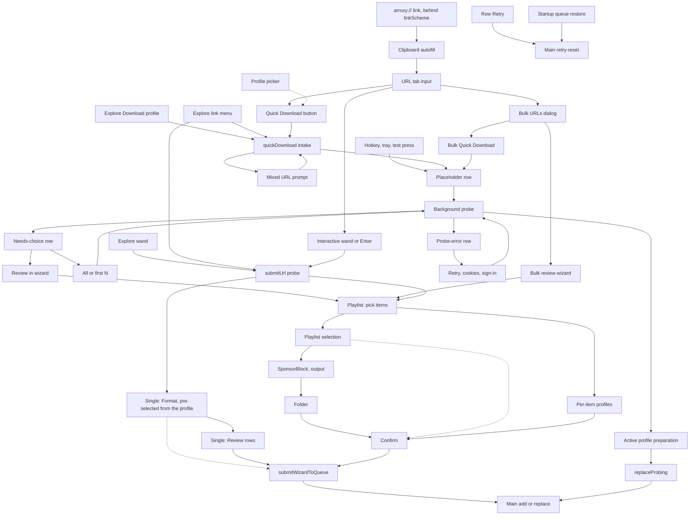

# Download Workflows Map

Every path that ends with something in the download queue, with the file that
owns each step. Read this before changing an entry point, a wizard step, or
how settings turn into a job, instead of re-tracing the code.

Verified against `main` @ `34e8dd68` (2026-10-17). Line numbers drift: trust
the function names, re-check the numbers. Update this file in the same PR when
a workflow, step, or settings source changes.

## The two queue writes

Rows reach the queue through two commands, `add` and `replaceProbing`, in
`src/main/services/QueueService.ts`, which admits, dedupes and commits them.
Link intake (`src/main/intake/IntakeService.ts`) issues them in main for the
background single-link path: the placeholder row, then the swap for the
prepared rows. The global hotkey reaches intake in main too
(`src/main/intake/HotkeyIntake.ts`) and never goes through the renderer; its
outcomes become hotkey notifications and are never sent on `intake:event`.
The renderer issues them over IPC (`queue.cmd.add`,
`queue.cmd.replaceProbing`) only from
`src/renderer/src/store/wizard/queueSubmissionAdapter.ts` (wizard, a
needs-choice row's review). It reaches intake
through `intake.cmd.*` (`src/renderer/src/store/quickDownload/quickDownloadPipeline.ts`)
and hears outcomes back on `intake:event`, keyed by the request id of the call
that caused them.

## Current map

The dotted edge from Format is the Download shortcut on the Format screen,
which skips Review; the highlighted Continue goes to Review. Dotted edges into
Confirm are `skipToConfirm`. The dotted Profile
picker edge sets the active profile that Quick Download uses.

## Entry points

| Node | What happens | Settings source | Owner |
| --- | --- | --- | --- |
| URL | Link field; Enter runs the wizard, not Quick Download | — | `DownloadProfilesHome` |
| CLIP | Clipboard watch only fills the field, never queues. A clipboard that is exactly one link replaces the field (toast with Undo) once the Download tab is idle; it waits through a probe, a starting quick download, the bulk dialog, another tab or a later wizard step, and the latest copy wins. Several links only hint at Bulk URLs | — | `ClipboardWatcher`, `clipboardLinks.ts`, `copiedLinkIntake.ts`, `clipboardIntake.ts`, `DownloadProfilesHome` |
| LINK | `arroxy://open?url=<percent-encoded http(s) link>` from another app or a web page, behind the `linkScheme` release flag. Main parses it strictly (one web link, no other parameters; anything else is dropped with a log line), holds it until the renderer listens (macOS `open-url` before `ready`, the launch command line, a `second-instance` command line), brings the window forward and hands it to the copied link, so it behaves exactly like CLIP with its own toast wording. An untrusted caller: it never probes or queues | — | `registerLinkScheme`, `LinkInbox`, `arroxyLink.ts`, `copiedLinkIntake.ts`; registered with the OS only once the flag ships, so until then only a command line carries one |
| QBTN, PICK | Quick Download with the active profile; the arrow switches it. On a YouTube link that names a video and a list (`videoListKind`), the card splits: This video (quick download, `playlistMode: 'video'`, no question) beside the list button (Download playlist…, Download Mix…), which opens MIX | active profile | `DownloadProfilesHome`, `QuickProfileControl`, `systemSlice.setActiveDownloadProfile` |
| EXD, EXW | Explore's Download button (quick) and wand (`submitUrl('explore')`, returns to Explore). On a video in a list: This video beside the list segment, as on the URL tab | active profile / wizard | `ExploreTab`, `ExploreToolbar`, `probeOrchestrator` |
| EXL | Right-click a link in the Explore page: the same Download, profile pick (sets the active profile first) and wand, for the link; a native menu built in main. On a video in a list: Download this video, This video with ▸, From this <list> ▸ with MIX's two one-move answers (`answerVideoListLink`), and the wand, which opens MIX's Interactive form as the URL tab's wand does | active profile / wizard | `exploreLinkMenu.ts`, `exploreLinkActions.ts` |
| HK | Hotkey chord, tray item, or Settings test press, run in main; a mixed URL is forced to its video. Acknowledged at once (queued, or why not), then one follow-up only when the link fails, needs a choice or adds nothing; both keyed by the intake id, as a toast on a focused window or an OS notification | the window's active profile, else main's | `HotkeyService`, `HotkeyIntake`, `src/shared/intake/hotkeyIntake.ts`, `hotkeyFeedback.ts` |
| QD, MIX | Cleans the URL, blocks on incomplete cookies setup, asks how to take the list for a link that names a video and a list (Mix and `RDCLAK` included): in the background (the row asks past the load limit), exactly the first N, or the wizard's picker; from the wand it only confirms how many to load | — | `quickDownloadSlice.quickDownload`, `MixedUrlPromptDialog`, `probeOrchestrator.answerVideoListLink` |
| PLC → SWAP | In main: places a placeholder row that stores the active profile and the window's folder (`pinnedProfile`) and who took it in (`origin`), probes in the background once a probe slot frees ("Links checked at once"; the window's probe goes first), then swaps in prepared items or leaves a needs-choice / probe-error row | pinned active profile | `IntakeService`, `ProbeSlots`, `src/shared/intake/probeResolution.ts` |
| NC, PE | Rows that need the user: the size question (All and Review, plus first N when the list went past the load limit; asked for a plain list link past the limit and for any list the link did not announce, never for a row that already carries a count); Retry / cookies / sign in. All, first N and Retry run in main, and the answer is stored on the row so a Retry keeps it; the probe a needs-choice row asked about is kept there (bounded) for first N and the review | pinned profile; Review starts each picked video from it, in the row's folder | `QueueAttentionRow`, `quickDownloadSlice`, `IntakeService` |
| BULK, BQ | Bulk dialog: Quick Download places every accepted link through link intake, one placeholder row each, last link first so Downloads (newest first) reads them in pasted order, with one toast for the batch; main's probe slots pace the probes, and a list past the load limit asks on its row. Otherwise the bulk wizard. Links are read with `classifyBulkUrlIntent`: a former Radio link (any `RD…` list) stays one video; a plain mixed link is placed as a row that asks this video or the list before anything is probed (`ask: 'video-or-list'`), and its answer probes the video, the list in the background, or opens the list's Review | active profile / wizard | `BulkUrlDialog`, `quickDownloadSlice.bulkQuickDownload`, `IntakeService` |
| DLR, BOOT | Retry on a resolved row re-runs its stored job; startup restores `queue.json`; placeholder rows left probing at quit (the quit stops their probes) probe again once the window reports its context, in queue order and paced by the probe slots, and any other row left probing becomes a probe error | the row's job | `queueSlice`, `QueueService`, `QueueProbeLifecycle`, `QueueAutoRetry`, `IntakeService.resumePlaceholderProbes` |

No queue row can be reopened in the wizard except a needs-choice row's Review.

How a YouTube link is read (`cleanUrl`, `classifyUrlIntent`, the list kinds) is held to yt-dlp's own reading by the YouTube URL contract: `tests/unit/youtube-url-contract.test.ts` checks every URL in yt-dlp's YouTube test cases, every shape a video is shared in with a list and every list id yt-dlp accepts, from a snapshot `bun run youtube:url-contract` regenerates (weekly, by `youtube-url-contract.yml`). Which extractor yt-dlp hands a link to decides what `--no-playlist` and `--yes-playlist` can do with it.

## Rate-limit cooldown

Every yt-dlp launch, whichever path started it, passes `YtDlp.run`, which asks
`SiteRequestState` first, and again right before the spawn (after binary setup,
any signed-in slot wait and the token mint). The cooldown starts at the first stderr line that
shows the site rate-limiting this connection (an HTTP 429, or YouTube's session
limit), while the run may still be transferring, and goes against the route
that run used. From then on, new requests to that site
on the same network route wait out one cooldown: the window's probe fails at
once as a `rateLimit` without launching, a background probe (a placeholder
row's, a title lookup's) waits in `ProbeSlots` without taking a slot and runs
when it ends, `QueueService` keeps pending rows pending (both lanes) and starts
them when it ends, and `QueueAutoRetry` schedules no sooner.
The subtitle phase of a job that already saved its media is the only run that
goes ahead. The wizard's Format and error steps and the quick-download alert
show `RateLimitAlert`, whose "Try now" lets one request through; its clean
answer ends that cooldown early, but not a newer one another request met since.

## Wizard steps per mode

Step list: `wizardStepNameSchema` in `src/shared/schemas.ts`. Visibility:
`stepApplies` in `src/renderer/src/store/wizard/wizardStepGraph.ts`.

- **Single:** url → formats (the Format screen) → confirm (rendered as the
  Review screen). Format lists every stream the probe found, pre-selected from
  the active download profile, with the Video + audio / Video, no audio /
  Audio only / Subtitles only switch;
  Review holds subtitles, SponsorBlock, extras, folder and file name as rows
  that open in place. Download works from both. A part of the video (a time
  range) is picked on the Format screen and travels on the job as
  `videoPart`; `buildMediaRequest` turns it into yt-dlp `--download-sections`.
  Spec: [interactive-download.md](interactive-download.md).
- **Playlist / bulk:** url → playlistItems → playlistPresets (subtitles are
  picked inside it) → sponsorblock → output → folder → confirm.
- **Multi-profile (batch only):** url → playlistItems → playlistProfiles →
  confirm.

## Settings sources

Five sources feed jobs, and which one applies depends on the path:

1. **Active download profile:** Quick Download, Explore, hotkey, bulk quick.
2. **Pinned profile:** the active profile and the wizard's folder, stored on
   a placeholder row at intake, so switching profiles later, a window
   reload or a restart doesn't change queued work. A row saved before rows
   stored it prepares with the active profile. Main learns the wizard's
   folder, the screen's HDR and the active profile the window shows from the
   window (`intake.cmd.setWindowContext`); the hotkey pins that profile.
3. **Per-item profiles:** multi-profile playlist mode. Each video starts from
   the active profile, or, in a needs-choice row's Review, from the row's
   pinned profile and folder (`playlistBaselineProfile`), which is why that
   Review opens in this mode.
4. **Profile pick, then wizard edits (single video):** the active profile
   resolved against the probe (`resolveProfileSelection`,
   `applyProfileToWizard`); edits apply to that download only and nothing is
   remembered afterwards. "Save as profile" turns them into a new profile.
5. **Wizard selections (batch):** playlist selection and SponsorBlock, embed
   and subfolder choices, remembered in `settings.playlist` and the
   `common.last*` fields.

## Where settings become job options

- **Profile path:** `resolveDownloadProfile` (`src/shared/downloadProfiles.ts`)
  → `preparePinnedProfileQueueSubmission` (`src/shared/queueSubmission.ts`,
  pure: the renderer passes the wizard's folder, its screen's HDR and its
  filename reports in) / `prepareMultiProfileQueueSubmission`
  → `profileJob` → `prepareJob`.
- **Wizard path:** `buildSingleQueueItemFromState` (single, exact format ids
  from the profile pick or the user's edits, via `sanitizeJobOptions`) and
  `buildPlaylistQueueItem` (playlist/bulk, via
  `playlistSelectionToMediaIntent`), both from `prepareManualQueueSubmission`.

A job carries a subtitle request, never resolved tracks (ADR 0016): a
profile's, batch's or Quick Download's languages and subtitle source, or the
tracks picked on the Format screen (`SubtitleRequest`,
`src/shared/subtitleTracks.ts`). Both subtitle phases first get the video's
complete lists (`src/main/services/phases/subtitleTracks.ts`): the media run's
or the probe's info-json on a site that lists every track up front
(`probeListsSubtitleTracks`, YouTube; the probe's is copied into the job's temp
folder first, as for the media run, so its cache path never reaches yt-dlp),
otherwise a `subtitle-listing` run
(`-J` with the subtitle flags), saved in the job's temp folder. They plan the
request over those lists with `planSubtitleTracks`, the rule the Format screen
previews with, and fetch the planned tracks with `--load-info-json` on the
same info-json, so nothing is extracted twice. The written files come from the
run's report (`requested_subtitles`), never from the log; each file's language
and embedded title come from the plan, its name from the lists.

The same step decides what a job ends as when the plan lacks languages
(`missingSubtitles`): a subtitles-only job with none of them fails hard with
`noSubtitles`, never retried automatically; otherwise the job keeps what it
saved and ends with a notice naming the missing languages. A notice about the
video itself (sound kept, quality limited) keeps the row and carries the
languages, which the queue names on a line of their own.

Known duplication between the two:

- Three QueueItem builders repeat the row literal, filename binding and
  `prepareJob` call.
- Two converters into the same `MediaIntent` (`playlistSelectionToMediaIntent`,
  `mediaIntentFromProfileMedia`).
- Media normalization in two places (`sanitizeJobOptions` vs
  `resolveDownloadProfile`); the playlist wizard path relies on `prepareJob`
  alone.
- Output folder, `.m3u` and format label computed differently per path.

## yt-dlp bridge gaps

The app sends the bridge only `probe` requests and *caller* `media` /
`subtitles` requests (`CallerMediaWorkflowInput` in
`packages/yt-dlp-bridge/src/workflow.ts`). The managed planner supports
`dateAfter`, `matchFilters`, `downloadArchive`, `breakOnExisting` and more,
but the caller request type has no fields for them, and `src/` sets none.
Filters and archive-based sync each need the field added to the caller
request first. `downloadSections` and `forceKeyframesAtCuts` are on the caller
request (part of video).

## Next

Spec: [interactive-download.md](interactive-download.md). The single-video
Format + Review flow and "part of video" are built; moving the batch
`playlistPresets` step to profiles is a follow-up.
