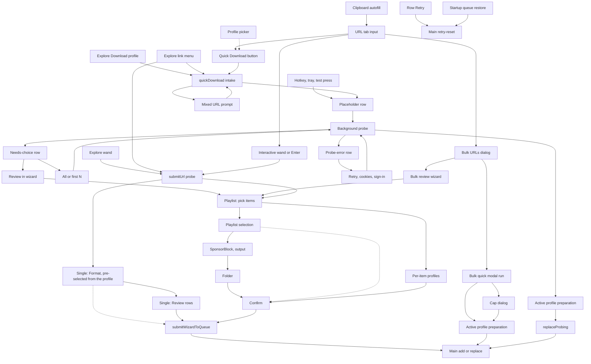

# Download Workflows Map

Every path that ends with something in the download queue, with the file that
owns each step. Read this before changing an entry point, a wizard step, or
how settings turn into a job, instead of re-tracing the code.

Verified against `main` @ `34e8dd68` (2026-10-17). Line numbers drift: trust
the function names, re-check the numbers. Update this file in the same PR when
a workflow, step, or settings source changes.

## The two queue writes

Rows reach the queue through two commands, `add` and `replaceProbing`, in
`src/main/services/QueueService.ts`, which admits, dedupes and commits them.
Link intake (`src/main/intake/IntakeService.ts`) issues them in main for the
background single-link path: the placeholder row, then the swap for the
prepared rows. The renderer issues them over IPC (`queue.cmd.add`,
`queue.cmd.replaceProbing`) only from
`src/renderer/src/store/wizard/queueSubmissionAdapter.ts` (wizard, bulk quick
run, playlist cap dialog, a needs-choice row's review). It reaches intake
through `intake.cmd.*` (`src/renderer/src/store/quickDownload/quickDownloadPipeline.ts`)
and hears outcomes back on `intake:event`, keyed by the request id of the call
that caused them.

## Current map

The dotted edge from Format is the Download shortcut on the Format screen,
which skips Review; the highlighted Continue goes to Review. Dotted edges into
Confirm are `skipToConfirm`. The dotted Profile
picker edge sets the active profile that Quick Download uses.

## Entry points

| Node | What happens | Settings source | Owner |
| --- | --- | --- | --- |
| URL | Link field; Enter runs the wizard, not Quick Download | — | `DownloadProfilesHome` |
| CLIP | Clipboard watch only fills the field, never queues. A clipboard that is exactly one link replaces the field (toast with Undo) once the Download tab is idle; it waits through a probe, a starting quick download, the bulk dialog, another tab or a later wizard step, and the latest copy wins. Several links only hint at Bulk URLs | — | `ClipboardWatcher`, `clipboardLinks.ts`, `copiedLinkIntake.ts`, `clipboardIntake.ts`, `DownloadProfilesHome` |
| QBTN, PICK | Quick Download with the active profile; the arrow switches it | active profile | `DownloadProfilesHome`, `systemSlice.setActiveDownloadProfile` |
| EXD, EXW | Explore's Download button (quick) and wand (`submitUrl('explore')`, returns to Explore) | active profile / wizard | `ExploreTab`, `probeOrchestrator` |
| EXL | Right-click a link in the Explore page: the same Download, profile pick (sets the active profile first) and wand, for the link; a native menu built in main | active profile / wizard | `exploreLinkMenu.ts`, `exploreLinkActions.ts` |
| HK | Hotkey chord, tray item, or Settings test press; a mixed URL is forced to its video | active profile | `HotkeyService`, `hotkeyTrigger.ts`, `src/shared/intake/urlIntentPolicy.ts` |
| QD, MIX | Cleans the URL, blocks on incomplete cookies setup, asks video-or-list for mixed URLs | — | `quickDownloadSlice.quickDownload` |
| PLC → SWAP | In main: places a placeholder row that stores the active profile and the window's folder (`pinnedProfile`) and who took it in (`origin`), probes in the background, then swaps in prepared items or leaves a needs-choice / probe-error row | pinned active profile | `IntakeService`, `src/shared/intake/probeResolution.ts` |
| NC, PE | Rows that need the user: All / first N / Review; Retry / cookies / sign in. All, first N and Retry run in main; the probe a needs-choice row asked about is kept there (bounded) for first N and the review | pinned profile; Review uses wizard selections | `QueueAttentionRow`, `quickDownloadSlice`, `IntakeService` |
| BULK, BQ, CAP | Bulk dialog: quick runs a modal probe loop (no placeholder rows, own cap dialog); otherwise the bulk wizard | active profile / wizard | `BulkUrlDialog`, `quickDownloadPreparation.ts` |
| DLR, BOOT | Retry on a resolved row re-runs its stored job; startup restores `queue.json`, stale probing rows become errors | the row's job | `queueSlice`, `QueueService`, `QueueProbeLifecycle`, `QueueAutoRetry` |

No queue row can be reopened in the wizard except a needs-choice row's Review.

## Rate-limit cooldown

Every yt-dlp launch, whichever path started it, passes `YtDlp.run`, which asks
`SiteRequestState` first, and again right before the spawn (after binary setup,
any signed-in slot wait and the token mint). The cooldown starts at the first stderr line that
shows the site rate-limiting this connection (an HTTP 429, or YouTube's session
limit), while the run may still be transferring, and goes against the route
that run used. From then on, new requests to that site
on the same network route wait out one cooldown: a probe fails at once as a
`rateLimit` without launching, `QueueService` keeps pending rows pending (both
lanes) and starts them when it ends, and `QueueAutoRetry` schedules no sooner.
The subtitle phase of a job that already saved its media is the only run that
goes ahead. The wizard's Format and error steps and the quick-download alert
show `RateLimitAlert`, whose "Try now" lets one request through; its clean
answer ends that cooldown early, but not a newer one another request met since.

## Wizard steps per mode

Step list: `wizardStepNameSchema` in `src/shared/schemas.ts`. Visibility:
`stepApplies` in `src/renderer/src/store/wizard/wizardStepGraph.ts`.

- **Single:** url → formats (the Format screen) → confirm (rendered as the
  Review screen). Format lists every stream the probe found, pre-selected from
  the active download profile, with the Video + audio / Video, no audio /
  Audio only / Subtitles only switch;
  Review holds subtitles, SponsorBlock, extras, folder and file name as rows
  that open in place. Download works from both. A part of the video (a time
  range) is picked on the Format screen and travels on the job as
  `videoPart`; `buildMediaRequest` turns it into yt-dlp `--download-sections`.
  Spec: [interactive-download.md](interactive-download.md).
- **Playlist / bulk:** url → playlistItems → playlistPresets (subtitles are
  picked inside it) → sponsorblock → output → folder → confirm.
- **Multi-profile (batch only):** url → playlistItems → playlistProfiles →
  confirm.

## Settings sources

Five sources feed jobs, and which one applies depends on the path:

1. **Active download profile:** Quick Download, Explore, hotkey, bulk quick.
2. **Pinned profile:** the active profile and the wizard's folder, stored on
   a placeholder row at intake, so switching profiles later, a window
   reload or a restart doesn't change queued work. A row saved before rows
   stored it prepares with the active profile. Main learns the wizard's
   folder and the screen's HDR from the window (`intake.cmd.setWindowContext`).
3. **Per-item profiles:** multi-profile playlist mode.
4. **Profile pick, then wizard edits (single video):** the active profile
   resolved against the probe (`resolveProfileSelection`,
   `applyProfileToWizard`); edits apply to that download only and nothing is
   remembered afterwards. "Save as profile" turns them into a new profile.
5. **Wizard selections (batch):** playlist selection and SponsorBlock, embed
   and subfolder choices, remembered in `settings.playlist` and the
   `common.last*` fields.

## Where settings become job options

- **Profile path:** `resolveDownloadProfile` (`src/shared/downloadProfiles.ts`)
  → `preparePinnedProfileQueueSubmission` (`src/shared/queueSubmission.ts`,
  pure: the renderer passes the wizard's folder, its screen's HDR and its
  filename reports in) / `prepareMultiProfileQueueSubmission`
  → `profileJob` → `prepareJob`.
- **Wizard path:** `buildSingleQueueItemFromState` (single, exact format ids
  from the profile pick or the user's edits, via `sanitizeJobOptions`) and
  `buildPlaylistQueueItem` (playlist/bulk, via
  `playlistSelectionToMediaIntent`), both from `prepareManualQueueSubmission`.

A job carries a subtitle request, never resolved tracks (ADR 0016): a
profile's, batch's or Quick Download's languages and subtitle source, or the
tracks picked on the Format screen (`SubtitleRequest`,
`src/shared/subtitleTracks.ts`). Both subtitle phases first get the video's
complete lists (`src/main/services/phases/subtitleTracks.ts`): the media run's
or the probe's info-json on a site that lists every track up front
(`probeListsSubtitleTracks`, YouTube; the probe's is copied into the job's temp
folder first, as for the media run, so its cache path never reaches yt-dlp),
otherwise a `subtitle-listing` run
(`-J` with the subtitle flags), saved in the job's temp folder. They plan the
request over those lists with `planSubtitleTracks`, the rule the Format screen
previews with, and fetch the planned tracks with `--load-info-json` on the
same info-json, so nothing is extracted twice. The written files come from the
run's report (`requested_subtitles`), never from the log; each file's language
and embedded title come from the plan, its name from the lists.

The same step decides what a job ends as when the plan lacks languages
(`missingSubtitles`): a subtitles-only job with none of them fails hard with
`noSubtitles`, never retried automatically; otherwise the job keeps what it
saved and ends with a notice naming the missing languages. A notice about the
video itself (sound kept, quality limited) keeps the row and carries the
languages, which the queue names on a line of their own.

Known duplication between the two:

- Three QueueItem builders repeat the row literal, filename binding and
  `prepareJob` call.
- Two converters into the same `MediaIntent` (`playlistSelectionToMediaIntent`,
  `mediaIntentFromProfileMedia`).
- Media normalization in two places (`sanitizeJobOptions` vs
  `resolveDownloadProfile`); the playlist wizard path relies on `prepareJob`
  alone.
- Output folder, `.m3u` and format label computed differently per path.
- Two quick pipelines for the same job (placeholder rows vs the bulk modal run).
- Copied helpers: `maybeBlockIncompleteCookiesConfig` and
  `applyPlaylistProbeResult` exist in both `probeOrchestrator.ts` and
  `quickDownloadPreparation.ts`.

## yt-dlp bridge gaps

The app sends the bridge only `probe` requests and *caller* `media` /
`subtitles` requests (`CallerMediaWorkflowInput` in
`packages/yt-dlp-bridge/src/workflow.ts`). The managed planner supports
`dateAfter`, `matchFilters`, `downloadArchive`, `breakOnExisting` and more,
but the caller request type has no fields for them, and `src/` sets none.
Filters and archive-based sync each need the field added to the caller
request first. `downloadSections` and `forceKeyframesAtCuts` are on the caller
request (part of video).

## Next

Spec: [interactive-download.md](interactive-download.md). The single-video
Format + Review flow and "part of video" are built; moving the batch
`playlistPresets` step to profiles is a follow-up.
