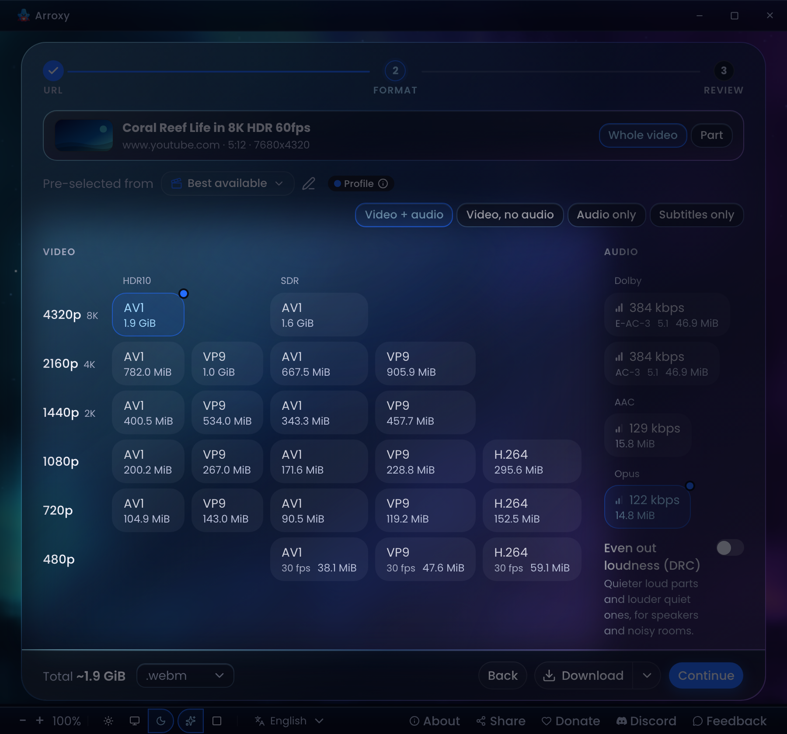

<div align="center">
  

# Arroxy — Ingyenes, nyílt forráskódú YouTube- (+ 2000 webhely) letöltő beépített böngészővel Windowsra, macOS-re és Linuxra

**Built-in browser · Members-only & age-restricted · 4K · 60fps · HDR · Dolby audio · Part of a video · Playlists · Shorts · MP3 · Subtitles · SponsorBlock · +2000 sites**

**Olvassa el ezen a nyelven:** [Afaan Oromoo](README.om.md) · [Bahasa Indonesia](README.id.md) · [Català](README.ca.md) · [Čeština](README.cs.md) · [Dansk](README.da.md) · [Deutsch](README.de.md) · [Eesti](README.et.md) · [English](../../README.md) · [Español](README.es.md) · [Euskara](README.eu.md) · [Français](README.fr.md) · [Galego](README.gl.md) · [Hrvatski](README.hr.md) · [Italiano](README.it.md) · [Kiswahili](README.sw.md) · [Latviešu](README.lv.md) · [Lietuvių](README.lt.md) · **Magyar** · [Nederlands](README.nl.md) · [Norsk bokmål](README.nb.md) · [O'zbekcha](README.uz.md) · [Polski](README.pl.md) · [Português](README.pt.md) · [Română](README.ro.md) · [Slovenčina](README.sk.md) · [Slovenščina](README.sl.md) · [Suomi](README.fi.md) · [Svenska](README.sv.md) · [Tiếng Việt](README.vi.md) · [Türkçe](README.tr.md) · [አማርኛ](README.am.md) · [עברית](README.he.md) · [العربية](README.ar.md) · [اردو](README.ur.md) · [پښتو](README.ps.md) · [فارسی](README.fa.md) · [বাংলা](README.bn.md) · [हिन्दी](README.hi.md) · [ไทย](README.th.md) · [မြန်မာဘာသာ](README.my.md) · [ខ្មែរ](README.km.md) · [Ελληνικά](README.el.md) · [Български](README.bg.md) · [Русский](README.ru.md) · [Српски](README.sr.md) · [Українська](README.uk.md) · [中文](README.zh.md) · [日本語](README.ja.md) · [한국어](README.ko.md) · [繁體中文](README.zh-Hant.md)

[](https://github.com/antonio-orionus/Arroxy/releases/latest) [](https://github.com/antonio-orionus/Arroxy/actions/workflows/release.yml) [](https://arroxy.com/)   

Töltsön le videókat, Shortsokat, zenét, csatornákat, podcastokat vagy hangsávokat a **YouTube-ról és 2000+ támogatott webhelyről** — akár 8K HDR-ben 60 fps-sel, MP3 / AAC / Opus formátumban, vagy csak a szükséges részt. **Böngésszen a YouTube-on vagy bármely más webhelyen közvetlenül az Arroxyban** a Felfedezés lapon, és töltse le az éppen nézett videót, lejátszási listát vagy csatornát; jelentkezzen be ott, hogy privát, csak tagoknak szóló és korhatáros videókat is letölthessen, amelyeket a fiókja megnézhet. Helyben fut Windowson, macOS-en és Linuxon. **Nincs reklám, nincs felesleges ballaszt, nincs kéretlen ajánlat.**

[**↓ A legújabb kiadás telepítése**](#install) &nbsp;·&nbsp; [**Webhely**](https://arroxy.com/) &nbsp;·&nbsp; [Első indítás Windowson](#windows-first-launch) · [Első indítás macOS-en](#macos-first-launch) · [Első indítás Linuxon](#linux-first-launch)

[](https://discord.gg/ueGvXwQH8y)

<table>
  <tr>
    <td width="50%" valign="top" align="center"></td>
    <td width="50%" valign="top" align="center"></td>
  </tr>
</table>

Ha az Arroxy időt spórol Önnek, egy ⭐ segít másoknak megtalálni.

</div>

> **What is Arroxy?** Arroxy is a free, open-source desktop GUI that downloads videos, audio, playlists, and subtitles from YouTube and 2000+ other [yt-dlp](https://github.com/yt-dlp/yt-dlp)-supported sites. It runs on Windows 10/11, macOS 13+ (Intel + Apple Silicon), and Linux (AppImage, Flatpak, tar.gz). GPLv3 licensed. No ads, no usage limits. Distributed via [Winget](https://winget.run/pkg/AntonioOrionus/Arroxy), [Scoop](https://github.com/antonio-orionus/scoop-bucket), [Homebrew Cask](https://github.com/antonio-orionus/homebrew-arroxy), Flatpak, AppImage, and direct download.
>
> **Key difference: a built-in browser.** Most free YouTube downloaders are thin yt-dlp wrappers: a URL box and a format menu, with no browser of their own. Arroxy has one, the **Explore tab**. You browse YouTube or any other site inside the app and download the video, playlist, or channel you're on, or right-click any link. You sign in once in Explore, and Arroxy downloads private, members-only, and age-restricted videos your account can watch, plus your Watch Later and Liked lists, with no cookie export. Sign in to other sites there too, and their downloads use that sign-in when they need it. It retries with that sign-in when YouTube asks you to confirm you're not a bot. Its built-in browser also gets the token YouTube expects before a download, so YouTube doesn't cut a download down to fewer formats. A URL-box wrapper hits all of these limits. Details: [Why Arroxy](#why-explore).
>
> _Last updated: 2026-10-21._

> 🌐 Ez a fordítás MI támogatásával készült. Az [angol README](../../README.md) az irányadó forrás. Hibát talált? [Nyisson egy PR-t](../../../../pulls).

---

## Tartalom

- [✨ Funkciók](#features)
- [📥 Telepítés és első indítás](#install)
  - [Első indítás Windowson](#windows-first-launch)
  - [Első indítás macOS-en](#macos-first-launch)
  - [Miért jelenhet meg figyelmeztetés](#why-warning)
  - [Első indítás Linuxon](#linux-first-launch)
  - [A letöltés ellenőrzése (SHA256)](#verify)
- [⚖️ Miért az Arroxy](#why)
- [🔒 Adatvédelem](#privacy)
- [❓ GYIK](#faq)
- [🗺️ Ütemterv](#roadmap)
- [💖 Az Arroxy támogatása](#support)
- [🛠️ Ezzel készült](#tech)

---

## <a id="features"></a>✨ Funkciók

<table align="center" width="100%">
  <tr>
    <td colspan="2" valign="top" align="center"><br/> <sub><b>Felfedezés</b><br/>Böngésszen a YouTube-on vagy bármely más webhelyen az Arroxyban, és töltse le az éppen nézett oldalt az aktív profillal</sub></td>
  </tr>
  <tr>
    <td width="50%" valign="top" align="center"><br/> <sub><b>A Felfedezés első képernyője</b><br/>Rövid bemutató a Felfedezésről, és arról, miért biztonságosabb a másodlagos fiókkal való bejelentkezés</sub></td>
    <td width="50%" valign="top" align="center"><br/> <sub><b>A Letöltések megmondja, mi igényli Önt</b><br/>A hivatkozások a háttérben készülnek elő; a sikertelen felajánlja a javítást, a hosszú lejátszási lista a választására vár</sub></td>
  </tr>
  <tr>
    <td colspan="2" valign="top" align="center"><br/> <sub><b>Csak a videó egy részének letöltése</b><br/>Válasszon kezdetet és véget vagy egy fejezetet — az Arroxy csak azt a tartományt menti</sub></td>
  </tr>
  <tr>
    <td colspan="2" valign="top" align="center"><br/> <sub><b>8K HDR 60 fps-sel</b><br/>A videó által kínált minden felbontás, kodek és HDR-adatfolyam egymás mellett</sub></td>
  </tr>
  <tr>
    <td colspan="2" valign="top" align="center"><br/> <sub><b>Profilszerkesztő</b><br/>Hangolja a profilt: fájltípus, felbontás, feliratok, célmappa, fájlnévsablon és egyebek</sub></td>
  </tr>
  <tr>
    <td colspan="2" valign="top" align="center"><br/><sub><b>Sötét vagy világos, üveg vagy tömör</b><br/>Négy megjelenés közül választhat: üvegpanelek mozgó égbolt fölött vagy nyugodt, tömör felületek, mindegyik sötét és világos változatban</sub></td>
  </tr>
  <tr>
    <td colspan="2" valign="top" align="center"><picture><source media="(prefers-color-scheme: dark)" srcset="build/Global-hotkey-dark.png" /></picture><br/><sub><b>Globális letöltési gyorsbillentyű</b><br/>Másoljon ki egy hivatkozást bárhol, nyomja meg egyszer — a sorba kerül, és elindul a letöltés</sub></td>
  </tr>
  <tr>
    <td colspan="2" valign="top" align="center"><br/><sub><b>Lejátszásilista-elemenkénti profilok</b><br/>Adjon minden videónak saját profilt — egyeseket archiváljon 4K-ban, a többit töltse le MP3-ként</sub></td>
  </tr>
  <tr>
    <td width="50%" valign="top" align="center"><br/><sub><b>Gyorsletöltés kezdőlap</b><br/>Illesszen be egy URL-t, és azonnal töltse le az aktív profillal</sub></td>
    <td width="50%" valign="top" align="center"><br/><sub><b>Újrahasználható letöltési profilok</b><br/>Mentsen formátum-, minőség- és kimeneti előbeállításokat — használja újra letöltésenként</sub></td>
  </tr>
  <tr>
    <td width="50%" valign="top" align="center"><br/><sub><b>Többnyelvű hangsávok</b><br/>Válassza ki a videóhoz tartozó pontos hangnyelvet</sub></td>
    <td width="50%" valign="top" align="center"><br/><sub><b>Térhatású / Dolby hang</b><br/>Az 5.1-es és a Dolby hangsávok felismerve és megőrizve</sub></td>
  </tr>
  <tr>
    <td width="50%" valign="top" align="center"><br/><sub><b>Tömeges URL mód</b><br/>Illesszen be egy listát, automatikus ismétlődés-szűrés, és az összeset egyszerre sorba állíthatja</sub></td>
    <td width="50%" valign="top" align="center"><br/><sub><b>Párhuzamos letöltési sor</b><br/>Több letöltés egyszerre, élő haladással</sub></td>
  </tr>
</table>

<details open>
<summary><strong>🧭 Felfedezés: böngészés az interneten az Arroxyban</strong></summary>

- **Felfedezés lap** — böngésszen a YouTube-on vagy bármely más webhelyen az Arroxyban, és töltse le a talált tartalmat hivatkozások másolása nélkül. A **Letöltés · *a profilja*** sorba állítja a nézett videót, lejátszási listát vagy csatornát; a mellette lévő nyíl profilt vált, a varázspálca pedig megnyitja a lépésenkénti letöltést a formátumok, feliratok és egyebek kiválasztásához
- **Jobb kattintásos letöltés** — kattintson jobb gombbal bármely videó-, lejátszási lista- vagy csatornahivatkozásra a Felfedezésben, hogy letöltse a profiljával, válasszon másik profilt a **Letöltés ezzel:** menüből, nyissa meg a lépésenkénti letöltést, vagy másolja a hivatkozást. Nem kell előbb megnyitni az egyes videókat
- **Kompakt elrendezés** — egy kattintás a Felfedezés eszköztárán áthelyezi az Arroxy lapjait az eszköztárba, és több helyet ad az oldalnak
- **Címsor** — írjon be keresést a YouTube-on, vagy adjon meg bármilyen webcímet az adott webhely megnyitásához
- **Fiókot igénylő letöltések** — jelentkezzen be egyszer a Felfedezésben, és az Arroxy letöltheti a privát és csak tagoknak szóló videókat, amelyeket a fiókja megnézhet, a korhatáros videókat, ha a fiók korhatár-ellenőrzött, valamint a Megnézendő és a Kedvelt listáit. Más webhelyekre is bejelentkezhet ott, és azok letöltései ezt a bejelentkezést használják, ha szükséges. Az Arroxy továbbra is előbb kijelentkezve tölt le, és csak akkor használja a Felfedezés-bejelentkezést, ha a letöltés olyan módon hibásodik meg, amit egy fiók orvosolhat. Amikor a YouTube azt kéri, erősítse meg, hogy nem robot, az Arroxy a Felfedezés-bejelentkezést is megpróbálja
- **Használjon másodlagos fiókot** — a Felfedezés első képernyője elmagyarázza az okát: a fiókkal való letöltés kockázatot hordoz, hogy a fiókot korlátozzák. A Beállításokban bármikor kijelentkezhet a Felfedezésből, hogy elfelejtse a bejelentkezéseit
- **Hirdetésblokkoló** — alapból ki van kapcsolva. Egy kattintás a pajzsra a Felfedezés eszköztárán letiltja a hirdetéseket és a nyomkövetőket az oldalain, a letöltéseket nem érintve. A YouTube ellenállhat a hirdetésblokkolóknak a bejelentkezett fiókoknál

</details>

<details>
<summary><strong>🎞️ Minőség és formátumok</strong></summary>

- Akár **8K (4320p)**, 4K UHD (2160p), 1440p, 1080p, 720p, 480p, 360p
- **Magas képkockasebesség és HDR** változatlanul megőrizve — 60 fps, HDR10
- **Hang** — exportáljon csak hangot MP3, M4A/AAC, Opus vagy WAV formátumban. Az interaktív letöltésekben válassza ki a forrás eredeti térhatású/Dolby hangsávjait (AC-3, E-AC-3, 5.1, DRC), ha elérhetők, vagy állítson be globális **Térhatású / Dolby előnyben** alapértelmezést
- **Célhoz kötött profilok** — *Legjobb kép* (AV1 · VP9) vagy *Okostévé* (MP4 · H.264), mentve Automatikus, MP4, MKV vagy WebM formátumban újrakódolás nélkül. A HDR lehet *Automatikus* (csak ha a képernyő meg tudja jeleníteni), *SDR* vagy *HDR*
- **Minden kodek minden felbontásban** — a lépésenkénti letöltés egymás mellett listázza az AV1-et, a VP9-et és a H.264-et minden felbontásnál, így kiválaszthatja azt, amelyet a tévéje vagy a szerkesztője lejátszik
- **Tudja meg, mi valójában egy adatfolyam** — megjelöli a YouTube által MI-vel felskálázott méreteket, az MI-vel szinkronizált hangnyelveket, a megnövelt bitrátájú adatfolyamokat, a 360°-os videókat, valamint a sérült vagy vízjeles példányokat. A profilok kihagyják az MI-vel felskálázott adatfolyamokat, hacsak nem engedélyezi őket

</details>

<details>
<summary><strong>🛡️ Adatvédelem és felügyelet</strong></summary>

- 100%-ban helyi feldolgozás — a letöltések közvetlenül a YouTube-ról a lemezre kerülnek
- **Nyílt forráskód** — minden sor ellenőrizhető, GPLv3 licenc alatt
- A fájlok közvetlenül a kiválasztott mappába kerülnek

</details>

<details>
<summary><strong>⚡ Munkafolyamat</strong></summary>

- **Globális letöltési gyorsbillentyű** — másoljon ki egy hivatkozást bármely alkalmazásban, és nyomja meg a `Ctrl+Shift+D` billentyűparancsot (macOS-en `Cmd+Shift+D`); az Arroxy az aktív profillal sorba állítja az ablak megnyitása nélkül, és értesítés jelzi. Alapból be van kapcsolva, átállítható
- **Rugalmas indítási módok** — válasszon vezetett egyedi letöltést, lejátszási lista/csatorna választót, tömeges URL-beillesztést, Gyorsletöltést mentett alapértelmezésekkel, vagy böngésszen és töltsön le a Felfedezésből
- **Központi letöltési sor** — minden egyedi, lejátszási listás, tömeges vagy gyors feladat egy helyre kerül a haladás, a szüneteltetés, a folytatás, a megszakítás, az újrapróbálás és a prioritáskezelés számára
- **Vágólap figyelése** — másoljon ki egy videóhivatkozást, és az Arroxyba visszatérve kitölti az URL-mezőt, **Visszavonás** lehetőséggel, ha nem ezt akarta. Amíg az Arroxy elfoglalt, a hivatkozás vár, amíg vissza nem tér az URL lapra (a Beállításokban kikapcsolható)
- **Automatikus URL-tisztítás** — eltávolítja a követőparamétereket (`si`, `pp`, `utm_*`, `fbclid`, `gclid`), és feloldja a `youtube.com/redirect` hivatkozásokat
- **Tálcamód** — az ablak bezárása után a letöltések a háttérben tovább futnak
- **50 nyelv** — automatikusan felismeri a rendszer nyelvét, bármikor váltható
- **Lejátszási lista szinkronizálása** — vizsgálja át újra a lejátszási listát egy helyi mappával szemben, hogy kihagyja a már letöltött videókat; `.m3u` lejátszásilista-fájlt készít, amely minden videó letöltésekor frissül
- **Sebesség- és ütemezésvezérlők** — korlátozza a letöltési sávszélességet, állítsa be, hány részt tölt le egyszerre egy videóból, és adjon hozzá kéréskésleltetést előbeállításokkal (*Ki · Kiegyensúlyozott · Óvatos · Egyéni*)
- **Fájlnévsablonok** — nevezze el a letöltéseket saját ízlése szerint a `{title}`, `{uploader}`, `{id}`, `{date}`, `{year}`, `{resolution}`, `{site}`, `{categories}`, `{artist}`, `{album}`, `{track}` és `{playlist_index}` tokenekkel, globálisan vagy letöltési profilonként
- **Egyidejű letöltések és automatikus újrapróbálás** — válassza ki, hány sorba állított letöltés fusson egyszerre, és hagyja, hogy az Arroxy újrapróbálja a hálózati vagy kiszolgálói problémába ütköző letöltést, minden kísérlet előtt egyre hosszabb ideig várva
- **Lejátszásilista-elemenkénti profilok** — rendeljen a lejátszási lista minden videójához saját letöltési profilt a teljes listára vonatkozó egyetlen beállítás helyett, így egyetlen menetben egyeseket teljes minőségben archiválhat, a többit pedig MP3-ként töltheti le
- **A Gyorsletöltés a háttérben működik** — a hivatkozás azonnal megjelenik a Letöltésekben, és ott készül elő, a **Megtekintés** gombos értesítés jelzi, az URL-mező pedig kiürül a következő hivatkozásnak. Indítson el annyit, amennyit szeretne, amíg a korábbiak előkészülnek
- **A Letöltések megmondja, mi igényli Önt** — ha az Arroxy nem tudja beolvasni a hivatkozást, a sora megmondja az okot, és felajánlja a javítást: Újra, sütik bekapcsolása vagy bejelentkezés a Felfedezésben. Kikapcsolt sütiknél a **Bejelentkezés a Felfedezéssel** újrapróbálja Ön helyett, amint bejelentkezett. A betöltési korlátnál hosszabb lejátszási lista a sorában várja, hogy válasszon: az egészet, az első elemeket vagy egy áttekintést. A Letöltések lap megszámolja az Önre váró sorokat
- **Csak a videó egy részének letöltése** — válasszon kezdetet és véget vagy egy fejezetet a Formátum képernyőn, és az Arroxy csak azt a tartományt menti, a videóazonosító után a tartománnyal elnevezve. A vágások a legközelebbi kulcsképkockára esnek; kapcsolja be a pontos vágást az újrakódoláshoz
- **Befejezett letöltések eltávolítása** — nem kötelező: a befejezett letöltés 5 másodperc múlva eltűnik a listáról. A fájlok a lemezen maradnak, a sikertelen letöltések pedig a listán
- **Méret és Hiányzik a Letöltésekben** — a rendezhető **Méret** oszlop megmutatja, mennyi helyet foglal az egyes letöltés, a **Hiányzik** pedig megjelöli az Arroxyn kívül áthelyezett vagy törölt fájlokat
- **Aurora vagy Minimal, sötét vagy világos** — üvegpanelek mozgó égbolt fölött, vagy nyugodt, tömör felületek; a láblécben válthat. A grafikus gyorsítás nélküli számítógépek automatikusan Minimalt kapnak
- **Mac menüsor** — macOS-en nyissa meg a Beállításokat (`Cmd+,`), állítsa be a letöltési sebességkorlátot, váltson stílust és témát, nyissa meg a naplókat vagy mentsen diagnosztikai fájlt a menüsorból
- **Profil módosítása bármely letöltésből** — finomhangoljon egy letöltést, majd frissítse a profilt, amelyből indult (a változások előnézetével), vagy mentse a beállításokat új profilként. A profilváltás megkérdezi, megtartja-e a módosításokat

</details>

<details>
<summary><strong>📝 Feliratok és utófeldolgozás</strong></summary>

- **Feliratok** SRT, VTT vagy ASS formátumban — kézi vagy automatikusan generált, bármely elérhető nyelven
- Mentés a videó mellé, beágyazás `.mkv`-be, vagy rendezés `Subtitles/` almappába
- **Csak feliratos kötegek** — illesszen be URL-listát vagy nyisson meg egy lejátszási listát, válassza a Feliratok lehetőséget, és csak a feliratfájlokat kapja meg minden videóhoz
- **SponsorBlock** — szponzorok, bevezetők, zárások, önreklámok átugrása vagy fejezetként jelölése
- **Beágyazott metaadatok** — a cím, a feltöltés dátuma, a csatorna, a leírás, a miniatűr és a fejezetjelölők a fájlba íródnak

</details>

<details>
<summary><strong>🌐 YouTube + 2000 webhely</strong></summary>

- **A YouTube teljes körűen** — Videók, Shorts, Csatornák, Lejátszási listák, YouTube Music és Podcastok elsőrangú forrásként kezelve
- **2000+ más webhely** a yt-dlp-n keresztül — Twitch, TikTok, Dailymotion, VK, SoundCloud, Bandcamp, Bilibili, archive.org, Streamable és sok más
- **Csak hang és feliratok** minden támogatott webhelyen működik, nem csak a YouTube-on
- Ha egy webhely megváltozik, a yt-dlp hetente ad ki javításokat, az Arroxy pedig induláskor automatikusan frissíti a binárist

</details>

---

## <a id="install"></a>📥 Telepítés és első indítás

**Windows**

```bash
winget install AntonioOrionus.Arroxy
```

**macOS**

```bash
brew install --cask antonio-orionus/arroxy/arroxy
```

**Linux**

AppImage:

```bash
curl -fsSL https://raw.githubusercontent.com/antonio-orionus/Arroxy/main/scripts/install.sh | sh -s -- --appimage
```

Flatpak:

```bash
curl -fsSL https://raw.githubusercontent.com/antonio-orionus/Arroxy/main/scripts/install.sh | sh -s -- --flatpak
```

A buildek csak x86_64-esek. Nincs `curl`? Cserélje a `curl -fsSL` parancsot `wget -qO-`-ra.

| Platform | Közvetlen letöltés |
| --- | --- |
| Windows | [](https://github.com/antonio-orionus/Arroxy/releases/latest/download/Arroxy-win-x64-Setup.exe) [](https://github.com/antonio-orionus/Arroxy/releases/latest/download/Arroxy-win-x64-Portable.exe) |
| macOS | [](https://github.com/antonio-orionus/Arroxy/releases/latest/download/Arroxy-mac-arm64.dmg) [](https://github.com/antonio-orionus/Arroxy/releases/latest/download/Arroxy-mac-x64.dmg) |
| Linux | [](https://github.com/antonio-orionus/Arroxy/releases/latest/download/Arroxy-linux-x64.AppImage) [](https://github.com/antonio-orionus/Arroxy/releases/latest/download/Arroxy-linux-x64.flatpak) [](https://github.com/antonio-orionus/Arroxy/releases/latest/download/Arroxy-linux-x64.tar.gz) |
| Verify | [](https://github.com/antonio-orionus/Arroxy/releases/latest/download/SHA256SUMS) |

[**Az összes kiadási fájl →**](https://github.com/antonio-orionus/Arroxy/releases/latest)

<details>
<summary><strong><a id="windows-first-launch"></a>🪟 Első indítás Windowson</strong></summary>

Az első indításkor megjelenhet a **„A Windows megvédte a számítógépét”** vagy az **„Ismeretlen közzétevő”** üzenet. Ez mind az `Arroxy-win-x64-Setup.exe`, mind az `Arroxy-win-x64-Portable.exe` fájlra vonatkozik. Az Arroxy ingyenes és nyílt forráskódú, a Windows-buildek pedig nincsenek fizetős tanúsítvánnyal kódaláírva, ezért jelzi őket a SmartScreen. Ez **nem** jelenti automatikusan, hogy az Arroxy nem biztonságos. A folytatáshoz:

<div align="center">
  
  
</div>

1. Kattintson a **További információ** lehetőségre.
2. Kattintson a **Futtatás mindenképpen** gombra.

#### Ha a Windows Defender megjelöli vagy eltávolítja a fájlt

A Defender heurisztikái olykor gyanúsként jelölik az aláíratlan NSIS-telepítőket és az Electron hordozható változatokat. Ha a Defender karanténba helyezi az `Arroxy-win-x64-Setup.exe` vagy az `Arroxy-win-x64-Portable.exe` fájlt, állítsa vissza a **Windows-biztonság → Vírus- és fenyegetésvédelem → Védelmi előzmények** részből, majd adja hozzá az Arroxy végrehajtható fájlját engedélyezett elemként a **Beállítások kezelése → Kizárások hozzáadása vagy eltávolítása** menüpontban. A SmartScreenhez hasonlóan itt is a hiányzó közzétevői aláírás a kiváltó ok, nem észlelt kártevő.

> Az Arroxyt csak a hivatalos GitHub Releases oldalról töltse le. Ha a fájlt másik webhelyről szerezte, vagy valaki elküldte Önnek, törölje, és töltsön le egy friss példányt a hivatalos forrásból. A forráskód nyilvános, így megvizsgálhatja, vagy ha szeretné, maga is lefordíthatja az Arroxyt.

Inkább a Scoopot szereti? `scoop bucket add arroxy https://github.com/antonio-orionus/scoop-bucket && scoop install arroxy`

</details>

<details>
<summary><strong><a id="macos-first-launch"></a>🍎 Első indítás macOS-en</strong></summary>

Az Arroxy macOS-buildjei ad-hoc aláírtak, de az Apple nem hitelesítette őket, ezért a Gatekeeper az első indításkor blokkolja őket az *„Arroxy.app” nem nyitható meg — az Apple nem tudta ellenőrizni, hogy az „Arroxy.app” mentes a kártevőktől* üzenettel. Ez azt jelenti, hogy a macOS nem tudja az Apple-lel ellenőrizni az alkalmazást, nem azt, hogy a fájlokkal bármi gond lenne. A Homebrew-val való telepítés teljesen elkerüli ezt a párbeszédpanelt. Ha a DMG-t használta, egyetlen terminálparancs megoldja:

<div align="center">
  
</div>

1. Húzza az `Arroxy.app` fájlt a csatolt DMG-ből az `/Applications` mappába.
2. Nyissa meg a Terminált, és futtassa ezt a két parancsot:

```bash
xattr -dr com.apple.quarantine /Applications/Arroxy.app
open /Applications/Arroxy.app
```

Az első parancs eltávolítja a karanténattribútumot, amelyet a macOS a fájl letöltésekor csatolt hozzá; a második elindítja az alkalmazást. Általában nincs szükség a `sudo`-ra, mert az `/Applications` mappában lévő példány az Öné — csak akkor adja hozzá, ha jogosultsági hibát kap.

**Apple Silicon vagy Intel:** M-sorozatú Macen (M1 / M2 / M3 / M4) az `arm64` DMG-t töltse le. Intel Macen az `x64` DMG-t. A rossz build is működik a Rosettán keresztül, de érezhetően lassabb.

> A macOS-buildek CI-n készülnek Apple Silicon és Intel futtatókon. Ha problémába ütközik, [nyisson egy hibajegyet](../../../../issues) — a macOS-felhasználók visszajelzései aktívan alakítják a macOS-tesztelési ciklust.

</details>

<details>
<summary><strong><a id="why-warning"></a>⚠️ Miért jelenhet meg figyelmeztetés</strong></summary>

Az Arroxy nyílt forráskódú és GPLv3 licenc alatt áll. A Windows- és macOS-buildek **nincsenek kódaláírva** — az Apple Developer ID és a Windows EV kódaláíró tanúsítványok egyenként évi több száz dollárba kerülnek, amit egy indie projekt saját zsebből fizet. E aláírások nélkül a Windows SmartScreen és a macOS Gatekeeper figyelmeztet az első indításkor. A figyelmeztetések azt jelentik, hogy *az operációs rendszer nem ismeri fel a közzétevőt* — nem azt, hogy az Arroxy kártevő.

Három módja az Arroxy saját ellenőrzésének, növekvő alaposság szerint:

- **Olvassa el a forráskódot.** Minden sor elérhető a [GitHubon](https://github.com/antonio-orionus/Arroxy), és [lefordíthatja forráskódból](#tech).
- **Ellenőrizze az SHA256-ot.** Vesse össze a fájlt a közzétett [`SHA256SUMS`](https://github.com/antonio-orionus/Arroxy/releases/latest/download/SHA256SUMS) fájllal — lásd lent: [A letöltés ellenőrzése](#verify).
- **Futtasson külső vizsgálatot.** Töltse fel a fájlt a [VirusTotalra](https://www.virustotal.com).

</details>

<details>
<summary><strong><a id="linux-first-launch"></a>🐧 Első indítás Linuxon</strong></summary>

Az AppImage-ek közvetlenül futnak — telepítés nélkül. Csak futtathatóként kell megjelölni a fájlt.

**Fájlkezelő:** kattintson jobb gombbal az `.AppImage` fájlra → **Tulajdonságok** → **Jogosultságok** → kapcsolja be a **Fájl futtatásának engedélyezése programként** lehetőséget, majd kattintson rá duplán.

**Terminál:**

```bash
chmod +x Arroxy-linux-x64.AppImage
./Arroxy-linux-x64.AppImage
```

Ha az indítás még mindig sikertelen, futtassa csatolás nélkül — FUSE-csomag nem szükséges:

```bash
./Arroxy-linux-x64.AppImage --appimage-extract-and-run
```

**Opcionális asztali integráció:** telepítse egyszer az [AppImageLaunchert](https://github.com/TheAssassin/AppImageLauncher), és minden duplán kattintott AppImage automatikusan bekerül az indítómenübe — kézi `.desktop` fájl nélkül.

**Egyszerű tarball (FUSE és telepítés nélkül):**

A `.tar.gz` build ugyanaz az alkalmazás az AppImage-burkoló nélkül — bárhol kicsomagolhatja és futtathatja. Nincs szükség telepítőre és FUSE-csomagra.

```bash
tar xzf Arroxy-linux-x64.tar.gz
./Arroxy-linux-x64/arroxy
```

**A kiadási oldalon található Linux-letöltések csak x86_64-esek.** ARM64-es gépeken (Raspberry Pi, Asahi Linux) a Flatpak még települ, majd indításkor `bwrap: execvp ldconfig: Exec format error` hibával meghiúsul.

</details>

<details>
<summary><strong><a id="verify"></a>🔐 A letöltés ellenőrzése (SHA256)</strong></summary>

Minden kiadás a binárisok mellett közzétesz egy `SHA256SUMS` fájlt is. Annak ellenőrzéséhez, hogy a letöltés nem sérült meg, és nem módosították szállítás közben, számítsa ki helyben a fájl hash-ét, és vesse össze a `SHA256SUMS` megfelelő sorával. Nyissa meg a legújabb kiadás oldalát → **Assets** → töltse le a `SHA256SUMS` fájlt.

**Windows (PowerShell vagy Parancssor):**

```powershell
certutil -hashfile Arroxy-win-x64-Setup.exe SHA256
```

**macOS (Terminál):**

```bash
shasum -a 256 Arroxy-mac-arm64.dmg
```

**Linux (Terminál):**

```bash
sha256sum Arroxy-linux-x64.AppImage
```

Külső kártevővizsgálatot szeretne? Töltse fel a fájlt a [VirusTotalra](https://www.virustotal.com). Néhány általános heurisztikus jelzés kisebb motoroktól normális az aláíratlan Electron-alkalmazásoknál; a nagy motorok széles körű észlelései viszont valódi aggodalomra adnának okot.

</details>

<details>
<summary><strong>📦 Windows: Telepítő vagy hordozható</strong></summary>

|               | NSIS-telepítő | Hordozható `.exe` |
| ------------- | :----------------------: | :---------------------: |
| Telepítés szükséges | Igen  | Nem — bárhonnan futtatható  |
| Automatikus frissítések | ✅ az alkalmazásban  | ❌ kézi letöltés  |
| Indulási sebesség | ✅ gyorsabb  | ⚠️ lassabb hidegindítás  |
| Felkerül a Start menübe |            ✅            |           ❌            |
| Egyszerű eltávolítás |            ✅            | ❌ törölje a fájlt  |

**Javaslat:** használja az NSIS-telepítőt az automatikus frissítésekhez és a gyorsabb induláshoz. A hordozható `.exe` telepítés és beállításjegyzék-bejegyzés nélküli megoldás.

</details>

---

## <a id="why"></a>⚖️ Miért az Arroxy

Összehasonlítás a leggyakoribb alternatívákkal:

|            | Arroxy | Typical free yt-dlp GUI | 4K Video Downloader | JDownloader | Y2Mate / online converters | Browser extensions |
| ---------- | :----: | :---------------------: | :-----------------: | :---------: | :------------------------: | :----------------: |
| Beépített böngésző (böngészés, bejelentkezés, letöltés) |   ✅   |           ❌            |         ⚠️          |     ❌      |             ❌             |        N/A         |
| Privát, csak tagoknak szóló és korhatáros videók sütik exportálása nélkül |   ✅   |           ⚠️            |         ⚠️          |     ⚠️      |             ❌             |         ⚠️         |
| Ingyenes, nincs prémium szint |   ✅   |           ✅            |         ⚠️          |     ✅      |             ⚠️             |         ⚠️         |
| Nyílt forráskód |   ✅   |           ✅            |         ❌          |     ❌      |             ❌             |         ⚠️         |
| Kizárólag helyi feldolgozás |   ✅   |           ✅            |         ✅          |     ✅      |             ❌             |         ✅         |
| Nincsenek használati korlátok |   ✅   |           ✅            |         ⚠️          |     ✅      |             🚫             |         ⚠️         |
| Platformfüggetlen asztali alkalmazás |   ✅   |           ⚠️            |         ✅          |     ✅      |            N/A             |         ❌         |
| Feliratok + SponsorBlock |   ✅   |           ⚠️            |         ⚠️          |     ❌      |             ❌             |         ❌         |

⚠️ = részben, vagy csak fizetős szinten. A 4K Video Downloader alkalmazáson belüli bejelentkezése a privát videókhoz fizetős funkció; a legtöbb ingyenes yt-dlp-grafikus felület csak sütifájlt fogad el, vagy a webböngészője sütijeit olvassa.

Az Arroxy egyetlen dologra készült: egy tiszta, helyi fájlra, akár URL-t illeszt be, akár a Felfedezésben találja meg a videót. Nincsenek kéretlen ajánlatok, nincs adatgyűjtés.

### <a id="why-explore"></a>🧭 Amire egy egyszerű yt-dlp-burkoló nem képes: a Felfedezés lap

A legtöbb ingyenes YouTube-letöltő egy URL-mező a yt-dlp tetején. Az Arroxy is a yt-dlp-t használja, de van egy **Felfedezése** is: egy az alkalmazásba épített böngésző, amely megnyitja a YouTube-ot vagy bármely más webhelyet. A Felfedezés áttöri azokat a korlátokat, amelyeket egy URL-mező nem tud:

- **Fiókot igénylő videók sütik exportálása nélkül** — privát, csak tagoknak szóló és korhatáros videók (korhatár-ellenőrzött fiókkal), valamint a Megnézendő és a Kedvelt listák, illetve más webhelyeken bejelentkezés mögötti videók. Egy egyszerű burkolónak cookies.txt-exportra van szüksége, vagy a webböngésző sütijeit kell olvasnia, amit a Chrome Windowson már blokkol. Az Arroxyban egyszer bejelentkezik a Felfedezésben, a többit az Arroxy elvégzi
- **„Jelentkezzen be annak megerősítéséhez, hogy nem robot”** — amikor a YouTube ezt kéri, az Arroxy a Felfedezés-bejelentkezéssel újrapróbálja a letöltést a hibaüzenet helyett
- **A YouTube letöltési tokenje** — az Arroxy beépített böngészője megszerzi azt a tokent, amelyet a YouTube a letöltés előtt elvár. Enélkül a YouTube kevesebb formátumot és alacsonyabb minőséget kínálhat, mint amit kért
- **Nincs hivatkozásmásolás** — keressen meg egy videót, lejátszási listát vagy csatornát a Felfedezésben, és töltse le egy kattintással, vagy kattintson jobb gombbal bármely hivatkozásra az oldalon
- **Hirdetésblokkoló, ha kell** — egy kattintás a pajzsra letiltja a hirdetéseket és a nyomkövetőket a Felfedezés oldalain

---

## <a id="privacy"></a>🔒 Adatvédelem

A letöltések közvetlenül a [yt-dlp](https://github.com/yt-dlp/yt-dlp) segítségével töltődnek le a YouTube-ról a kiválasztott mappába — semmi sem megy át külső kiszolgálón. A megtekintési előzmények, a letöltési előzmények, az URL-ek és a fájltartalom az eszközén marad.

Nincs telemetria — csak egy névtelen jelzés naponta: az alkalmazás verziója, az operációs rendszer, a nyelv, a telepítési csatorna, az ország és hozzávetőlegesen az, hogy mikor telepítették az Arroxyt, hogy megszámolhassuk az aktív és az új felhasználókat. Azonosítók, URL-ek, videócímek, fájlelérési utak vagy fiókadatok nincsenek benne. A Beállításokban kikapcsolható.

A Felfedezés saját bejelentkezéseket tart a böngészőjétől elkülönítve, és az Arroxy soha nem olvas vagy tölt ki bejelentkezési űrlapot — a webhely saját oldalán gépel. A letöltések kijelentkezve futnak; csak ha egy olyan módon hibásodik meg, amit egy fiók orvosolhat, olvassa be az Arroxy frissen a bejelentkezést, tartja egy ideiglenes fájlban az adott letöltés idejére, majd utána törli a fájlt. A Beállításokban a Felfedezésből való kijelentkezés elfelejti őket.

---

## <a id="faq"></a>❓ GYIK

<details>
<summary><strong>Tényleg ingyenes?</strong></summary>

Igen — GPLv3 licenc alatt, prémium szint és funkciókorlátozás nélkül.

</details>

<details>
<summary><strong>Miben különbözik az Arroxy más yt-dlp grafikus felületektől?</strong></summary>

A legtöbb ingyenes yt-dlp grafikus felület csak burkoló, amely egy hivatkozást fogad. Az Arroxy hozzáadja a **Felfedezést**, egy az alkalmazásba épített böngészőt, amely megnyitja a YouTube-ot vagy bármely más webhelyet: hivatkozásmásolás nélkül böngészhet és tölthet le, és ott egyszer bejelentkezve privát, csak tagoknak szóló és korhatáros videókat, valamint a Megnézendő és a Kedvelt listáit töltheti le, sütiexport nélkül. Az Arroxy ezt a bejelentkezést használja, amikor a YouTube azt kéri, erősítse meg, hogy nem robot, a beépített böngészője pedig megszerzi a YouTube letöltési tokenjét, hogy a letöltések ne essenek vissza kevesebb formátumra. Lásd: [Miért az Arroxy](#why).

</details>

<details>
<summary><strong>Milyen videóminőségeket tölthetek le?</strong></summary>

Bármit, amit a YouTube kiszolgál: 8K (4320p), 4K UHD (2160p), 1440p, 1080p, 720p, 480p, 360p, valamint csak hang. A 60 fps-es és HDR-adatfolyamok változatlanul megmaradnak, a lépésenkénti letöltés pedig lehetővé teszi az AV1, a VP9 vagy a H.264 kiválasztását minden felbontásnál.

</details>

<details>
<summary><strong>Kinyerhetem csak a hangot MP3-ként?</strong></summary>

Igen. Válassza a *csak hang* lehetőséget a formátummenüben, majd az MP3-at, M4A/AAC-t, Opust vagy WAV-ot.

</details>

<details>
<summary><strong>Hogyan tölthetek le YouTube-fiókot igénylő videókat?</strong></summary>

Jelentkezzen be egyszer a Felfedezés lapon. Az Arroxy ezután letöltheti a privát és csak tagoknak szóló videókat, amelyeket a fiókja megnézhet, a korhatáros videókat, ha a fiók korhatár-ellenőrzött, valamint a Megnézendő és a Kedvelt listáit. A bejelentkezést csak akkor használja, ha a letöltés olyan módon hibásodik meg, amit egy fiók orvosolhat; minden más a korábbiak szerint töltődik le. Ez a **Felfedezés-bejelentkezés** lehetőség, amely a sütibeállításokban az első helyen áll és Ajánlottként van megjelölve, az Arroxy pedig a Felfedezés első megnyitásakor kiválasztja Önnek. A yt-dlp wikije megjegyzi, hogy [a bejelentkezett automatizálás megjelölheti a Google-fiókot](https://github.com/yt-dlp/yt-dlp/wiki/Extractors#exporting-youtube-cookies), ezért a másodlagos fiók a biztonságosabb választás.

</details>

<details>
<summary><strong>Tovább fog működni, ha a YouTube módosít valamit?</strong></summary>

A yt-dlp induláskor automatikusan frissül, az Arroxy pedig gyorsan ad ki javításokat, ha a YouTube módosít valamit. Amikor a YouTube azt kéri, erősítse meg, hogy nem robot, az Arroxy a Felfedezés-bejelentkezést is megpróbálja, ha ott bejelentkezett, a fájlból vagy a böngészőből származó sütik pedig elérhetők a sütibeállításokban.

</details>

<details>
<summary><strong>Milyen nyelveken érhető el az Arroxy?</strong></summary>

50 nyelven, azonnal használhatóan: Afaan Oromoo · Bahasa Indonesia · Català · Čeština · Dansk · Deutsch · Eesti · English · Español · Euskara · Français · Galego · Hrvatski · Italiano · Kiswahili · Latviešu · Lietuvių · Magyar · Nederlands · Norsk bokmål · O'zbekcha · Polski · Português · Română · Slovenčina · Slovenščina · Suomi · Svenska · Tiếng Việt · Türkçe · አማርኛ · עברית · العربية · اردو · پښتو · فارسی · বাংলা · हिन्दी · ไทย · မြန်မာဘာသာ · ខ្មែរ · Ελληνικά · Български · Русский · Српски · Українська · 中文 · 日本語 · 한국어 · 繁體中文. Az Arroxy az első indításkor automatikusan felismeri az operációs rendszer nyelvét, és bármikor válthat az eszköztár nyelvválasztójával. A futásidejű nyelvi JSON a src/shared/i18n/locales/ mappában található, a fordítóknak szánt PO-katalógusok pedig az i18n/locales/ mappában — a közreműködéshez nyisson egy PR-t a GitHubon.

</details>

<details>
<summary><strong>Kell még valamit telepítenem?</strong></summary>

Nem. A yt-dlp, az ffmpeg és az ffprobe az első indításkor automatikusan letöltődik, és a gépen gyorsítótárba kerül. Ezután nincs szükség további beállításra.

</details>

<details>
<summary><strong>Letölthetek lejátszási listákat vagy teljes csatornákat?</strong></summary>

Igen — mindkettőt. Illesszen be egy lejátszási lista vagy csatorna URL-jét (pl. `youtube.com/@handle`, `/channel/UC…`, `/c/Name`, `/user/Old`); válassza ki, hány bejegyzést vizsgáljon át, majd állítsa sorba a teljes listát, vagy válasszon ki egyes videókat. A dátumtartomány-szűrők hamarosan érkeznek.

</details>

<details>
<summary><strong>A macOS azt mondja, „az alkalmazás sérült” — mit tegyek?</strong></summary>

Ez a macOS Gatekeeper, amely egy aláíratlan alkalmazást blokkol, nem tényleges sérülés. Lásd az [Első indítás macOS-en](#macos-first-launch) részt a karantént eltávolító és az Arroxyt elindító terminálparancsokért.

</details>

<details>
<summary><strong>Legális a YouTube-videók letöltése?</strong></summary>

Személyes, privát használatra a legtöbb joghatóságban általában elfogadott. Önnek kell gondoskodnia a YouTube [Szolgáltatási feltételeinek](https://www.youtube.com/t/terms) és a helyi szerzői jogi törvényeknek való megfelelésről.

</details>

---

## <a id="roadmap"></a>🗺️ Ütemterv

Még tervben van — nagyjából fontossági sorrendben:

| Funkció    | Leírás    |
| ---------------- | ---------------- |
| **Lejátszási lista- és csatornaszűrők** | Dátumtartomány-szűrők lejátszási lista vagy csatorna felsorolásakor |
| **YouTube-hangsáv-beállítások** | Alkalmazásszintű beszélt nyelvi hangsáv-beállítás, profilonkénti felülbírálással, ha a YouTube több hangsávot kínál |
| **Erősebb újrapróbálási helyreállítás** | Új újrapróbálási út a megbízhatatlan vagy problémás internetkapcsolat miatt megszakadt letöltésekhez |
| **Teljes letöltéskezelő panel** | A sorpanel teljesebb kezelővé alakítása, beleértve a sorba állított elemek célmappáinak módosítását |
| **Ütemezett letöltések** | Sor indítása megadott időpontban (éjszakai futtatások) |
| **AUR-csomag** | Telepítés Arch Linuxra és Omarchyra: `yay -S arroxy-bin` |

Van egy ötlete egy funkcióhoz? [Nyisson egy kérést](../../../../issues) — a közösség véleménye alakítja a prioritást.

---

## <a id="support"></a>💖 Az Arroxy támogatása

Az Arroxy ingyenes és GPLv3 licenc alatt áll — nincs reklám, nincs telemetria, nincs fizetős szint. Ha időt spórol Önnek, támogathatja a fejlesztést Bitcoinnal, Tronnal vagy Ethereummal: a címek a [DONATE.md](../../DONATE.md) fájlban találhatók, amely az egyetlen hivatalos forrásuk. Az Arroxy soha nem küld Önnek címet e-mailben vagy közvetlen üzenetben. A tároló csillagozása, a hibák jelentése és a fordítások javítása ugyanilyen sokat segít.

<a href="../../DONATE.md"></a> <a href="../../DONATE.md"></a> <a href="../../DONATE.md"></a>

---

## <a id="tech"></a>🛠️ Ezzel készült

<details>
<summary><strong>Technológiák</strong></summary>

- **Electron** — platformfüggetlen asztali keretrendszer
- **React 19** + **TypeScript** — felhasználói felület
- **Tailwind CSS v4** — stílusok
- **Zustand** — állapotkezelés
- **yt-dlp** + **ffmpeg** — letöltő- és muxolómotor (mindkettő futásidőben töltődik le: a yt-dlp naprakészen marad, az ffmpeg/ffprobe egyszer települ, és a frissítések után is megmarad)
- **Vite** + **electron-vite** — buildeszközök
- **Vitest** + **Playwright** — egység- és végpontok közötti tesztek

</details>

<details>
<summary><strong>Fordítás forráskódból</strong></summary>

### Előfeltételek — minden platformon

| Eszköz  | Verzió  | Telepítés |
| ------- | ------- | ------- |
| Git     | bármely | [git-scm.com](https://git-scm.com) |
| Node.js | 24.21.0 | `mise install` vagy `.node-version` |
| Bun     | 1.4.2  | `mise install` vagy `package.json` `packageManager` |

Ajánlott: telepítse a `mise`-t, majd futtassa a `mise install` parancsot a checkoutban. Mise nélkül a `bun run bootstrap` előtt kézzel aktiválja a Node.js-t a `.node-version`, a Bunt pedig a `package.json` alapján.

### Windows

```powershell
powershell -c "irm bun.sh/install.ps1 | iex"
```

A natív újrafordításokhoz szükség lehet a Visual Studio Build Tools és a Python telepítésére.

### macOS

```bash
brew install mise
xcode-select --install
```

Klónozás után futtassa a `mise trust && mise install` parancsot a checkoutban. Ha a shell már `fnm`-et, `nvm`-et vagy Homebrew-s Bunt használ, aktiválja a mise-t a `~/.zshrc` fájlban, hogy az Arroxy a Node.js 24.21.0 és a Bun 1.4.2 verziót kapja:

```bash
printf '
# mise
if command -v mise >/dev/null 2>&1; then
  eval "$(mise activate zsh)"
fi
' >> ~/.zshrc
exec zsh
```

### Linux (Ubuntu / Debian)

```bash
curl -fsSL https://bun.sh/install | bash

# Build + Electron futásidejű függőségek
sudo apt install -y build-essential python3 tar libgtk-3-0 libnss3 libasound2t64

# Csak E2E-tesztekhez (az Electronnak kijelző kell)
sudo apt install -y xvfb
```

### Klónozás és futtatás

```bash
git clone https://github.com/antonio-orionus/Arroxy
cd Arroxy
mise trust
mise install           # ajánlott; kihagyható, ha kézzel aktiválta a rögzített eszközöket
bun run bootstrap
bun run doctor
bun run dev            # Electron-alkalmazás a Vite rendererrel
```

### Terjeszthető csomag készítése

```bash
bun run build        # típusellenőrzés + fordítás
bun run dist         # csomagolás az aktuális operációs rendszerre
bun run dist:win     # Windows-célok csomagolása támogatott gépen futtatva
```

> A `bun run bootstrap` telepíti a függőségeket, újrafordítja az Electron-alkalmazás függőségeit, ellenőrzi az Electront, előkészíti a fejlesztéshez beágyazott ffmpeg/ffprobe-ot, és telepíti a Playwright Chromiumot. A kiadási buildek a yt-dlp-t, az ffmpeg-et és az ffprobe-ot futásidőben, az alkalmazásadatok mappájában kezelik; egyik sem kerül a telepítőbe.

</details>

---

## <a id="troubleshooting"></a>🩺 Troubleshooting

<details>
<summary><strong>🖥️ App won't open / no window appears</strong></summary>

The Arroxy process starts but no window shows up. Most often this is a GPU driver hang during startup. Try, in order:

**1. Check the log.** It records startup, GPU info, and any crash. Path:

| Platform | Path                             |
| -------- | -------------------------------- |
| Windows  | `%APPDATA%\Arroxy\logs\main.log` |
| macOS    | `~/Library/Logs/Arroxy/main.log` |
| Linux    | `~/.config/Arroxy/logs/main.log` |

**2. Launch with hardware acceleration disabled.** Open a terminal / Command Prompt and run the executable with a flag:

```bash
# Windows (Portable) — PowerShell, run from the folder containing the exe
.\Arroxy-win-x64-Portable.exe --disable-gpu

# Windows (Portable) — Command Prompt (cmd.exe), from the same folder
Arroxy-win-x64-Portable.exe --disable-gpu

# Windows (Installed) — works in both PowerShell and cmd.exe
"%LOCALAPPDATA%\Programs\Arroxy\Arroxy.exe" --disable-gpu

# macOS
/Applications/Arroxy.app/Contents/MacOS/Arroxy --disable-gpu

# Linux (AppImage)
./Arroxy-linux-x64.AppImage --disable-gpu
```

If that works, the GPU/driver is the cause. Make the change permanent (next step).

**3. Persist the flag via `argv.json`.** Create the file at:

| Platform | Path                                             |
| -------- | ------------------------------------------------ |
| Windows  | `%APPDATA%\Arroxy\argv.json`                     |
| macOS    | `~/Library/Application Support/Arroxy/argv.json` |
| Linux    | `~/.config/Arroxy/argv.json`                     |

With contents:

```json
{ "disable-hardware-acceleration": true }
```

Arroxy reads this before opening any window, so it works even when the window never appeared.

**4. Other flags worth trying** (combine if needed): `--disable-software-rasterizer`, `--disable-gpu-sandbox`, `--in-process-gpu`.

**5. Stale window position.** If the window may be opening off-screen (multi-monitor change since last run), delete `<userData>\window-state.json` and relaunch.

**6. Still stuck?** Open an issue with your OS version and any output from running with `--enable-logging --v=1`. If the app window does open, attach the file from **Settings → Save diagnostics file**: it holds both logs and your app details, with your user folder name removed. Otherwise attach `main.log`.

</details>

---

## 📜 Felhasználási feltételek

Az Arroxy kizárólag személyes, privát használatra szánt eszköz. Kizárólag Ön felel azért, hogy a letöltései megfeleljenek a YouTube [Szolgáltatási feltételeinek](https://www.youtube.com/t/terms) és a joghatósága szerzői jogi törvényeinek. Ne használja az Arroxyt olyan tartalom letöltésére, sokszorosítására vagy terjesztésére, amelynek felhasználására nincs joga. A fejlesztők nem felelnek a visszaélésekért.

## Star History

<a href="https://www.star-history.com/?repos=antonio-orionus%2FArroxy&type=timeline&legend=top-left">
 <picture>
   <source media="(prefers-color-scheme: dark)" srcset="https://api.star-history.com/chart?repos=antonio-orionus/Arroxy&type=timeline&theme=dark&legend=top-left" />
   <source media="(prefers-color-scheme: light)" srcset="https://api.star-history.com/chart?repos=antonio-orionus/Arroxy&type=timeline&legend=top-left" />
   
 </picture>
</a>

<div align="center">
  <sub>GPLv3 · Gondosan készítette: <a href="https://x.com/OrionusAI">@OrionusAI</a></sub>
</div>
