<div align="center">
  

# Arroxy — Windows, macOS နှင့် Linux အတွက် built-in browser ပါသော အခမဲ့ Open-Source YouTube (+ ၂၀၀၀ ဆိုဒ်) Downloader

**Built-in browser · Your own sign-in · 4K · 60fps · HDR · Dolby audio · Part of a video · Playlists · Shorts · MP3 · Subtitles · SponsorBlock · +2000 sites**

**ဘာသာဖြင့် ဖတ်ရှုရန်:** [Afaan Oromoo](README.om.md) · [Bahasa Indonesia](README.id.md) · [Català](README.ca.md) · [Čeština](README.cs.md) · [Dansk](README.da.md) · [Deutsch](README.de.md) · [Eesti](README.et.md) · [English](../../README.md) · [Español](README.es.md) · [Euskara](README.eu.md) · [Français](README.fr.md) · [Galego](README.gl.md) · [Hrvatski](README.hr.md) · [Italiano](README.it.md) · [Kiswahili](README.sw.md) · [Latviešu](README.lv.md) · [Lietuvių](README.lt.md) · [Magyar](README.hu.md) · [Nederlands](README.nl.md) · [Norsk bokmål](README.nb.md) · [O'zbekcha](README.uz.md) · [Polski](README.pl.md) · [Português](README.pt.md) · [Română](README.ro.md) · [Slovenčina](README.sk.md) · [Slovenščina](README.sl.md) · [Suomi](README.fi.md) · [Svenska](README.sv.md) · [Tiếng Việt](README.vi.md) · [Türkçe](README.tr.md) · [አማርኛ](README.am.md) · [עברית](README.he.md) · [العربية](README.ar.md) · [اردو](README.ur.md) · [پښتو](README.ps.md) · [فارسی](README.fa.md) · [বাংলা](README.bn.md) · [हिन्दी](README.hi.md) · [ไทย](README.th.md) · **မြန်မာဘာသာ** · [ខ្មែរ](README.km.md) · [Ελληνικά](README.el.md) · [Български](README.bg.md) · [Русский](README.ru.md) · [Српски](README.sr.md) · [Українська](README.uk.md) · [中文](README.zh.md) · [日本語](README.ja.md) · [한국어](README.ko.md) · [繁體中文](README.zh-Hant.md)

[](https://github.com/antonio-orionus/Arroxy/releases/latest) [](https://github.com/antonio-orionus/Arroxy/actions/workflows/release.yml) [](https://arroxy.com/)   

**YouTube နှင့် ၂၀၀၀+ ထောက်ပံ့သောဆိုဒ်များ** မှ ဗီဒီယိုများ၊ Shorts၊ channel များ၊ podcast များ သို့မဟုတ် audio track များကို ဒေါင်းလုဒ်ဆွဲပါ — 60 fps တွင် 8K HDR အထိ၊ MP3 / AAC / Opus အဖြစ်၊ သို့မဟုတ် လိုအပ်သည့်အပိုင်းကိုသာ။ Explore tab တွင် **Arroxy အတွင်းမှာပင် YouTube သို့မဟုတ် အခြားဝဘ်ဆိုက်ကို ကြည့်ရှုပြီး** သင်ကြည့်နေသော ဗီဒီယို၊ playlist သို့မဟုတ် channel ကို ဒေါင်းလုဒ်လုပ်ပါ၊ သင့်ကိုယ်ပိုင်အကောင့်ဖြင့် ကြည့်နိုင်ပြီးသား ဗီဒီယိုများကို ဒေါင်းလုဒ်လုပ်ရန် ထိုနေရာတွင် sign in လုပ်ပါ။ Windows, macOS နှင့် Linux တွင် သင့်ကွန်ပျူတာပေါ်တွင်သာ run ပါသည်။ **ကြော်ငြာမပါ၊ bloat မပါ၊ upsell မပါ။**

[**↓ နောက်ဆုံး Release ကို ဒေါင်းလုဒ်ဆွဲပါ**](#install) &nbsp;·&nbsp; [**ဝဘ်ဆိုက်**](https://arroxy.com/) &nbsp;·&nbsp; [Windows ပထမဆုံး launch](#windows-first-launch) · [macOS ပထမဆုံး launch](#macos-first-launch) · [Linux ပထမဆုံး launch](#linux-first-launch)

[](https://discord.gg/ueGvXwQH8y)

<table>
  <tr>
    <td width="50%" valign="top" align="center">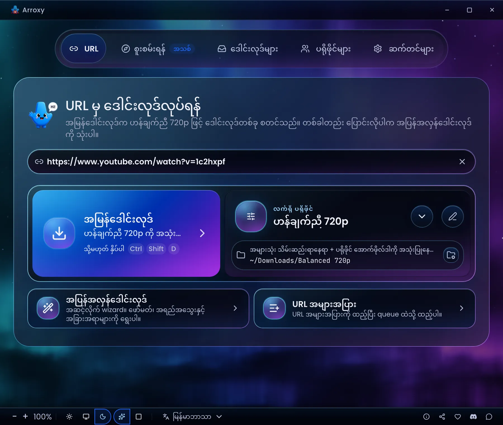</td>
    <td width="50%" valign="top" align="center">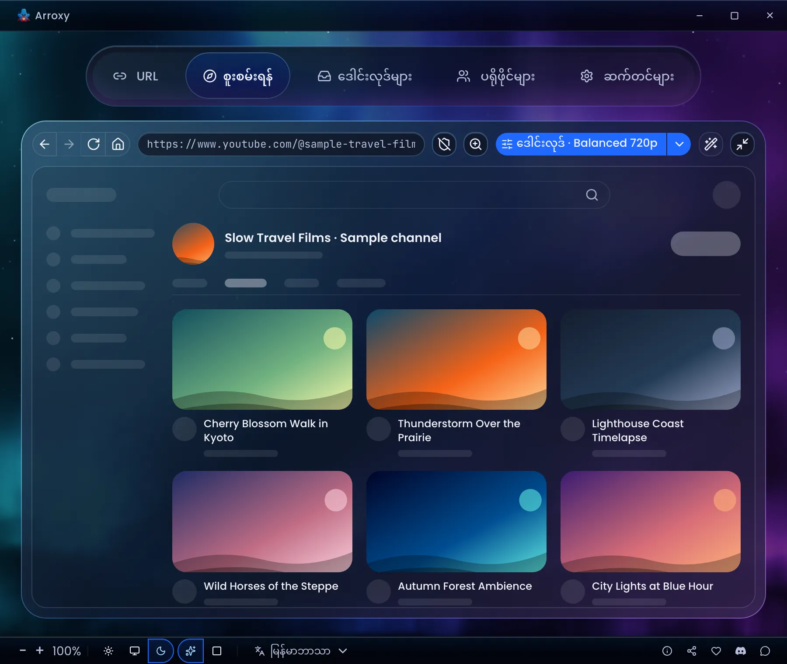</td>
  </tr>
</table>

Arroxy သည် သင့်အချိန်ကို သက်သာစေပါက ⭐ တစ်ချက်က အခြားသူများ ရှာတွေ့ရန် ကူညီပါသည်။

</div>

> **Arroxy ဆိုတာ ဘာလဲ။** Arroxy သည် YouTube နှင့် [yt-dlp](https://github.com/yt-dlp/yt-dlp) ပံ့ပိုးသော အခြားဆိုဒ် ၂၀၀၀+ မှ ဗီဒီယို၊ အသံ၊ playlist နှင့် subtitle များကို ဒေါင်းလုဒ်လုပ်ပေးသော အခမဲ့ open-source desktop GUI ဖြစ်သည်။ Windows 10/11, macOS 13+ (Intel + Apple Silicon) နှင့် Linux (AppImage, Flatpak, tar.gz) တွင် run သည်။ GPLv3 လိုင်စင်။ ကြော်ငြာမပါ၊ အသုံးပြုမှုကန့်သတ်ချက်မပါ။ [Winget](https://winget.run/pkg/AntonioOrionus/Arroxy), [Scoop](https://github.com/antonio-orionus/scoop-bucket), [Homebrew Cask](https://github.com/antonio-orionus/homebrew-arroxy), Flatpak, AppImage နှင့် တိုက်ရိုက်ဒေါင်းလုဒ်မှတစ်ဆင့် ဖြန့်ဝေသည်။
>
> **အဓိကကွာခြားချက်: built-in browser တစ်ခု။** အခမဲ့ YouTube downloader အများစုသည် URL box နှင့် format menu သာပါသော၊ ကိုယ်ပိုင် browser မရှိသည့် yt-dlp wrapper ပါးပါးများသာ ဖြစ်သည်။ Arroxy တွင် **Explore tab** ရှိသည်။ app အတွင်းမှာပင် YouTube သို့မဟုတ် အခြားဝဘ်ဆိုက်ကို ကြည့်ရှုပြီး သင်ကြည့်နေသော ဗီဒီယို၊ playlist သို့မဟုတ် channel ကို ဒေါင်းလုဒ်လုပ်နိုင်သည်၊ သို့မဟုတ် မည်သည့် လင့်ခ်ကိုမဆို right-click နှိပ်နိုင်သည်။ Explore တွင် တစ်ကြိမ် sign in ဝင်လိုက်လျှင် အကောင့်လိုသော ဒေါင်းလုဒ်များက ထို sign-in ကို အသုံးပြုသည်- သင်၏ private ဗီဒီယိုများ၊ Watch Later နှင့် Liked စာရင်းများ၊ သင့်အကောင့်ဖြင့် ကြည့်နိုင်ပြီးသား အခြားဗီဒီယိုများကို cookie export မလုပ်ဘဲ ဒေါင်းလုဒ်လုပ်ပေးသည်။ အခြားဆိုဒ်များကိုလည်း ထိုနေရာတွင် sign in ဝင်နိုင်ပြီး လိုအပ်သည့်အခါ ၎င်းတို့၏ ဒေါင်းလုဒ်များက ထို sign-in ကို အသုံးပြုသည်။ အသေးစိတ်: [Arroxy ဘာကြောင့်](#why-explore)။
>
> _နောက်ဆုံးအပ်ဒိတ်: 2026-10-23။_

---

## မာတိကာ

- [✨ လုပ်ဆောင်ချက်များ](#features)
- [📥 ထည့်သွင်းခြင်းနှင့် ပထမဆုံးဖွင့်ခြင်း](#install)
  - [Windows ပထမဆုံး launch](#windows-first-launch)
  - [macOS ပထမဆုံး launch](#macos-first-launch)
  - [သတိပေးချက် ဘာကြောင့်မြင်ရနိုင်သနည်း](#why-warning)
  - [Linux ပထမဆုံး launch](#linux-first-launch)
  - [သင့်ဒေါင်းလုဒ်ကို အတည်ပြုပါ (SHA256)](#verify)
- [⚖️ Arroxy ဘာကြောင့်](#why)
- [🔒 ကိုယ်ရေးကိုယ်တာ](#privacy)
- [❓ မေးလေ့ရှိသောမေးခွန်းများ](#faq)
- [🗺️ လမ်းပြမြေပုံ](#roadmap)
- [💖 Arroxy ကို ပံ့ပိုးရန်](#support)
- [🛠️ တည်ဆောက်ထားသောနည်းပညာ](#tech)
- [📜 အသုံးပြုမှုသဘောတူညီချက်](#terms)

---

## <a id="features"></a>✨ လုပ်ဆောင်ချက်များ

<table align="center" width="100%">
  <tr>
    <td colspan="2" valign="top" align="center"><br/> <sub><b>Explore</b><br/>Arroxy အတွင်းမှာပင် YouTube သို့မဟုတ် အခြားဝဘ်ဆိုက်ကို ကြည့်ရှုပြီး ကြည့်နေသော စာမျက်နှာကို လက်ရှိပရိုဖိုင်ဖြင့် ဒေါင်းလုဒ်လုပ်ပါ</sub></td>
  </tr>
  <tr>
    <td width="50%" valign="top" align="center">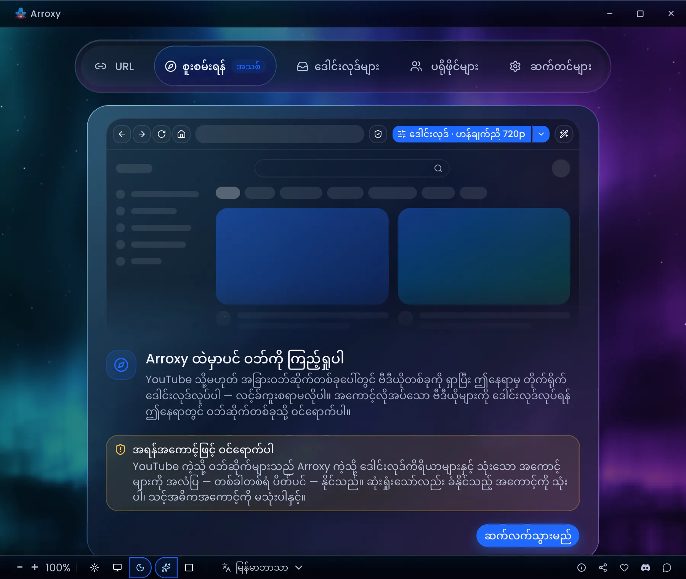<br/> <sub><b>Explore ၏ ပထမဆုံးမျက်နှာပြင်</b><br/>Explore ကို အကျဉ်းချုပ်ကြည့်ခြင်းနှင့် အရန်အကောင့်က sign in ဝင်ရန် ပိုလုံခြုံသည့် အကြောင်းရင်း</sub></td>
    <td width="50%" valign="top" align="center">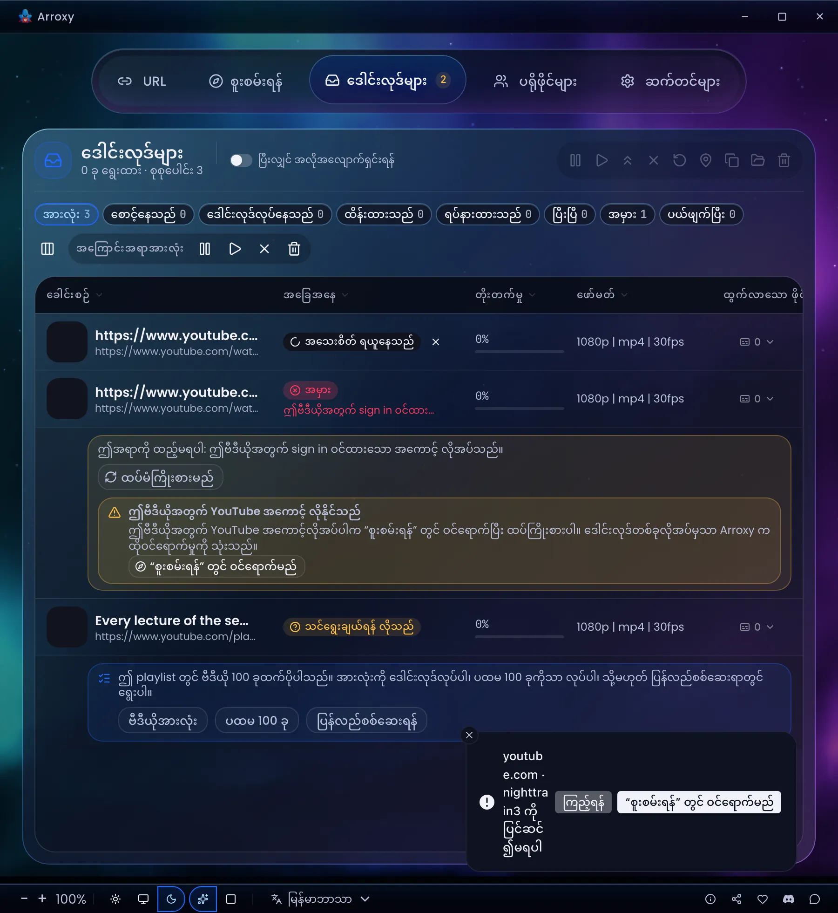<br/> <sub><b>ဒေါင်းလုဒ်များက သင့်အကူအညီလိုသည်ကို ပြောပြသည်</b><br/>လင့်ခ်များကို နောက်ခံတွင် ပြင်ဆင်သည်၊ မအောင်မြင်သည့်လင့်ခ်က ဖြေရှင်းနည်းပေးပြီး ရှည်သော playlist က သင့်ရွေးချယ်မှုကို စောင့်သည်</sub></td>
  </tr>
  <tr>
    <td colspan="2" valign="top" align="center">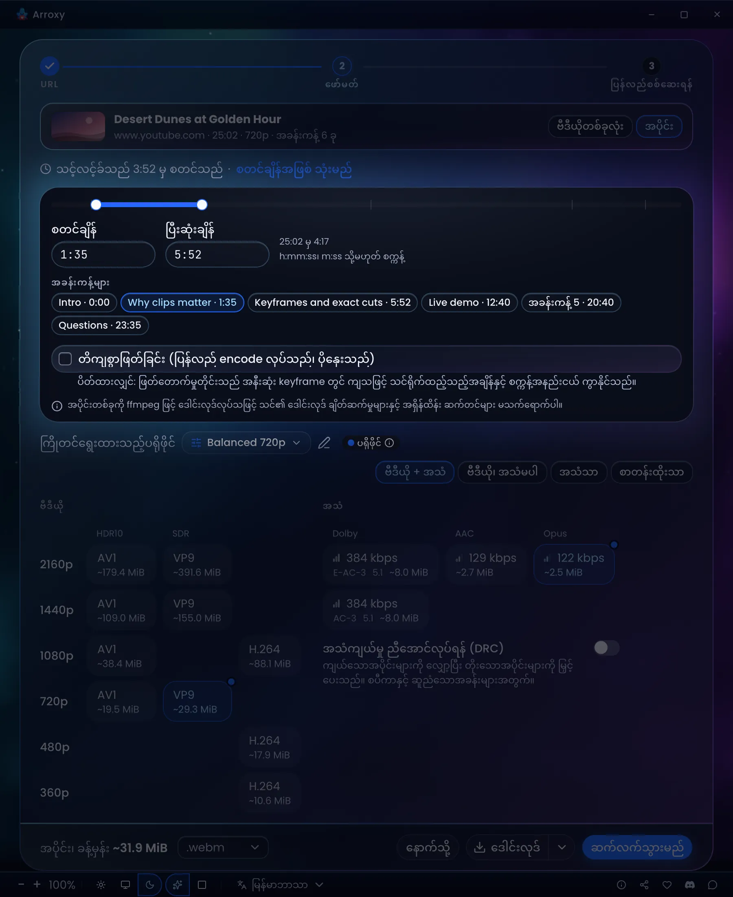<br/> <sub><b>ဗီဒီယိုရဲ့ တစ်စိတ်တစ်ပိုင်းကိုသာ ဒေါင်းလုဒ်လုပ်ပါ</b><br/>အစနဲ့ အဆုံး ဒါမှမဟုတ် အခန်းတစ်ခုကို ရွေးပါ — Arroxy က ထိုအပိုင်းကိုသာ သိမ်းပေးပါတယ်</sub></td>
  </tr>
  <tr>
    <td colspan="2" valign="top" align="center">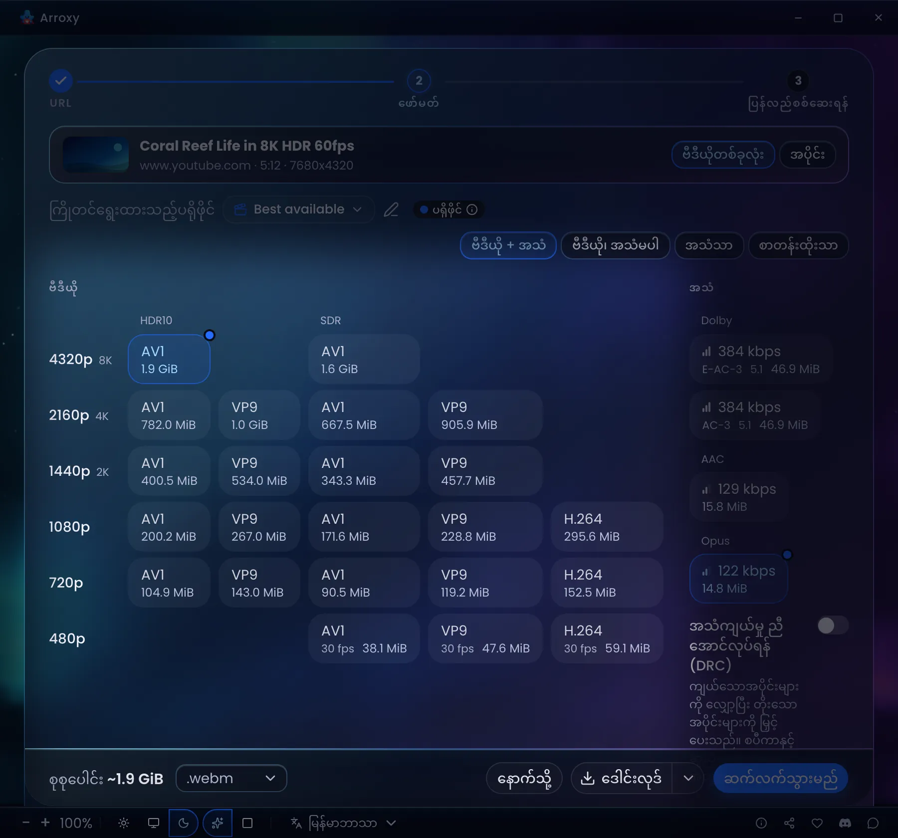<br/> <sub><b>60 fps ဖြင့် 8K HDR</b><br/>ဗီဒီယိုတစ်ခုပေးသော resolution၊ codec နှင့် HDR stream အားလုံးကို ဘေးချင်းယှဉ်၍</sub></td>
  </tr>
  <tr>
    <td colspan="2" valign="top" align="center">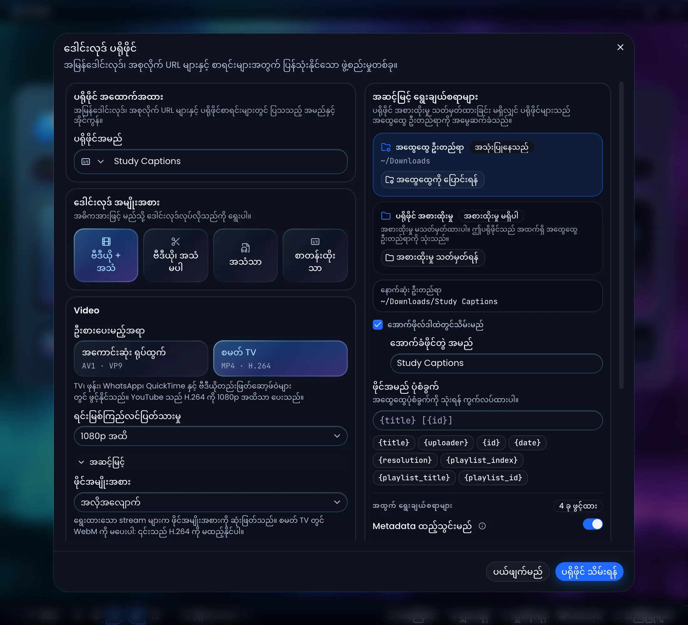<br/> <sub><b>ပရိုဖိုင် တည်းဖြတ်ကိရိယာ</b><br/>ပရိုဖိုင်ကို ညှိပါ- ဖိုင်အမျိုးအစား၊ ရီဇိုလူးရှင်း၊ စာတန်းထိုး၊ သိမ်းဆည်းမည့်နေရာ၊ ဖိုင်အမည်ပုံစံနှင့် အခြားများ</sub></td>
  </tr>
  <tr>
    <td colspan="2" valign="top" align="center">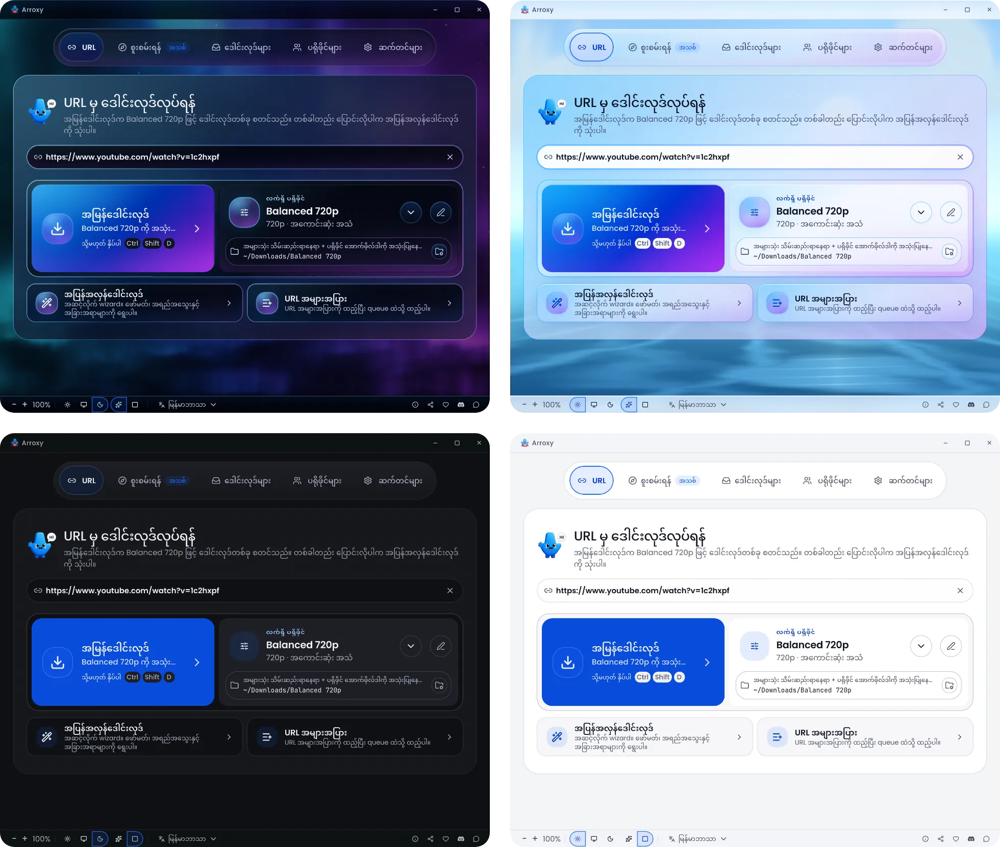<br/><sub><b>မှောင် သို့မဟုတ် လင်း၊ မှန် သို့မဟုတ် ရိုးရိုး</b><br/>ရွေးချယ်စရာ ပုံစံလေးမျိုး- ရွေ့လျားနေသော ကောင်းကင်ပေါ်ရှိ မှန်အကန့်များ သို့မဟုတ် တည်ငြိမ်သော ရိုးရိုးမျက်နှာပြင်များ၊ တစ်ခုချင်းစီ မှောင်နှင့် လင်းနှစ်မျိုးလုံးဖြင့်</sub></td>
  </tr>
  <tr>
    <td colspan="2" valign="top" align="center"><picture><source media="(prefers-color-scheme: dark)" srcset="../../build/Global-hotkey-dark.png" /></picture><br/><sub><b>စနစ်တစ်ခုလုံးအတွက် ဒေါင်းလုဒ် ဖြတ်လမ်းခလုတ်</b><br/>ဘယ်နေရာမှာမဆို လင့်ခ်ကူးပြီး တစ်ချက်နှိပ်လိုက်ရုံ — စာရင်းထဲရောက်ပြီး ဒေါင်းလုဒ်စတင်</sub></td>
  </tr>
  <tr>
    <td colspan="2" valign="top" align="center">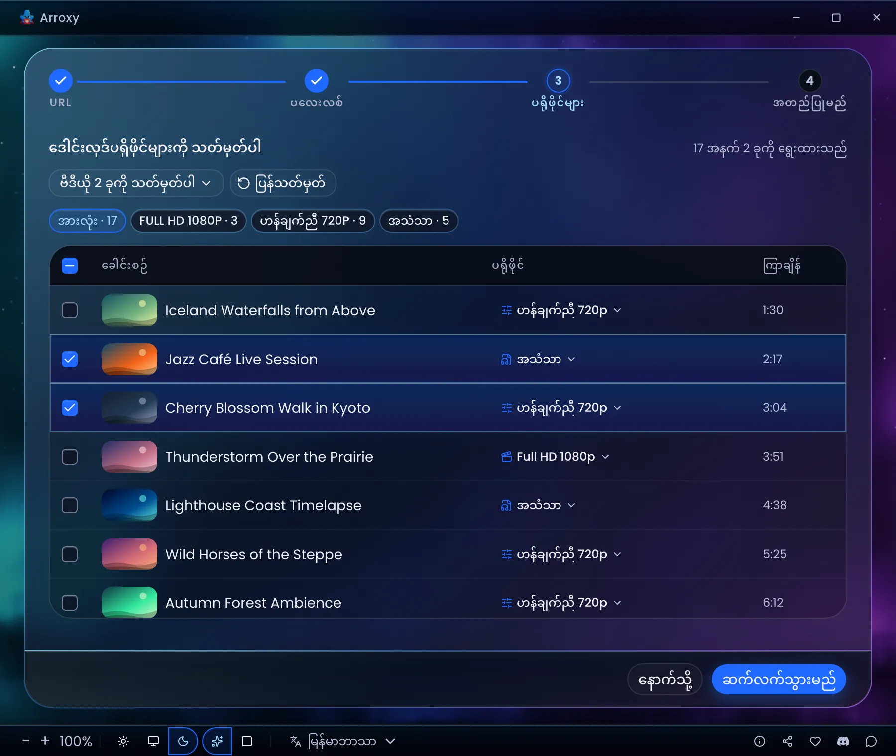<br/><sub><b>Playlist ရှိ item တစ်ခုချင်းအတွက် ပရိုဖိုင်</b><br/>ဗီဒီယိုတစ်ခုစီကို ကိုယ်ပိုင်ပရိုဖိုင် သတ်မှတ်ပါ — အချို့ကို 4K ဖြင့် သိမ်းပြီး ကျန်တာကို အသံသာ အဖြစ် သိမ်းပါ</sub></td>
  </tr>
  <tr>
    <td width="50%" valign="top" align="center"><br/><sub><b>အမြန်ဒေါင်းလုဒ် ပင်မ</b><br/>URL ကို ကူးထည့်ပြီး သင့်လက်ရှိ ပရိုဖိုင်ဖြင့် ချက်ချင်းဒေါင်းလုဒ်လုပ်ပါ</sub></td>
    <td width="50%" valign="top" align="center">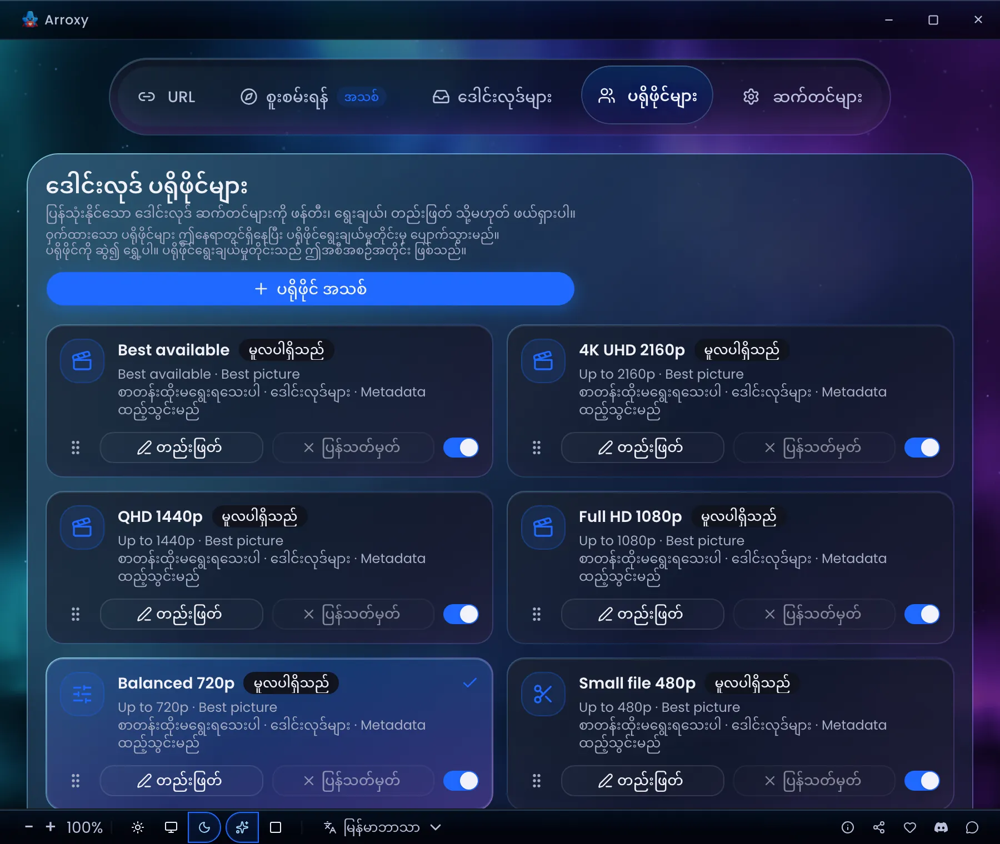<br/><sub><b>ပြန်သုံးနိုင်သော ဒေါင်းလုဒ်ပရိုဖိုင်များ</b><br/>ဖော်မတ်၊ အရည်အသွေးနှင့် အထွက်ကို ကြိုတင်သတ်မှတ်ချက်အဖြစ် သိမ်းပါ — ဒေါင်းလုဒ်တိုင်းတွင် ပြန်သုံးပါ</sub></td>
  </tr>
  <tr>
    <td width="50%" valign="top" align="center">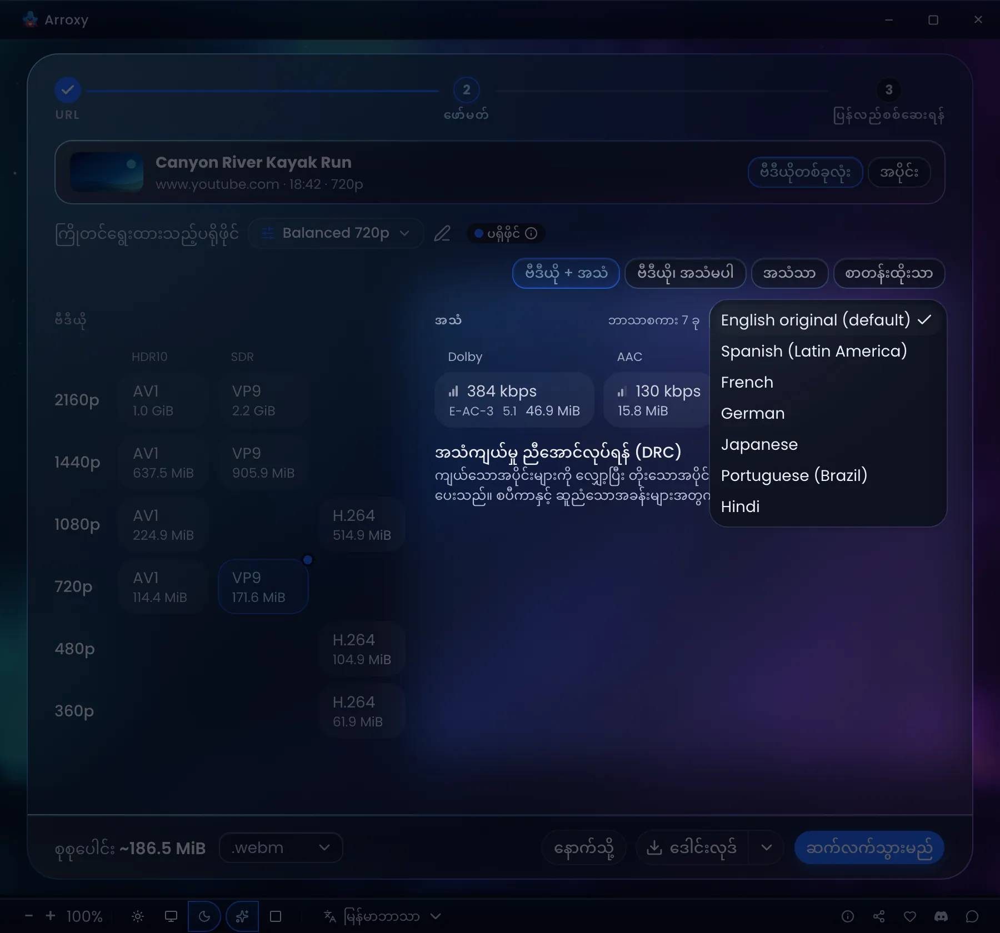<br/><sub><b>ဘာသာစကားစုံ အသံလမ်းကြောင်းများ</b><br/>ဗီဒီယိုပါ တိကျသော အသံဘာသာစကားကို ရွေးပါ</sub></td>
    <td width="50%" valign="top" align="center">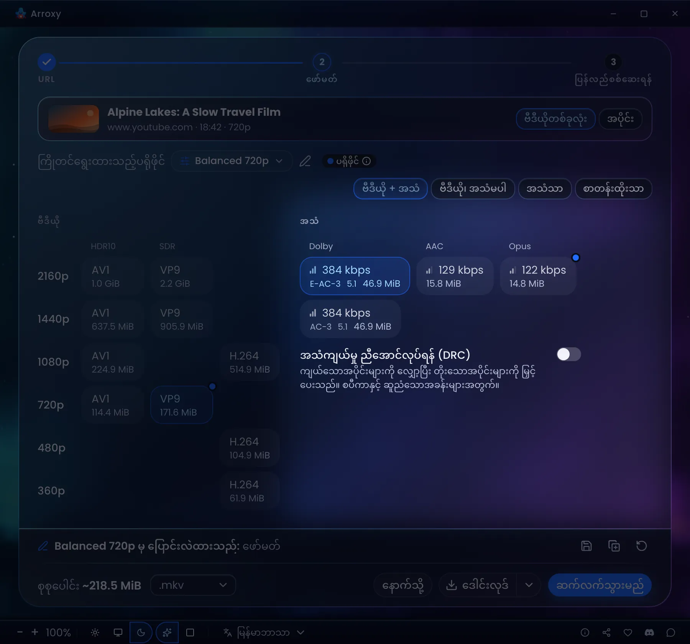<br/><sub><b>Surround / Dolby အသံ</b><br/>5.1 နှင့် Dolby လမ်းကြောင်းများကို ရှာဖွေ ထိန်းသိမ်းပေးသည်</sub></td>
  </tr>
  <tr>
    <td width="50%" valign="top" align="center">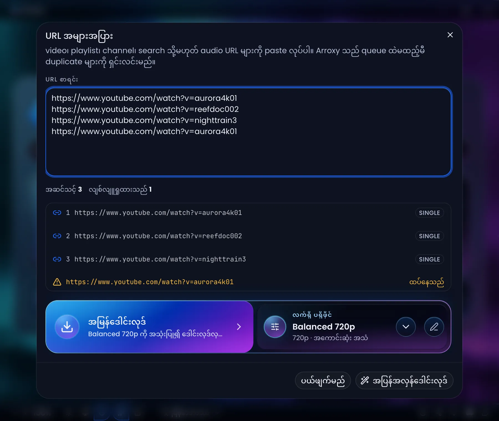<br/><sub><b>အစုလိုက် URL မုဒ်</b><br/>စာရင်းကူးထည့်ပါ၊ ပွားနေသည်များကို အလိုအလျောက်ဖယ်ရှားပါ၊ အားလုံးကို တစ်ပြိုင်နက်တန်းစီပါ</sub></td>
    <td width="50%" valign="top" align="center">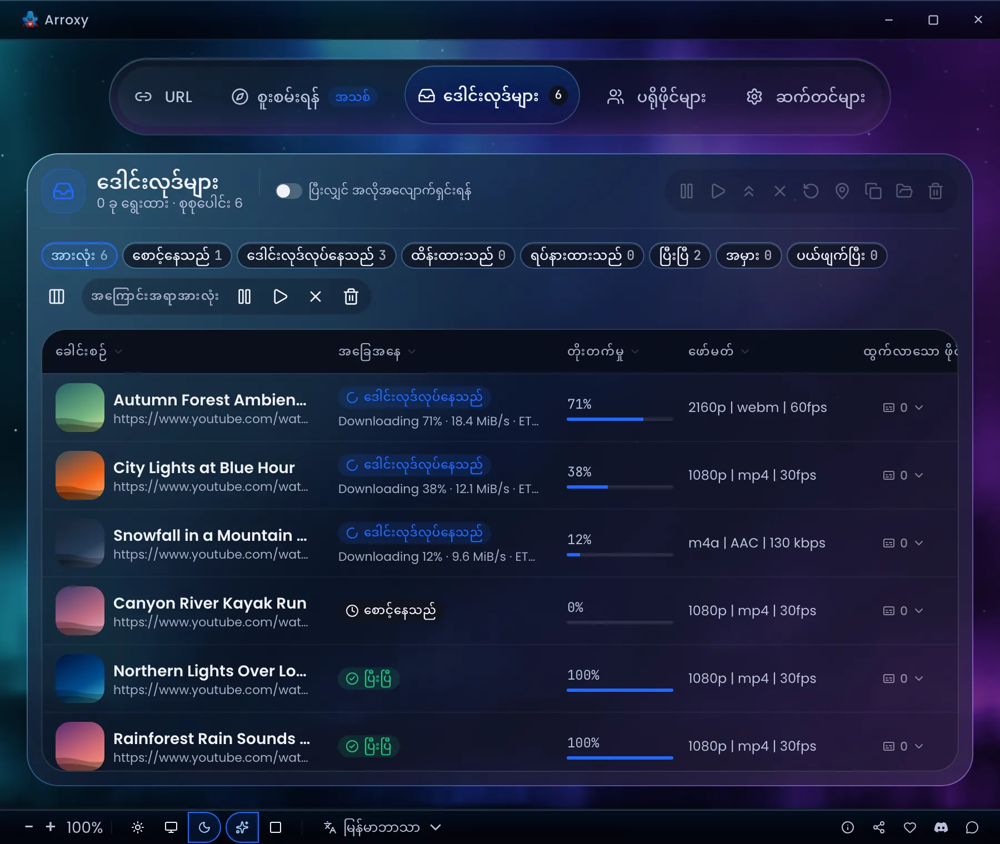<br/><sub><b>ပြိုင်တူ ဒေါင်းလုဒ်တန်းစီ</b><br/>တိုက်ရိုက်တိုးတက်မှုဖြင့် တစ်ပြိုင်နက် ဒေါင်းလုဒ်များစွာ</sub></td>
  </tr>
</table>

<details open>
<summary><strong>🧭 Explore: Arroxy အတွင်းမှာပင် ဝဘ်ကို ကြည့်ရှုပါ</strong></summary>

- **Explore tab** — Arroxy အတွင်းမှာပင် YouTube သို့မဟုတ် အခြားဝဘ်ဆိုက်ကို ကြည့်ရှုပြီး လင့်ခ်မကူးဘဲ တွေ့သည့်အရာကို ဒေါင်းလုဒ်လုပ်ပါ။ **ဒေါင်းလုဒ် · *သင့်ပရိုဖိုင်*** သည် သင်ကြည့်နေသော ဗီဒီယို၊ playlist သို့မဟုတ် channel ကို စာရင်းထဲထည့်ပေးသည်၊ ဘေးရှိ မြှားက ပရိုဖိုင်ပြောင်းပေးပြီး မှော်လှံတံက format၊ subtitle စသည်တို့ကို ရွေးရန် အဆင့်ဆင့် ဒေါင်းလုဒ်ကို ဖွင့်ပေးသည်
- **Right-click ဖြင့် ဒေါင်းလုဒ်** — Explore ရှိ မည်သည့် ဗီဒီယို၊ playlist သို့မဟုတ် channel လင့်ခ်ကိုမဆို right-click နှိပ်ပြီး သင့်ပရိုဖိုင်ဖြင့် ဒေါင်းလုဒ်လုပ်ပါ၊ **ပရိုဖိုင်ဖြင့် ဒေါင်းလုဒ်** မှ အခြားပရိုဖိုင်ကို ရွေးပါ၊ အဆင့်ဆင့် ဒေါင်းလုဒ်ကို ဖွင့်ပါ သို့မဟုတ် လင့်ခ်ကို ကူးယူပါ။ ဗီဒီယိုတစ်ခုချင်းစီကို အရင်ဖွင့်ရန် မလိုပါ
- **ကျစ်လစ်သော အပြင်အဆင်** — Explore ၏ toolbar ရှိ တစ်ချက်နှိပ်ရုံဖြင့် Arroxy ၏ tab များကို ၎င်းထဲသို့ ရွှေ့ပေးပြီး စာမျက်နှာကို နေရာပိုပေးသည်
- **လိပ်စာဘား** — YouTube တွင် ရှာဖွေရန် ရိုက်ထည့်ပါ သို့မဟုတ် မည်သည့်ဝဘ်လိပ်စာကိုမဆို ရိုက်ထည့်ပြီး ထိုဆိုက်ကို ဖွင့်ပါ
- **အကောင့်လိုသော ဒေါင်းလုဒ်များ** — Explore တွင် တစ်ကြိမ် sign in လုပ်ထားလျှင် Arroxy သည် သင့်အကောင့်ဖြင့် ကြည့်နိုင်သော ဗီဒီယိုများကို ဒေါင်းလုဒ်လုပ်နိုင်သည်- သင်၏ private ဗီဒီယိုများ၊ အသက်အတည်ပြုထားသော အကောင့်ဖြစ်လျှင် အသက်ကန့်သတ်ဗီဒီယိုများ၊ သင်၏ Watch Later နှင့် Liked စာရင်းများ။ အခြားဝဘ်ဆိုက်များတွင်လည်း ထိုနေရာ၌ sign in လုပ်နိုင်ပြီး ၎င်းတို့၏ ဒေါင်းလုဒ်များသည် လိုအပ်သည့်အခါ ထို sign-in ကို အသုံးပြုသည်။ Arroxy သည် ဦးစွာ sign out အခြေအနေတွင် ဒေါင်းလုဒ်လုပ်ပြီး အကောင့်ဖြင့် ဖြေရှင်းနိုင်သော အကြောင်းရင်းကြောင့် ဒေါင်းလုဒ်မအောင်မြင်မှသာ သင်၏ Explore sign-in ကို အသုံးပြုသည်
- **အရန်အကောင့် သုံးပါ** — Explore ၏ ပထမဆုံးမျက်နှာပြင်က အကြောင်းရင်းကို ရှင်းပြထားသည် - အကောင့်ဖြင့် ဒေါင်းလုဒ်လုပ်ခြင်းသည် ထိုအကောင့် ကန့်သတ်ခံရနိုင်သည့် အန္တရာယ် အနည်းငယ်ရှိသည်။ sign-in အားလုံးကို မေ့စေလိုသည့်အခါ ဆက်တင်များမှ Explore ကို အချိန်မရွေး sign out လုပ်ပါ
- **ကြော်ငြာပိတ်ဆို့ကိရိယာ** — မူရင်းအတိုင်း ပိတ်ထားသည်။ Explore toolbar ရှိ ဒိုင်းလွှားကို တစ်ချက်နှိပ်ရုံဖြင့် Explore စာမျက်နှာများတွင် ကြော်ငြာနှင့် tracker များကို ပိတ်ဆို့ပေးပြီး ဒေါင်းလုဒ်များကို မထိခိုက်ပါ။ sign in ဝင်ထားသော အကောင့်များအတွက် YouTube က ကြော်ငြာပိတ်ဆို့ကိရိယာကို ပြန်လည်တားဆီးနိုင်သည်

</details>

<details>
<summary><strong>🎞️ အရည်အသွေးနှင့် format များ</strong></summary>

- **8K (4320p)** အထိ၊ 4K UHD (2160p), 1440p, 1080p, 720p, 480p, 360p
- **High frame rate နှင့် HDR** ကို မူရင်းအတိုင်း ထိန်းသိမ်း — 60 fps, HDR10
- **အသံ** — အသံသာကို MP3၊ M4A/AAC၊ Opus သို့မဟုတ် WAV အဖြစ် export လုပ်ပါ။ interactive downloads တွင် ရနိုင်ပါက source ၏ native surround/Dolby tracks (AC-3၊ E-AC-3၊ 5.1၊ DRC) ကို ရွေးချယ်ပါ၊ သို့မဟုတ် global default **surround / Dolby ကို ဦးစားပေးပါ** ကို သတ်မှတ်ပါ
- **ရည်မှန်းချက်ပါသော ပရိုဖိုင်များ** — *အကောင်းဆုံး ရုပ်ထွက်* (AV1 · VP9) သို့မဟုတ် *စမတ် TV* (MP4 · H.264)၊ ပြန်လည် encode မလုပ်ဘဲ အလိုအလျောက်၊ MP4၊ MKV သို့မဟုတ် WebM အဖြစ် သိမ်းဆည်းသည်။ HDR သည် *အလိုအလျောက်* (သင့်စခရင်ပြသနိုင်မှသာ)၊ *SDR* သို့မဟုတ် *HDR* ဖြစ်သည်
- **ကြည်လင်ပြတ်သားမှုတိုင်းတွင် codec တိုင်း** — အဆင့်ဆင့် ဒေါင်းလုဒ်သည် ကြည်လင်ပြတ်သားမှု တစ်ခုစီတွင် AV1, VP9 နှင့် H.264 ကို ဘေးချင်းယှဉ် ပြသပေးသဖြင့် သင့် TV သို့မဟုတ် editor ဖွင့်နိုင်သည့်တစ်ခုကို ရွေးနိုင်သည်
- **Stream တစ်ခု အမှန်တကယ် ဘာလဲဆိုတာ သိပါ** — YouTube က AI ဖြင့် ချဲ့ထားသော အရွယ်အစားများ၊ AI အသံသွင်းထားသော အသံဘာသာစကားများ၊ မြှင့်ထားသော bitrate ပါသည့် streams များ၊ 360° ဗီဒီယိုများနှင့် ပျက်စီးနေသော သို့မဟုတ် watermark ပါသော မိတ္တူများကို အမှတ်အသားပြထားသည်။ သင်ခွင့်မပြုလျှင် ပရိုဖိုင်များသည် AI ချဲ့ထားသော streams များကို ကျော်သွားသည်

</details>

<details>
<summary><strong>🛡️ ကိုယ်ရေးကိုယ်တာနှင့် ထိန်းချုပ်မှု</strong></summary>

- 100% local processing — ဒေါင်းလုဒ်များသည် YouTube မှ တိုက်ရိုက် သင့် disk သို့ သွားသည်
- Login မပါ၊ cookie မပါ၊ Google account ချိတ်ဆက်မှုမပါ
- သင်ရွေးချယ်သောဖိုဒါတွင် ဖိုင်များကို တိုက်ရိုက်သိမ်းဆည်းသည်

</details>

<details>
<summary><strong>⚡ Workflow</strong></summary>

- **စနစ်တစ်ခုလုံးအတွက် ဒေါင်းလုဒ် ဖြတ်လမ်းခလုတ်** — မည်သည့်အက်ပ်တွင်မဆို လင့်ခ်ကို ကူးယူပြီး `Ctrl+Shift+D` (macOS တွင် `Cmd+Shift+D`) ကိုနှိပ်ပါ။ Arroxy သည် ဝင်းဒိုးမဖွင့်ဘဲ သင့်လက်ရှိပရိုဖိုင်ဖြင့် စာရင်းထဲထည့်ပေးပြီး အသိပေးချက်ဖြင့် အတည်ပြုပါသည်။ မူရင်းအတိုင်း ဖွင့်ထားပြီး ပြန်သတ်မှတ်နိုင်သည်
- **ပြောင်းလွယ်ပြင်လွယ် စတင်မုဒ်များ** — လမ်းညွှန်ထားသော single download၊ playlist/channel picker၊ bulk URL paste၊ သိမ်းထားသော defaults ဖြင့် Quick Download၊ သို့မဟုတ် Explore တွင် ကြည့်ရှုပြီး ဒေါင်းလုဒ်လုပ်ခြင်းတို့ကို ရွေးပါ
- **ဗဟို download queue** — single၊ playlist၊ bulk၊ quick job အားလုံးသည် progress၊ pause၊ resume၊ cancel၊ retry နှင့် priority control အတွက် တစ်နေရာတည်းသို့ ရောက်သည်
- **Clipboard watch** — ဗီဒီယိုလင့်ခ်ကို copy လုပ်ပါက Arroxy သို့ ပြန်လာသောအခါ URL အကွက်ကို ဖြည့်ပေးပြီး မရည်ရွယ်ခဲ့လျှင် **ပြန်ဖျက်ရန်** ပါသည်။ Arroxy အလုပ်များနေစဉ် သင် URL tab သို့ ပြန်ရောက်သည်အထိ လင့်ခ်က စောင့်နေသည် (ဆက်တင်များတွင် ပိတ်နိုင်သည်)
- **Auto-clean URLs** — tracking params (`si`, `pp`, `utm_*`, `fbclid`, `gclid`) ကိုဖယ်ရှားပြီး `youtube.com/redirect` links ကိုဖြေရှင်းသည်
- **Tray mode** — window ကိုပိတ်လျှင် downloads များသည် နောက်ကွယ်တွင် ဆက်လည်ပတ်နေသည်
- **50 ဘာသာစကား** — စနစ်ဒေသကို အလိုအလျောက်သိရှိနိုင်ပြီး အချိန်မရွေးပြောင်းနိုင်သည်
- **Playlist sync** — ဒေါင်းလုဒ်လုပ်ပြီးသား ဗီဒီယိုများကို ကျော်ရန် playlist ကို local folder နှင့် ပြန်စစ်ဆေးပြီး၊ ဗီဒီယိုတစ်ခုစီ ဒေါင်းလုဒ်ပြီးတိုင်း အပ်ဒိတ်ဖြစ်သော `.m3u` playlist ဖိုင်ကို ဖန်တီးသည်
- **Speed နှင့် pacing controls** — download bandwidth ကိုကန့်သတ်ပါ၊ ဗီဒီယိုအပိုင်းမည်မျှကို တစ်ပြိုင်နက် download လုပ်မည်ကို သတ်မှတ်ပါ၊ presets (*Off · Balanced · Careful · Custom*) ဖြင့် request delays ထည့်ပါ
- **ဖိုင်အမည် ပုံစံခွက်များ** — `{title}`၊ `{uploader}`၊ `{id}`၊ `{date}`၊ `{year}`၊ `{resolution}`၊ `{site}`၊ `{categories}`၊ `{artist}`၊ `{album}`၊ `{track}` နှင့် `{playlist_index}` တို့ဖြင့် ဒေါင်းလုဒ်များကို သင်နှစ်သက်သလို အမည်ပေးပါ။ အထွေထွေ သို့မဟုတ် ဒေါင်းလုဒ်ပရိုဖိုင်တစ်ခုစီအလိုက် သတ်မှတ်နိုင်သည်
- **တစ်ပြိုင်နက် ဒေါင်းလုဒ်များ နှင့် အလိုအလျောက် ပြန်ကြိုးစားမှု** — တန်းစီထားသော ဒေါင်းလုဒ်မည်မျှကို တစ်ပြိုင်နက် လုပ်မည်ကို ရွေးပါ၊ ကွန်ရက် သို့မဟုတ် ဆာဗာ ပြဿနာ ကြုံရသော ဒေါင်းလုဒ်ကို Arroxy သည် ကြိုးစားမှုတိုင်းမတိုင်မီ ပိုကြာစွာ စောင့်ပြီး ပြန်ကြိုးစားပါမည်
- **Playlist ရှိ item တစ်ခုချင်းအတွက် ပရိုဖိုင်** — list တစ်ခုလုံးအတွက် setting တစ်ခုတည်း အသုံးပြုမည့်အစား၊ playlist ထဲက ဗီဒီယိုတစ်ခုစီကို ၎င်းတို့ ကိုယ်ပိုင် ဒေါင်းလုဒ်ပရိုဖိုင် သတ်မှတ်ပေးနိုင်သဖြင့် တစ်ကြိမ်တည်းတွင် အချို့ကို အရည်အသွေးအပြည့်ဖြင့် သိမ်းဆည်းပြီး ကျန်တာကို အသံသာ အဖြစ် သိမ်းနိုင်သည်
- **Quick Download သည် နောက်ခံတွင် အလုပ်လုပ်သည်** — လင့်ခ်သည် ဒေါင်းလုဒ်များထဲတွင် ချက်ချင်းပေါ်လာပြီး ထိုနေရာတွင်ပင် ပြင်ဆင်ပေးကာ **ကြည့်ရန်** ပါသော မှတ်စုက အတည်ပြုပေးပြီး နောက်လင့်ခ်အတွက် URL အကွက်ကို ရှင်းပေးသည်။ ယခင်ဟာများ ပြင်ဆင်နေစဉ်မှာပင် လိုသလောက် စတင်နိုင်သည်
- **ဒေါင်းလုဒ်များက သင့်အကူအညီလိုသည်ကို ပြောပြသည်** — Arroxy က လင့်ခ်ကို မဖတ်နိုင်ပါက ၎င်း၏အတန်းတွင် အကြောင်းရင်းကိုပြပြီး ဖြေရှင်းနည်းကို အကြံပြုသည် - ထပ်မံကြိုးစားမည်၊ cookie ဖွင့်ပါ သို့မဟုတ် Explore တွင် sign in ဝင်ပါ။ cookie ပိတ်ထားလျှင် သင် sign in ဝင်ပြီးနောက် **Explore ဖြင့် Sign in** က သင့်အတွက် ပြန်စမ်းပေးသည်။ load ကန့်သတ်ချက်ထက် ရှည်သော playlist သည် ၎င်း၏အတန်းပေါ်တွင် စောင့်နေပြီး အားလုံး၊ ပထမအနည်းငယ် သို့မဟုတ် ပြန်လည်စစ်ဆေးခြင်းကို သင်ရွေးရန် စောင့်သည်။ ဒေါင်းလုဒ်များ tab တွင် သင့်ကိုစောင့်နေသော အတန်းအရေအတွက်ကို ပြသည်
- **ဗီဒီယိုတစ်ခု၏ အပိုင်းတစ်ခုကိုသာ ဒေါင်းလုဒ်လုပ်ပါ** — Format စခရင်တွင် စတင်ချိန်နှင့် ပြီးဆုံးချိန်၊ သို့မဟုတ် အခန်းကန့်တစ်ခုကို ရွေးပါက Arroxy သည် ထိုအပိုင်းကိုသာ သိမ်းပြီး ဗီဒီယို id နောက်တွင် အပိုင်းကို ထည့်၍ အမည်ပေးသည်။ ဖြတ်တောက်မှုများသည် အနီးဆုံး keyframe တွင် ကျသည်၊ တိကျစွာဖြတ်ခြင်းကို ဖွင့်ပါက ပြန်လည် encode လုပ်မည်
- **ပြီးဆုံးသော ဒေါင်းလုဒ်များကို အလိုအလျောက် ဖယ်ရှားရန်** — ရွေးချယ်နိုင်သည်- ပြီးဆုံးသော ဒေါင်းလုဒ်သည် 5 စက္ကန့်အကြာတွင် စာရင်းမှ ထွက်သွားသည်။ ၎င်း၏ ဖိုင်များ disk ပေါ်တွင် ကျန်ရှိပြီး မအောင်မြင်သော ဒေါင်းလုဒ်များ စာရင်းထဲတွင် ဆက်ရှိနေသည်
- **ဒေါင်းလုဒ်များရှိ အရွယ်အစားနှင့် မရှိပါ** — စီနိုင်သော **အရွယ်အစား** ကော်လံက ဒေါင်းလုဒ်တစ်ခုစီ နေရာမည်မျှယူသည်ကို ပြပြီး **မရှိပါ** က Arroxy အပြင်ဘက်တွင် ရွှေ့ထား သို့မဟုတ် ဖျက်ထားသော ဖိုင်များကို အမှတ်အသားပြုသည်
- **အောရိုရာ သို့မဟုတ် ရိုးရှင်း၊ အမှောင် သို့မဟုတ် အလင်း** — ရွေ့လျားနေသော ကောင်းကင်ပေါ်ရှိ ဖန်သားပြားများ သို့မဟုတ် တိတ်ဆိတ်သော အစိုင်အခဲမျက်နှာပြင်များ၊ footer မှ ပြောင်းနိုင်သည်။ ဂရပ်ဖစ်အရှိန်မြှင့်မှု မရှိသော ကွန်ပျူတာများသည် ရိုးရှင်း ကို အလိုအလျောက် ရရှိသည်
- **Mac menu bar** — macOS တွင် menu bar မှ ဆက်တင်များ (`Cmd+,`) ကိုဖွင့်ပါ၊ ဒေါင်းလုဒ်အမြန်နှုန်းကန့်သတ်ချက်ကို သတ်မှတ်ပါ၊ စတိုင်နှင့် အသွင်အပြင်ကို ပြောင်းပါ၊ မှတ်တမ်းများကိုဖွင့်ပါ သို့မဟုတ် စစ်ဆေးချက်ဖိုင်ကို သိမ်းပါ
- **မည်သည့်ဒေါင်းလုဒ်မှမဆို ပရိုဖိုင်ကို ပြောင်းပါ** — ဒေါင်းလုဒ်တစ်ခုကို ချိန်ညှိပြီးနောက် ၎င်းစတင်ခဲ့သော ပရိုဖိုင်ကို update လုပ်ပါ (ဘာပြောင်းမည်ကို ကြိုကြည့်နိုင်သည်) သို့မဟုတ် ဆက်တင်များကို ပရိုဖိုင်အသစ်အဖြစ် သိမ်းပါ။ ပရိုဖိုင်ပြောင်းသောအခါ သင့်ပြင်ဆင်မှုများကို ထားမလား မေးသည်

</details>

<details>
<summary><strong>📝 Subtitles နှင့် post-processing</strong></summary>

- SRT, VTT သို့မဟုတ် ASS တွင် **Subtitles** — ကိုယ်တိုင်ရိုက်ထည့်ထားသော သို့မဟုတ် auto-generated၊ မည်သည့် language မဆို
- ဗီဒီယိုဘေးတွင်သိမ်းပါ၊ `.mkv` ထဲ embed လုပ်ပါ၊ သို့မဟုတ် `Subtitles/` subfolder တွင် စီစဉ်ပါ
- **စာတန်းထိုးသီးသန့် အစုလိုက်** — URL စာရင်းကို ကူးထည့်ပါ သို့မဟုတ် ပလေးလစ်ကို ဖွင့်ပါ၊ စာတန်းထိုးကို ရွေးပါ၊ ဗီဒီယိုတစ်ခုချင်းစီအတွက် စာတန်းထိုးဖိုင်များကိုသာ ရယူပါ
- **SponsorBlock** — sponsors, intros, outros, self-promos ကို ကျော်ပြီး chapter-mark လုပ်ပါ
- **Embedded metadata** — ခေါင်းစဉ်၊ upload date, channel, description, thumbnail နှင့် chapter markers တို့ကို ဖိုင်ထဲသို့ ရေးသွင်းသည်

</details>

<details>
<summary><strong>🌐 YouTube + ၂၀၀၀ ဆိုဒ်</strong></summary>

- **YouTube၊ အပြည့်အဝ** — Videos, Shorts, Channels, Playlists, YouTube Music နှင့် Podcasts တို့ကို ပထမတန်းစား ရင်းမြစ်များအဖြစ် ကိုင်တွယ်သည်
- **၂၀၀၀+ အခြားဆိုဒ်များ** yt-dlp မှတဆင့် — Twitch, TikTok, Dailymotion, VK, SoundCloud, Bandcamp, archive.org, Streamable နှင့် အခြားအများကြီး
- **အသံသာနှင့် subtitle များ** ထောက်ပံ့သောဆိုဒ်တိုင်းတွင် အလုပ်လုပ်သည်၊ YouTube တွင်သာမဟုတ်
- ဆိုဒ်တစ်ခု ပြောင်းလဲပါက yt-dlp သည် အပတ်တိုင်း fix များ ထုတ်ပြီး Arroxy သည် launch တွင် binary ကို auto-update လုပ်သည်

</details>

---

## <a id="install"></a>📥 ထည့်သွင်းခြင်းနှင့် ပထမဆုံးဖွင့်ခြင်း

**Windows**

```bash
winget install AntonioOrionus.Arroxy
```

**macOS**

```bash
brew install --cask antonio-orionus/arroxy/arroxy
```

**Linux**

AppImage:

```bash
curl -fsSL https://raw.githubusercontent.com/antonio-orionus/Arroxy/main/scripts/install.sh | sh -s -- --appimage
```

Flatpak:

```bash
curl -fsSL https://raw.githubusercontent.com/antonio-orionus/Arroxy/main/scripts/install.sh | sh -s -- --flatpak
```

Build များမှာ x86_64 အတွက်သာ ဖြစ်သည်။ `curl` မရှိဘူးလား။ `curl -fsSL` အစား `wget -qO-` သုံးပါ။

| Platform | Format |
| --- | --- |
| Windows | [](https://github.com/antonio-orionus/Arroxy/releases/latest/download/Arroxy-win-x64-Setup.exe) [](https://github.com/antonio-orionus/Arroxy/releases/latest/download/Arroxy-win-x64-Portable.exe) |
| macOS | [](https://github.com/antonio-orionus/Arroxy/releases/latest/download/Arroxy-mac-arm64.dmg) [](https://github.com/antonio-orionus/Arroxy/releases/latest/download/Arroxy-mac-x64.dmg) |
| Linux | [](https://github.com/antonio-orionus/Arroxy/releases/latest/download/Arroxy-linux-x64.AppImage) [](https://github.com/antonio-orionus/Arroxy/releases/latest/download/Arroxy-linux-x64.flatpak) [](https://github.com/antonio-orionus/Arroxy/releases/latest/download/Arroxy-linux-x64.tar.gz) |
| Verify | [](https://github.com/antonio-orionus/Arroxy/releases/latest/download/SHA256SUMS) |

[**နောက်ဆုံး release ကို ယူပါ →**](https://github.com/antonio-orionus/Arroxy/releases/latest)

<details>
<summary><strong><a id="windows-first-launch"></a>🪟 Windows ပထမဆုံး launch</strong></summary>

ပထမဆုံး ဖွင့်သောအခါ **"Windows protected your PC"** သို့မဟုတ် **"Unknown publisher."** ဟု မြင်ရနိုင်သည်။ ၎င်းသည် `Arroxy-win-x64-Setup.exe` နှင့် `Arroxy-win-x64-Portable.exe` နှစ်မျိုးစလုံးအတွက် သက်ဆိုင်သည်။ Arroxy သည် အခမဲ့ open-source ဖြစ်ပြီး Windows builds များကို ငွေပေးချေ certificate ဖြင့် code-sign မလုပ်ထားသောကြောင့် SmartScreen က flag လုပ်သည်။ ၎င်းသည် Arroxy မဘေးကင်းကြောင်း **အလိုအလျောက်** မဆိုလိုပါ။ ဆက်လုပ်ရန်:

<div align="center">
  
  
</div>

1. **More info** ကို နှိပ်ပါ။
2. **Run anyway** ကို နှိပ်ပါ။

#### Windows Defender သည် ဖိုင်ကို flag လုပ်ခြင်း သို့မဟုတ် ဖယ်ရှားပါက

Defender heuristics သည် တစ်ခါတစ်ရံ unsigned NSIS installers နှင့် Electron portables ကို သံသယဖြစ်ဖွယ်ဟု flag လုပ်တတ်သည်။ Defender က `Arroxy-win-x64-Setup.exe` သို့မဟုတ် `Arroxy-win-x64-Portable.exe` ကို quarantine ထည့်ပါက **Windows Security → Virus & threat protection → Protection history** မှ ပြန်ယူပြီး Arroxy executable ကို **Manage settings → Add or remove exclusions** အောက်တွင် ခွင့်ပြုထားသောအရာအဖြစ် ထည့်သွင်းပါ။ SmartScreen ကဲ့သို့ပင် trigger သည် ပျောက်ဆုံးသော publisher signature ဖြစ်ပြီး malware တွေ့ရှိမှုမဟုတ်ပါ။

> Arroxy ကို တရားဝင် GitHub Releases စာမျက်နှာမှသာ ဒေါင်းလုဒ်ဆွဲပါ။ ဖိုင်ကို အခြား website မှ ရရှိပါက သို့မဟုတ် တစ်ယောက်ယောက်က ပေးပို့ပါက ၎င်းကို ဖျက်ပြီး တရားဝင် source မှ အသစ် download ဆင်းပါ။ source code ကို public တင်ထားသောကြောင့် သင်ကြိုက်ပါက ကိုယ်တိုင် စစ်ဆေးနိုင်သည် သို့မဟုတ် Arroxy ကိုယ်တိုင် build လုပ်နိုင်သည်။

Scoop ကို ပိုနှစ်သက်ပါသလား။ `scoop bucket add arroxy https://github.com/antonio-orionus/scoop-bucket && scoop install arroxy`

</details>

<details>
<summary><strong><a id="macos-first-launch"></a>🍎 macOS ပထမဆုံး launch</strong></summary>

Arroxy သည် macOS အတွက် code-sign မလုပ်ရသေးသောကြောင့် DMG မှ install လုပ်ပြီးနောက် Gatekeeper သည် ကြောက်စရာ *"Arroxy.app is damaged and can't be opened"* dialog ကို ပြသနိုင်သည်။ ထို message သည် macOS က unsigned app ကို quarantine လုပ်ထားသည်ဟု ဆိုလိုပြီး app files တကယ်ပျက်စီးနေသည်ဟု မဆိုလိုပါ။ လက်ရှိ macOS တွင် ယုံကြည်ရသော ဖြေရှင်းနည်းမှာ Terminal ဖြစ်သည်:

<div align="center">
  
</div>

1. တပ်ဆင်ထားသော DMG မှ `Arroxy.app` ကို `/Applications` သို့ ဆွဲထည့်ပါ။
2. Terminal ကိုဖွင့်ပြီး ဤ command နှစ်ခုကို run ပါ:

```bash
xattr -dr com.apple.quarantine /Applications/Arroxy.app
open /Applications/Arroxy.app
```

ပထမ command သည် သင်ထည့်သွင်းထားသော Arroxy copy မှ quarantine attribute ကို ဖယ်ရှားသည်။ ဒုတိယ command သည် app ကို ဖွင့်သည်။ `sudo` သည် သင့် Mac password ကို တောင်းနိုင်သည်။ Terminal သည် password ရိုက်နေချိန်တွင် စာလုံးများကို မပြပါ။

**Apple Silicon နှင့် Intel:** M-series Mac (M1 / M2 / M3 / M4) ပေါ်တွင် `arm64` DMG ကိုဒေါင်းလုဒ်ဆွဲပါ။ Intel Mac ပေါ်တွင် `x64` DMG ကိုဒေါင်းလုဒ်ဆွဲပါ။ မမှန်ကန်သော build ကိုဖွင့်ပါက Rosetta မှတစ်ဆင့် အလုပ်လုပ်သော်လည်း သိသာစွာ နှေးကွေးပါမည်။

> macOS builds များကို Apple Silicon နှင့် Intel runners တို့ပေါ်တွင် CI မှတဆင့် ထုတ်လုပ်သည်။ ပြဿနာများကြုံတွေ့ပါက [issue တင်ပါ](../../../../issues) — macOS သုံးစွဲသူများ၏ feedback သည် macOS testing cycle ကို တက်ကြွစွာ ပုံဖော်ပေသည်။

</details>

<details>
<summary><strong><a id="why-warning"></a>⚠️ သတိပေးချက် ဘာကြောင့်မြင်ရနိုင်သနည်း</strong></summary>

Arroxy သည် open-source ဖြစ်ပြီး GPLv3-licensed ဖြစ်သည်။ Windows နှင့် macOS builds များသည် **code-sign မလုပ်ထားပါ** — Apple Developer ID နှင့် Windows EV code-signing certificates တို့သည် တစ်နှစ်လျှင် ဒေါ်လာ ရာနှင့်ချီ ကုန်ကျပြီး indie project တစ်ခုအတွက် ကိုယ်တိုင်ကျခံရသည်။ ထိုလက်မှတ်များမပါဘဲ Windows SmartScreen နှင့် macOS Gatekeeper တို့သည် ပထမဆုံး launch တွင် သတိပေးလိမ့်မည်။ သတိပေးချက်များ၏ အဓိပ္ပာယ်မှာ *သင့် OS က publisher ကို မသိသောကြောင့်ဖြစ်ပြီး* Arroxy malware ဖြစ်ကြောင်း မဆိုလိုပါ။

Arroxy ကိုယ်တိုင် စစ်ဆေးရန် နည်းလမ်းသုံးမျိုး၊ တဆင့်ပြင်းထန်လာသောစီစဉ်မှုဖြင့်:

- **Source ကိုဖတ်ပါ။** မျဉ်းတိုင်းသည် [GitHub](https://github.com/antonio-orionus/Arroxy) တွင်ရှိပြီး [source မှ build](#tech) လုပ်နိုင်သည်။
- **SHA256 စစ်ဆေးပါ။** သင့်ဖိုင်ကို ထုတ်ဝေထားသော [`SHA256SUMS`](../../../../releases/latest) နှင့် ကိုက်ညီမှုစစ်ဆေးပါ — အောက်တွင် [သင့်ဒေါင်းလုဒ်ကို အတည်ပြုပါ](#verify) ကိုကြည့်ပါ။
- **Third-party scan ပြုလုပ်ပါ။** ဖိုင်ကို [VirusTotal](https://www.virustotal.com) တွင် upload ပြုလုပ်ပါ။

</details>

<details>
<summary><strong><a id="linux-first-launch"></a>🐧 Linux ပထမဆုံး launch</strong></summary>

AppImages များကို တိုက်ရိုက် run နိုင်သည် — ထည့်သွင်းမှုမလိုအပ်ပါ။ ဖိုင်ကို executable အဖြစ် mark လုပ်ရုံသာ လိုအပ်သည်။

**File manager:** `.AppImage` ကို right-click → **Properties** → **Permissions** → **Allow executing file as program** ကိုဖွင့်ပြီး double-click နှိပ်ပါ။

**Terminal:**

```bash
chmod +x Arroxy-linux-x64.AppImage
./Arroxy-linux-x64.AppImage
```

Launch မအောင်မြင်သေးလျှင် mount မလုပ်ဘဲ ဖွင့်ပါ — FUSE package မလိုပါ:

```bash
./Arroxy-linux-x64.AppImage --appimage-extract-and-run
```

**ရွေးချယ်နိုင်သော desktop ပေါင်းစည်းမှု:** [AppImageLauncher](https://github.com/TheAssassin/AppImageLauncher) ကို တစ်ကြိမ်ထည့်သွင်းပါ၊ သင် double-click နှိပ်သော AppImage တိုင်းသည် သင့် launcher menu တွင် အလိုအလျောက် မှတ်ပုံတင်ပြီး ကိုယ်တိုင် `.desktop` ဖိုင်ဖန်တီးရန် မလိုအပ်တော့ပါ။

**ရိုးရိုး tarball (FUSE မလို၊ install မလို):**

`.tar.gz` ဗားရှင်းသည် AppImage အခွံမပါသော အက်ပ်တူပင်ဖြစ်သည် — ကြိုက်ရာနေရာတွင် ဖြေပြီး ဖွင့်လိုက်ပါ။ installer လည်းမလို၊ FUSE package လည်း မလိုပါ။

```bash
tar xzf Arroxy-linux-x64.tar.gz
./Arroxy-linux-x64/arroxy
```

**ထုတ်ဝေမှုစာမျက်နှာရှိ Linux ဒေါင်းလုဒ်များသည် x86_64 သီးသန့်ဖြစ်သည်။** ARM64 စက်များ (Raspberry Pi, Asahi Linux) တွင် Flatpak install လုပ်၍ရသော်လည်း ဖွင့်သည့်အခါ `bwrap: execvp ldconfig: Exec format error` ဖြင့် ကျရှုံးသည်။

</details>

<details>
<summary><strong><a id="verify"></a>🔐 သင့်ဒေါင်းလုဒ်ကို အတည်ပြုပါ (SHA256)</strong></summary>

Release တိုင်းသည် binaries များနှင့်အတူ `SHA256SUMS` ဖိုင်ကို ထုတ်ဝေသည်။ သင့်ဒေါင်းလုဒ်သည် ပိုဆောင်ရင်းတွင် ပျက်စီးသွားခြင်း သို့မဟုတ် ကြားဖြတ်ဝင်ရောက်ပြောင်းလဲမှုမရှိကြောင်း စစ်ဆေးရန် ဖိုင်ကို locally hash ပြုလုပ်ပြီး `SHA256SUMS` ရှိ လိုင်းနှင့် ကိုက်ညီမှုစစ်ဆေးပါ။ နောက်ဆုံး release page ဖွင့်ပါ → **Assets** → `SHA256SUMS` ကိုဒေါင်းလုဒ်ဆွဲပါ။

**Windows (PowerShell သို့မဟုတ် Command Prompt):**

```powershell
certutil -hashfile Arroxy-win-x64-Setup.exe SHA256
```

**macOS (Terminal):**

```bash
shasum -a 256 Arroxy-mac-arm64.dmg
```

**Linux (Terminal):**

```bash
sha256sum Arroxy-linux-x64.AppImage
```

Third-party malware scan လိုချင်ပါသလား? [VirusTotal](https://www.virustotal.com) တွင် ဖိုင်ကို upload ပြုလုပ်ပါ။ unsigned Electron apps အတွက် သေးငယ်သော engines မှ generic-heuristic flags အနည်းငယ်ရှိခြင်းသည် ပုံမှန်ဖြစ်သည်၊ သို့သော် အဓိက engines များမှ ကျယ်ပြန့်သော detections ရှိပါက စစ်မှန်သောစိုးရိမ်ဖွယ်ရာဖြစ်သည်။

</details>

<details>
<summary><strong>📦 Windows: Installer နှင့် Portable နှိုင်းယှဉ်</strong></summary>

|               | NSIS Installer | Portable `.exe` |
| ------------- | :----------------------: | :---------------------: |
| ထည့်သွင်းမှုလိုအပ်သည် | ဟုတ်သည်  | မလိုအပ်ပါ — မည်သည့်နေရာမှမဆို run ပါ  |
| Auto-update | ✅ app အတွင်းမှ  | ❌ ကိုယ်တိုင် download ဆင်းရသည်  |
| Startup မြန်နှုန်း | ✅ ပိုမြန်သည်  | ⚠️ cold start နှေးသည်  |
| Start Menu တွင် ထည့်သည် |            ✅            |           ❌            |
| လွယ်ကူစွာ ဖြုတ်နိုင်သည် |            ✅            | ❌ ဖိုင်ကိုဖျက်ပစ်ပါ  |

**အကြံပြုချက်:** auto-update နှင့် ပိုမြန်သော startup အတွက် NSIS installer ကို အသုံးပြုပါ။ install မလုပ်ဘဲ registry မသုံးသောနည်းအတွက် portable `.exe` ကို အသုံးပြုပါ။

</details>

---

## <a id="why"></a>⚖️ Arroxy ဘာကြောင့်

အသုံးများဆုံး alternatives များနှင့် side-by-side နှိုင်းယှဉ်ချက်:

|            | Arroxy | Typical free yt-dlp GUI | 4K Video Downloader | JDownloader |     Online converters      | Browser extensions |
| ---------- | :----: | :---------------------: | :-----------------: | :---------: | :------------------------: | :----------------: |
| Built-in browser (ကြည့်ရှု၊ sign in၊ ဒေါင်းလုဒ်) |   ✅   |           ❌            |         ⚠️          |     ❌      |             ❌             |        N/A         |
| သင့်ကိုယ်ပိုင်အကောင့်ဖြင့် ကြည့်နိုင်သော ဗီဒီယိုများကို cookie export မလုပ်ဘဲ |   ✅   |           ⚠️            |         ⚠️          |     ⚠️      |             ❌             |         ⚠️         |
| အခမဲ့၊ premium tier မပါ |   ✅   |           ✅            |         ⚠️          |     ✅      |             ⚠️             |         ⚠️         |
| Open source |   ✅   |           ✅            |         ❌          |     ❌      |             ❌             |         ⚠️         |
| Local processing သာ |   ✅   |           ✅            |         ✅          |     ✅      |             ❌             |         ✅         |
| အသုံးပြုမှုကန့်သတ်ချက်မပါ |   ✅   |           ✅            |         ⚠️          |     ✅      |             🚫             |         ⚠️         |
| Cross-platform desktop app |   ✅   |           ⚠️            |         ✅          |     ✅      |            N/A             |         ❌         |
| Subtitles + SponsorBlock |   ✅   |           ⚠️            |         ⚠️          |     ❌      |             ❌             |         ❌         |

⚠️ = တစ်စိတ်တစ်ပိုင်းသာ သို့မဟုတ် ငွေပေးရသော tier တွင်သာ။ private ဗီဒီယိုများအတွက် 4K Video Downloader ၏ app အတွင်း sign-in သည် ငွေပေးရသော feature ဖြစ်သည်၊ အခမဲ့ yt-dlp GUI အများစုသည် cookie ဖိုင်ကိုသာ လက်ခံသည် သို့မဟုတ် သင့် web browser ၏ cookie များကို ဖတ်သည်။

Arroxy ကို ရည်ရွယ်ချက်တစ်ခုတည်းဖြင့် တည်ဆောက်ထားသည်: URL ကို paste လုပ်သည်ဖြစ်စေ၊ Explore တွင် ဗီဒီယိုကို ရှာတွေ့သည်ဖြစ်စေ သန့်ရှင်းသော local file တစ်ခုကို ရရှိစေရန်ပင်။ upsell မပါ၊ data ကောက်ခံမှုမပါ။

### <a id="why-explore"></a>🧭 ရိုးရိုး yt-dlp wrapper တစ်ခု မလုပ်နိုင်သည့်အရာ: Explore tab

အခမဲ့ YouTube downloader အများစုသည် yt-dlp ပေါ်တွင် URL box တစ်ခု တင်ထားခြင်းသာ ဖြစ်သည်။ Arroxy သည်လည်း yt-dlp ကို အသုံးပြုသော်လည်း app ထဲတွင် တည်ဆောက်ထားပြီး YouTube သို့မဟုတ် အခြားဝဘ်ဆိုက်ကို ဖွင့်နိုင်သော browser ဖြစ်သည့် **Explore** ပါ ပါရှိသည်။ Explore သည် URL box တစ်ခု မလုပ်နိုင်သည်များကို ထပ်ထည့်ပေးသည်:

- **သင့်အကောင့်ဖြင့် ကြည့်နိုင်သော ဗီဒီယိုများကို cookie export မလုပ်ဘဲ** — သင်၏ private ဗီဒီယိုများ၊ Watch Later နှင့် Liked စာရင်းများ၊ အသက်အတည်ပြုထားသော အကောင့်ရှိ အသက်ကန့်သတ်ဗီဒီယိုများ၊ အခြားဝဘ်ဆိုက်များတွင် သင်၏ sign-in လိုအပ်သော စာမျက်နှာများ။ ရိုးရိုး wrapper တစ်ခုသည် cookies.txt export လိုအပ်သည် သို့မဟုတ် သင့် web browser ၏ cookie များကို ဖတ်သည်။ Arroxy တွင်မူ Explore ၌ တစ်ကြိမ် sign in ဝင်ရုံဖြင့် ကျန်အရာများကို ၎င်းက လုပ်ဆောင်ပေးသည်
- **လင့်ခ်ကူးစရာမလို** — Explore တွင် ဗီဒီယို၊ playlist သို့မဟုတ် channel ကို ရှာပြီး တစ်ချက်နှိပ်ရုံဖြင့် ဒေါင်းလုဒ်လုပ်ပါ၊ သို့မဟုတ် စာမျက်နှာပေါ်ရှိ မည်သည့်လင့်ခ်ကိုမဆို right-click နှိပ်ပါ
- **လိုချင်သည့်အခါ ကြော်ငြာပိတ်ဆို့** — ဒိုင်းလွှားကို တစ်ချက်နှိပ်ရုံဖြင့် Explore စာမျက်နှာများတွင် ကြော်ငြာနှင့် tracker များကို ပိတ်ဆို့နိုင်သည်

---

## <a id="privacy"></a>🔒 ကိုယ်ရေးကိုယ်တာ

Downloads များကို [yt-dlp](https://github.com/yt-dlp/yt-dlp) မှတဆင့် YouTube မှ တိုက်ရိုက် သင်ရွေးချယ်သောဖိုဒါသို့ fetch လုပ်သည် — third-party server မှတဆင့် routing မလုပ်ပါ။ ကြည့်ရှုမှတ်တမ်း၊ ဒေါင်းလုဒ်မှတ်တမ်း၊ URL များနှင့် ဖိုင်အကြောင်းအရာများသည် သင့်ကိရိယာပေါ်တွင်သာ ကျန်ရှိသည်။

**No tracking.** Arroxy sends only anonymous reports that help us count users and fix problems — never your links, videos, files or accounts. You control them in Settings.

Explore keeps its own sign-ins, separate from your browser, and you always sign in on the site's own page. A download uses a sign-in only for that site, reads it fresh and deletes its copy afterwards. Signing out of Explore in Settings forgets them.

---

## <a id="faq"></a>❓ မေးလေ့ရှိသောမေးခွန်းများ

<details>
<summary><strong>တကယ်ကို အခမဲ့လား?</strong></summary>

ဟုတ်သည် — GPLv3 licensed၊ premium tier မပါ၊ feature gating မပါ။

</details>

<details>
<summary><strong>Arroxy သည် အခြား yt-dlp GUI များနှင့် မည်သို့ကွာခြားသနည်း?</strong></summary>

အခမဲ့ yt-dlp GUI အများစုသည် လင့်ခ်ကိုသာ လက်ခံသော wrapper များဖြစ်သည်။ Arroxy တွင် app ထဲ၌ တည်ဆောက်ထားပြီး YouTube သို့မဟုတ် အခြားဝဘ်ဆိုက်ကို ဖွင့်နိုင်သော browser ဖြစ်သည့် **Explore** ပါရှိသည်: လင့်ခ်မကူးဘဲ ကြည့်ရှုပြီး ဒေါင်းလုဒ်လုပ်နိုင်ကာ ထိုနေရာတွင် တစ်ကြိမ် sign in ဝင်ရုံဖြင့် သင့်အကောင့်ဖြင့် ကြည့်နိုင်သော ဗီဒီယိုများ၊ ဥပမာ သင်၏ private ဗီဒီယိုများနှင့် Watch Later နှင့် Liked စာရင်းများကို cookie export မလုပ်ဘဲ ဒေါင်းလုဒ်လုပ်နိုင်သည်။ [Arroxy ဘာကြောင့်](#why) ကို ကြည့်ပါ။

</details>

<details>
<summary><strong>မည်သည့် ဗီဒီယိုအရည်အသွေးများ ဒေါင်းလုဒ်ဆွဲနိုင်သနည်း?</strong></summary>

YouTube ပေးသောအရာများအားလုံး: 8K (4320p), 4K UHD (2160p), 1440p, 1080p, 720p, 480p, 360p နှင့် audio-only။ 60 fps နှင့် HDR streams များကို မူရင်းအတိုင်း ထိန်းသိမ်းပြီး အဆင့်ဆင့် ဒေါင်းလုဒ်တွင် ကြည်လင်ပြတ်သားမှု တစ်ခုစီ၌ AV1, VP9 သို့မဟုတ် H.264 ကို ရွေးနိုင်သည်။

</details>

<details>
<summary><strong>Audio ကိုသာ MP3 အဖြစ် ထုတ်ယူနိုင်သလား?</strong></summary>

ဟုတ်ပါတယ်။ format menu ထဲက *အသံသာ* ကိုရွေးပြီး MP3၊ M4A/AAC၊ Opus သို့မဟုတ် WAV ကိုရွေးပါ။

</details>

<details>
<summary><strong>YouTube account လိုအပ်သော ဗီဒီယိုများကို ဘယ်လို ဒေါင်းလုဒ်လုပ်ရမလဲ?</strong></summary>

Explore tab တွင် တစ်ကြိမ် sign in ဝင်ပါ။ ထို့နောက် Arroxy သည် သင့်အကောင့်ဖြင့် ကြည့်နိုင်သော ဗီဒီယိုများကို ဒေါင်းလုဒ်လုပ်နိုင်သည်- သင်၏ private ဗီဒီယိုများ၊ အသက်အတည်ပြုထားသော အကောင့်ဖြစ်လျှင် အသက်ကန့်သတ်ဗီဒီယိုများ၊ သင်၏ Watch Later နှင့် Liked စာရင်းများ။ အကောင့်ဖြင့် ဖြေရှင်းနိုင်သော အကြောင်းရင်းကြောင့် ဒေါင်းလုဒ်မအောင်မြင်မှသာ ထို sign-in ကို သုံးပြီး ကျန်အရာအားလုံးကို အရင်ကဲ့သို့ပင် ဒေါင်းလုဒ်လုပ်သည်။ ၎င်းမှာ cookie ဆက်တင်များတွင် ပထမဆုံးစာရင်းသွင်းထားပြီး "အကြံပြု" ဟု အမှတ်အသားပြထားသော **Explore sign-in** ရွေးချယ်မှုဖြစ်ပြီး Explore ကို ပထမဆုံးဖွင့်သောအခါ Arroxy က သင့်အတွက် ရွေးပေးသည်။ yt-dlp ၏ wiki က [sign in ဝင်ထားသော automation သည် Google account ကို flag လုပ်နိုင်ကြောင်း](https://github.com/yt-dlp/yt-dlp/wiki/Extractors#exporting-youtube-cookies) သတိပေးထားသဖြင့် အရန် account တစ်ခုသည် ပိုပြီးဘေးကင်းသောရွေးချယ်မှုဖြစ်သည်။

</details>

<details>
<summary><strong>YouTube တွင် တစ်ခုခုပြောင်းသောအခါ ဆက်လက်အလုပ်လုပ်မည်လား?</strong></summary>

yt-dlp ကို launch တိုင်း အလိုအလျောက် update လုပ်ပြီး YouTube က တစ်ခုခု ပြောင်းလဲသောအခါ Arroxy က fix များကို လျင်မြန်စွာ ထုတ်ပေးသည်။ ဒေါင်းလုဒ်တစ်ခုသည် sign in လိုအပ်သောအခါ Explore တွင် sign in ဝင်ထားလျှင် Arroxy က သင်၏ Explore sign-in ကို သုံးပြီး cookie ဆက်တင်များတွင် ဖိုင် သို့မဟုတ် browser မှ cookie များကိုလည်း သုံးနိုင်သည်။

</details>

<details>
<summary><strong>Arroxy ကို မည်သည့်ဘာသာစကားများဖြင့် ရနိုင်သနည်း?</strong></summary>

ချက်ချင်းအသုံးပြုနိုင်သော 50 ဘာသာစကားများ: Afaan Oromoo · Bahasa Indonesia · Català · Čeština · Dansk · Deutsch · Eesti · English · Español · Euskara · Français · Galego · Hrvatski · Italiano · Kiswahili · Latviešu · Lietuvių · Magyar · Nederlands · Norsk bokmål · O'zbekcha · Polski · Português · Română · Slovenčina · Slovenščina · Suomi · Svenska · Tiếng Việt · Türkçe · አማርኛ · עברית · العربية · اردو · پښتو · فارسی · বাংলা · हिन्दी · ไทย · မြန်မာဘာသာ · ខ្មែរ · Ελληνικά · Български · Русский · Српски · Українська · 中文 · 日本語 · 한국어 · 繁體中文။ Arroxy သည် ပထမဆုံးစတင်ချိန်တွင် သင့် operating system ဘာသာစကားကို အလိုအလျောက်သိရှိပြီး toolbar ရှိ ဘာသာစကားရွေးချယ်စနစ်မှ အချိန်မရွေးပြောင်းနိုင်သည်။ Runtime locale JSON သည် src/shared/i18n/locales/ တွင်ရှိပြီး ဘာသာပြန်သူများအတွက် PO catalog များသည် i18n/locales/ တွင်ရှိသည် — ပါဝင်ရန် GitHub တွင် PR ဖွင့်ပါ။

</details>

<details>
<summary><strong>အခြားအရာများ ထည့်သွင်းရန်လိုသလား?</strong></summary>

မလိုပါ။ yt-dlp, ffmpeg နှင့် ffprobe တို့ကို ပထမဆုံး ဖွင့်ချိန်တွင် အလိုအလျောက် ဒေါင်းလုဒ်လုပ်ပြီး သင့်စက်တွင် cache လုပ်သည်။ ထို့နောက် နောက်ထပ် setup မလိုအပ်ပါ။

</details>

<details>
<summary><strong>Playlist များ သို့မဟုတ် channel တစ်ခုလုံး ဒေါင်းလုဒ်ဆွဲနိုင်သလား?</strong></summary>

ရပါတယ် — နှစ်မျိုးလုံး။ playlist သို့မဟုတ် channel URL ကို paste လုပ်ပါ (ဥပမာ `youtube.com/@handle`, `/channel/UC…`, `/c/Name`, `/user/Old`); scan လုပ်မည့် entries အရေအတွက်ကိုရွေးပြီး စာရင်းတစ်ခုလုံးကို queue ထဲထည့်ပါ သို့မဟုတ် video များကို သီးသန့်ရွေးပါ။ date-range filters မကြာမီလာပါမည်။

</details>

<details>
<summary><strong>macOS က "app ပျက်စီးနေသည်" ဟုဆိုသည် — ဘာလုပ်ရမည်နည်း?</strong></summary>

၎င်းသည် macOS Gatekeeper က unsigned app ကို block လုပ်ခြင်းဖြစ်ပြီး တကယ်ပျက်စီးမှုမဟုတ်ပါ။ quarantine ကိုဖယ်ရှားပြီး Arroxy ကိုဖွင့်ရန် Terminal commands များကို [macOS first launch](#macos-first-launch) တွင် ကြည့်ပါ။

</details>

<details>
<summary><strong>YouTube ဗီဒီယိုများ ဒေါင်းလုဒ်ဆွဲခြင်း တရားဝင်ပါသလား?</strong></summary>

၎င်းသည် သင့်နိုင်ငံနှင့် သင်ဒေါင်းလုဒ်လုပ်သည့်အရာပေါ် မူတည်သည်။ သင်ပိုင်ဆိုင်သော အကြောင်းအရာ၊ ဒေါင်းလုဒ်လုပ်ရန် လိုင်စင်ရထားသော အကြောင်းအရာ သို့မဟုတ် သင့်နိုင်ငံ၏ ဥပဒေက ကူးယူခွင့်ပြုသော အကြောင်းအရာကိုသာ ဒေါင်းလုဒ်လုပ်ပါ။ YouTube ၏ [Terms of Service](https://www.youtube.com/t/terms) နှင့် သင့်ဒေသခံ copyright ဥပဒေများနှင့် ကိုက်ညီစေရန် သင်ကိုယ်တိုင် တာဝန်ယူရသည်။ [အသုံးပြုမှုသဘောတူညီချက်](#terms) ကို ကြည့်ပါ။

</details>

---

## <a id="roadmap"></a>🗺️ လမ်းပြမြေပုံ

ဆက်လက်စီစဉ်ထားသည် — ဦးစားပေးအစဉ်လိုက် ခန့်မှန်းအားဖြင့်:

| လုပ်ဆောင်ချက်    | ဖော်ပြချက်    |
| ---------------- | ---------------- |
| **Playlist နှင့် channel filters** | playlist သို့မဟုတ် channel ကို enumerate လုပ်သည့်အခါ date-range filters |
| **YouTube audio track preference များ** | YouTube တွင် audio tracks များစွာရှိပါက app တစ်ခုလုံးအတွက် spoken-language track preference သတ်မှတ်ပြီး profile တစ်ခုချင်းစီမှာ override လုပ်ပါ |
| **ပိုမိုခိုင်မာသော retry recovery** | မတည်ငြိမ်သော သို့မဟုတ် ပြဿနာရှိသော internet connection ကြောင့် ပြတ်တောက်သွားသော downloads များအတွက် retry လမ်းကြောင်းအသစ် |
| **ပြည့်စုံသော download manager drawer** | queue drawer ကို ပိုမိုပြည့်စုံသော manager အဖြစ် ပြောင်းလဲပြီး queued items များအတွက် destination folder ပြောင်းလဲနိုင်ရန် |
| **ဒေါင်းလုဒ်ချိန်သတ်မှတ်ခြင်း** | သတ်မှတ်ချိန်တွင် queue ကို စတင်ပါ (ညဘက် runs) |
| **AUR package** | Arch Linux နှင့် Omarchy တွင် `yay -S arroxy-bin` ဖြင့် ထည့်သွင်းပါ |

လုပ်ဆောင်ချက်တစ်ခု ကြံဆထားပါသလား? [Request တင်ပါ](../../../../issues) — community input က ဦးစားပေးမှုကို ပုံဖော်သည်။

---

## <a id="support"></a>💖 Arroxy ကို ပံ့ပိုးရန်

Arroxy သည် အခမဲ့ဖြစ်ပြီး GPLv3 လိုင်စင်ဖြင့် ဖြန့်ဝေသည် — ကြော်ငြာမပါ၊ tracking မပါ၊ ငွေပေးရသည့် ဗားရှင်းလည်း မရှိပါ။ သင့်အချိန်ကို သက်သာစေပါက Bitcoin, Tron သို့မဟုတ် Ethereum ဖြင့် ဖွံ့ဖြိုးတိုးတက်မှုကို ပံ့ပိုးနိုင်ပါသည် — လိပ်စာများကို [DONATE.md](../../DONATE.md) တွင် ကြည့်ပါ၊ ၎င်းသည် လိပ်စာများ၏ တစ်ခုတည်းသော တရားဝင် အရင်းအမြစ် ဖြစ်ပါသည်။ Arroxy သည် သင့်ထံသို့ အီးမေးလ် သို့မဟုတ် တိုက်ရိုက်မက်ဆေ့ချ်ဖြင့် လိပ်စာ ဘယ်တော့မျှ ပို့မည်မဟုတ်ပါ။ repo ကို ကြယ်ပွင့်ပေးခြင်း၊ bug များ အစီရင်ခံခြင်းနှင့် ဘာသာပြန်များ တိုးတက်အောင် ကူညီခြင်းတို့သည်လည်း အလားတူ အထောက်အကူဖြစ်ပါသည်။

<a href="../../DONATE.md"></a> <a href="../../DONATE.md"></a> <a href="../../DONATE.md"></a>

---

## <a id="tech"></a>🛠️ တည်ဆောက်ထားသောနည်းပညာ

<details>
<summary><strong>နည်းပညာ stack</strong></summary>

- **Electron** — cross-platform desktop shell
- **React 19** + **TypeScript** — UI
- **Tailwind CSS v4** — styling
- **Zustand** — state management
- **yt-dlp** + **ffmpeg** — download နှင့် mux engine (နှစ်ခုလုံးကို runtime တွင် fetch လုပ်သည်: yt-dlp ကို နောက်ဆုံးပေါ်ဖြစ်အောင် ထိန်းထားပြီး ffmpeg/ffprobe ကို တစ်ကြိမ်သာ install လုပ်ကာ update များအတွင်း ဆက်ထားသည်)
- **Vite** + **electron-vite** — build tooling
- **Vitest** + **Playwright** — unit နှင့် end-to-end tests

</details>

<details>
<summary><strong>Source code မှ Build လုပ်ခြင်း</strong></summary>

### လိုအပ်သောအရာများ — platform အားလုံးအတွက်

| Tool    | ဗားရှင်း | ထည့်သွင်းရန် |
| ------- | ------- | ------- |
| Git     | မည်သည့်ဗားရှင်းမဆို | [git-scm.com](https://git-scm.com) |
| Node.js | 24.21.0 | `mise install` သို့မဟုတ် `.node-version` |
| Bun     | 1.4.2  | `mise install` သို့မဟုတ် `package.json` `packageManager` |

အကြံပြုချက်: `mise` ကို install လုပ်ပြီး checkout အတွင်း `mise install` ကို run ပါ။ mise မသုံးပါက `bun run bootstrap` မလုပ်ခင် `.node-version` မှ Node.js နှင့် `package.json` မှ Bun ကို manual activate လုပ်ပါ။

### Windows

```powershell
powershell -c "irm bun.sh/install.ps1 | iex"
```

Native rebuilds အတွက် Visual Studio Build Tools နှင့် Python လိုအပ်နိုင်သည်။

### macOS

```bash
brew install mise
xcode-select --install
```

clone ပြီးနောက် checkout ထဲတွင် `mise trust && mise install` ကို run လုပ်ပါ။ သင့် shell က `fnm`, `nvm`, သို့မဟုတ် Homebrew Bun ကို အသုံးပြုနေပြီးသားဖြစ်ပါက Arroxy သည် Node.js 24.21.0 နှင့် Bun 1.4.2 ကို သုံးနိုင်ရန် `~/.zshrc` တွင် mise ကို activate လုပ်ပါ:

```bash
printf '
# mise
if command -v mise >/dev/null 2>&1; then
  eval "$(mise activate zsh)"
fi
' >> ~/.zshrc
exec zsh
```

### Linux (Ubuntu / Debian)

```bash
curl -fsSL https://bun.sh/install | bash

# Build နှင့် Electron runtime deps
sudo apt install -y build-essential python3 tar libgtk-3-0 libnss3 libasound2t64

# E2E tests only (Electron needs a display)
sudo apt install -y xvfb
```

### Clone နှင့် run လုပ်ခြင်း

```bash
git clone https://github.com/antonio-orionus/Arroxy
cd Arroxy
mise trust
mise install           # အကြံပြု; pinned tools ကို manual activate လုပ်ထားလျှင် ကျော်နိုင်သည်
bun run bootstrap
bun run doctor
bun run dev            # Vite renderer ဖြင့် Electron app
```

### Distributable ကို Build လုပ်ခြင်း

```bash
bun run build        # typecheck + compile
bun run dist         # လက်ရှိ OS အတွက် package ထုတ်ရန်
bun run dist:win     # supported host တွင် Windows targets package ထုတ်ရန်
```

> `bun run bootstrap` သည် dependencies ကို install လုပ်ပြီး Electron app dependencies ကို rebuild လုပ်သည်၊ Electron ကို verify လုပ်သည်၊ development အတွက် embedded ffmpeg/ffprobe ကို ပြင်ဆင်သည်၊ Playwright Chromium ကို install လုပ်သည်။ Release build များသည် yt-dlp, ffmpeg နှင့် ffprobe ကို runtime တွင် app data folder ထဲ၌ manage လုပ်ပြီး ၎င်းတို့တစ်ခုမျှ installer ထဲတွင် မပါဝင်ပါ။

</details>

---

## <a id="troubleshooting"></a>🩺 Troubleshooting

<details>
<summary><strong>🖥️ App won't open / no window appears</strong></summary>

The Arroxy process starts but no window shows up. Most often this is a GPU driver hang during startup. Try, in order:

**1. Check the log.** It records startup, GPU info, and any crash. Path:

| Platform | Path                             |
| -------- | -------------------------------- |
| Windows  | `%APPDATA%\arroxy\logs\main.log` |
| macOS    | `~/Library/Logs/arroxy/main.log` |
| Linux    | `~/.config/arroxy/logs/main.log` |

**2. Launch with hardware acceleration disabled.** Open a terminal / Command Prompt and run the executable with a flag:

```bash
# Windows (Portable) — PowerShell, run from the folder containing the exe
.\Arroxy-win-x64-Portable.exe --disable-gpu

# Windows (Portable) — Command Prompt (cmd.exe), from the same folder
Arroxy-win-x64-Portable.exe --disable-gpu

# Windows (Installed) — works in both PowerShell and cmd.exe
"%LOCALAPPDATA%\Programs\Arroxy\Arroxy.exe" --disable-gpu

# macOS
/Applications/Arroxy.app/Contents/MacOS/Arroxy --disable-gpu

# Linux (AppImage)
./Arroxy-linux-x64.AppImage --disable-gpu
```

If that works, the GPU/driver is the cause. Make the change permanent (next step).

**3. Persist the flag via `argv.json`.** Create the file at:

| Platform | Path                                             |
| -------- | ------------------------------------------------ |
| Windows  | `%APPDATA%\arroxy\argv.json`                     |
| macOS    | `~/Library/Application Support/arroxy/argv.json` |
| Linux    | `~/.config/arroxy/argv.json`                     |

On Flatpak, both `main.log` and `argv.json` live under
`~/.var/app/io.github.antonio_orionus.Arroxy/config/arroxy/`
(for example `logs/main.log`).

With contents:

```json
{ "disable-hardware-acceleration": true }
```

Arroxy reads this before opening any window, so it works even when the window never appeared.

**4. Other flags worth trying** (combine if needed): `--disable-software-rasterizer`, `--disable-gpu-sandbox`, `--in-process-gpu`.

**5. Stale window position.** If the window may be opening off-screen (multi-monitor change since last run), delete `<userData>\window-state.json` and relaunch.

**6. Still stuck?** Open an issue with your OS version and any output from running with `--enable-logging --v=1`. If the app window does open, attach the file from **Settings → Save diagnostics file**: it holds both logs and your app details, with your user folder name removed. Otherwise attach `main.log`.

</details>

---

## <a id="terms"></a>📜 အသုံးပြုမှုသဘောတူညီချက်

Arroxy သည် ကိုယ်ရေးကိုယ်တာ သုံးစွဲမှုအတွက်သာ tool ဖြစ်သည်။ သင့် downloads သည် YouTube ၏ [Terms of Service](https://www.youtube.com/t/terms) နှင့် သင့်နိုင်ငံ၏ copyright ဥပဒေများနှင့် ကိုက်ညီကြောင်း သေချာစေရန် တာဝန်သည် သင့်ကိုယ်သင်တွင်သာ ရှိသည်။ သင့်တွင် အသုံးပြုခွင့်မရှိသောကြောင့် content ကို ဒေါင်းလုဒ်ဆွဲ၊ ထပ်ဆင့်ဖြန့်ဝေ သို့မဟုတ် ဖြန့်ဖြူးရန် Arroxy ကို မသုံးပါနှင့်။ Developer များသည် မည်သည့် အလွဲသုံးမှုမဆိုအတွက် တာဝန်ကင်းသည်။

## Star History

<a href="https://www.star-history.com/?repos=antonio-orionus%2FArroxy&type=timeline&legend=top-left">
 <picture>
   <source media="(prefers-color-scheme: dark)" srcset="https://api.star-history.com/chart?repos=antonio-orionus/Arroxy&type=timeline&theme=dark&legend=top-left" />
   <source media="(prefers-color-scheme: light)" srcset="https://api.star-history.com/chart?repos=antonio-orionus/Arroxy&type=timeline&legend=top-left" />
   
 </picture>
</a>

<div align="center">
  <sub>GPLv3 · <a href="https://x.com/OrionusAI">@OrionusAI</a> မှ ဂရုတစိုက်ဖန်တီးထားသည်</sub>
</div>
