<div align="center">
  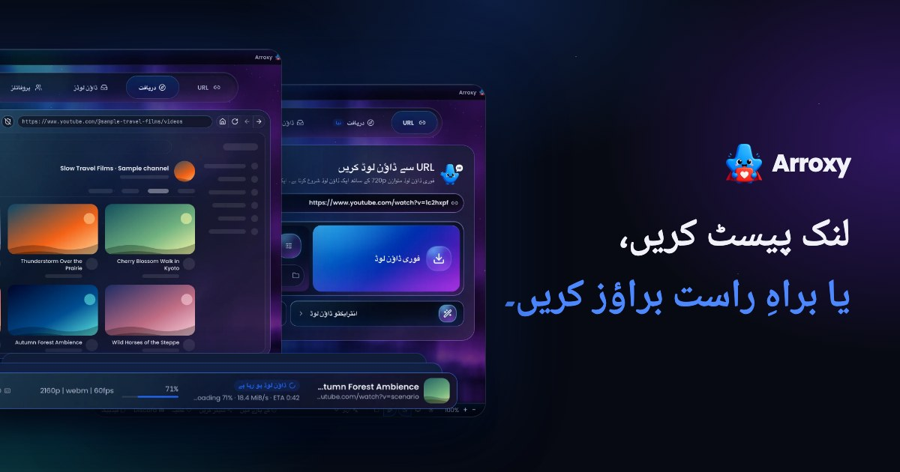

# Arroxy

YouTube اور 2000+ سائٹس کے لیے بلٹ اِن براؤزر کے ساتھ مفت، اوپن سورس ڈاؤن لوڈر۔ Windows، macOS اور Linux کے لیے۔

<p>
  
  
  
  
  
  
  
  
  
  
  
  
  
</p>

[**↓ Arroxy انسٹال کریں**](#install) &nbsp;·&nbsp; [**ویب سائٹ**](https://arroxy.com/)

[Windows پر پہلی بار لانچ](#windows-first-launch) · [macOS پر پہلی بار لانچ](#macos-first-launch) · [Linux پر پہلی بار لانچ](#linux-first-launch)

[](https://github.com/antonio-orionus/Arroxy/releases/latest) [](https://github.com/antonio-orionus/Arroxy/actions/workflows/release.yml)  

**زبان:** [Afaan Oromoo](README.om.md) · [Bahasa Indonesia](README.id.md) · [Català](README.ca.md) · [Čeština](README.cs.md) · [Dansk](README.da.md) · [Deutsch](README.de.md) · [Eesti](README.et.md) · [English](../../README.md) · [Español](README.es.md) · [Euskara](README.eu.md) · [Français](README.fr.md) · [Galego](README.gl.md) · [Hrvatski](README.hr.md) · [Italiano](README.it.md) · [Kiswahili](README.sw.md) · [Latviešu](README.lv.md) · [Lietuvių](README.lt.md) · [Magyar](README.hu.md) · [Nederlands](README.nl.md) · [Norsk bokmål](README.nb.md) · [O'zbekcha](README.uz.md) · [Polski](README.pl.md) · [Português](README.pt.md) · [Română](README.ro.md) · [Slovenčina](README.sk.md) · [Slovenščina](README.sl.md) · [Suomi](README.fi.md) · [Svenska](README.sv.md) · [Tiếng Việt](README.vi.md) · [Türkçe](README.tr.md) · [አማርኛ](README.am.md) · [עברית](README.he.md) · [العربية](README.ar.md) · **اردو** · [پښتو](README.ps.md) · [فارسی](README.fa.md) · [বাংলা](README.bn.md) · [हिन्दी](README.hi.md) · [ไทย](README.th.md) · [မြန်မာဘာသာ](README.my.md) · [ខ្មែរ](README.km.md) · [Ελληνικά](README.el.md) · [Български](README.bg.md) · [Русский](README.ru.md) · [Српски](README.sr.md) · [Українська](README.uk.md) · [中文](README.zh.md) · [日本語](README.ja.md) · [한국어](README.ko.md) · [繁體中文](README.zh-Hant.md)

<table>
  <tr>
    <td width="50%" valign="top" align="center">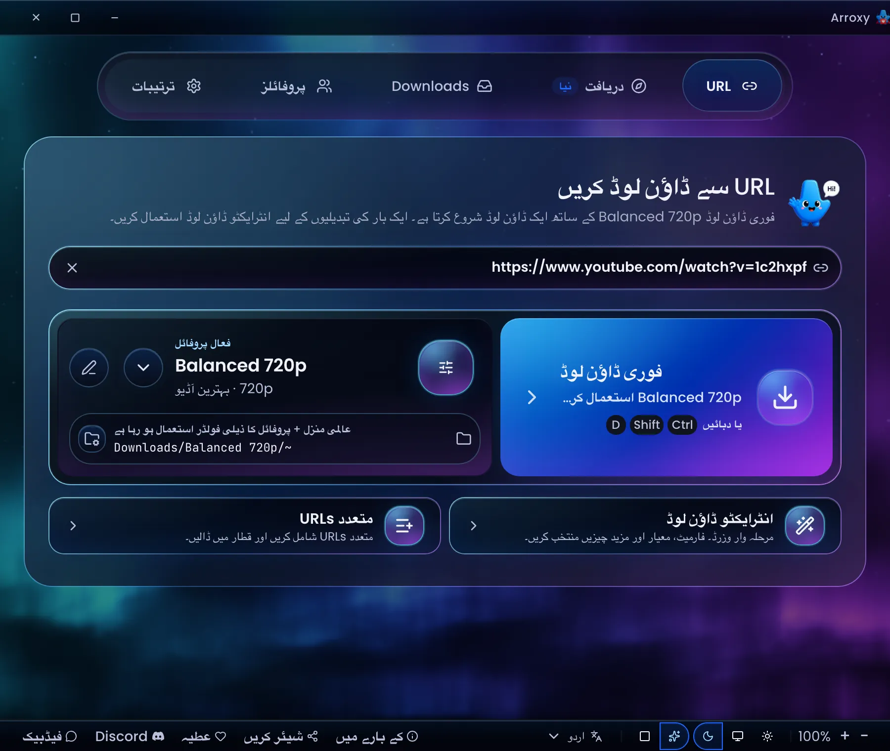</td>
    <td width="50%" valign="top" align="center">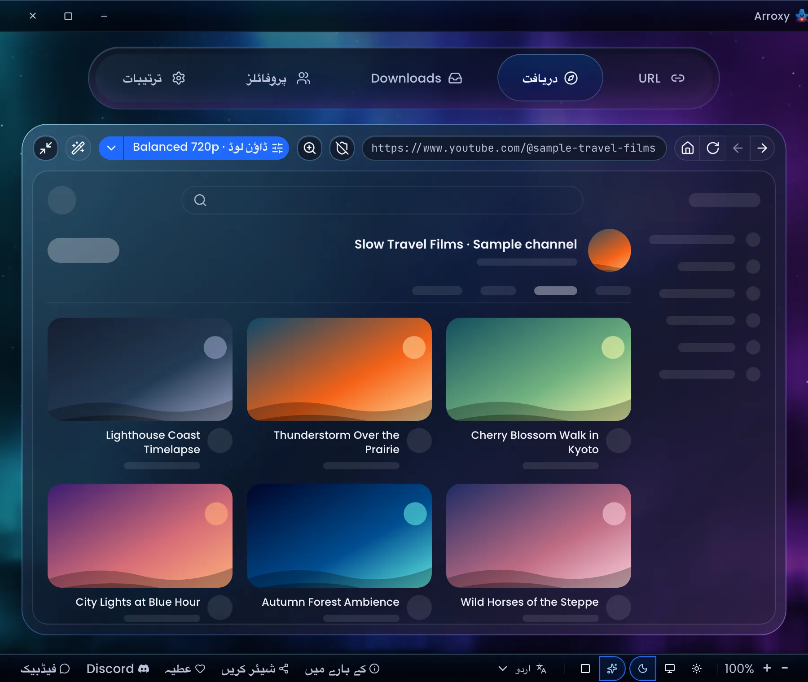</td>
  </tr>
</table>

نہ اشتہارات، نہ استعمال کی حدود، نہ مہنگا ورژن خریدنے کا دباؤ۔

[](https://discord.gg/ueGvXwQH8y)

اگر Arroxy آپ کا وقت بچاتا ہے، تو ایک ⭐ دوسروں کو اسے ڈھونڈنے میں مدد کرتا ہے۔

</div>

## براؤز کریں، سائن ان کریں، ڈاؤن لوڈ کریں

**لنک پیسٹ کریں یا ایپ کے اندر براؤز کریں۔** جس ویڈیو، پلے لسٹ یا چینل کو آپ دیکھ رہے ہیں اسے ڈاؤن لوڈ کرنے کے لیے دریافت ٹیب استعمال کریں، یا کسی لنک کو ڈاؤن لوڈ کرنے کے لیے اس پر رائٹ کلک کریں۔

کسی سائٹ پر ایک بار سائن ان کر کے وہ مواد ڈاؤن لوڈ کریں جس تک آپ کے اکاؤنٹ کو رسائی ہے، بشمول آپ کی نجی ویڈیوز، “بعد میں دیکھیں” اور پسندیدہ ویڈیوز کی فہرستیں۔ کوکیز ایکسپورٹ کرنے کی ضرورت نہیں۔ [دریافت کے بارے میں مزید](#why-explore)۔

_آخری تازہ کاری: 2026-10-24۔_

> 🌐 یہ AI کی مدد سے کیا گیا ترجمہ ہے۔ [انگریزی README](../../README.md) سچائی کا ماخذ ہے۔ کوئی غلطی نظر آئی؟ [PR کا خیر مقدم ہے](../../../../pulls)۔

---

## فہرست

- [✨ خصوصیات](#features)
- [📥 انسٹال اور پہلی بار لانچ](#install)
  - [Windows پر پہلی بار لانچ](#windows-first-launch)
  - [macOS پر پہلی بار لانچ](#macos-first-launch)
  - [آپ کو وارننگ کیوں نظر آ سکتی ہے](#why-warning)
  - [Linux پر پہلی بار لانچ](#linux-first-launch)
  - [اپنا ڈاؤن لوڈ تصدیق کریں (SHA256)](#verify)
- [⚖️ Arroxy کیوں](#why)
- [🔒 پرائیویسی](#privacy)
- [❓ اکثر پوچھے گئے سوالات](#faq)
- [🗺️ روڈ میپ](#roadmap)
- [💖 Arroxy کی معاونت کریں](#support)
- [🛠️ ان چیزوں سے بنایا گیا](#tech)
- [📜 استعمال کی شرائط](#terms)

---

## <a id="features"></a>✨ خصوصیات

<table align="center" width="100%">
  <tr>
    <td colspan="2" valign="top" align="center"><br/> <sub><b>Explore</b><br/>Arroxy کے اندر YouTube یا کوئی بھی دوسری سائٹ براؤز کریں اور اپنے فعال پروفائل کے ساتھ موجودہ صفحہ ڈاؤن لوڈ کریں</sub></td>
  </tr>
  <tr>
    <td width="50%" valign="top" align="center">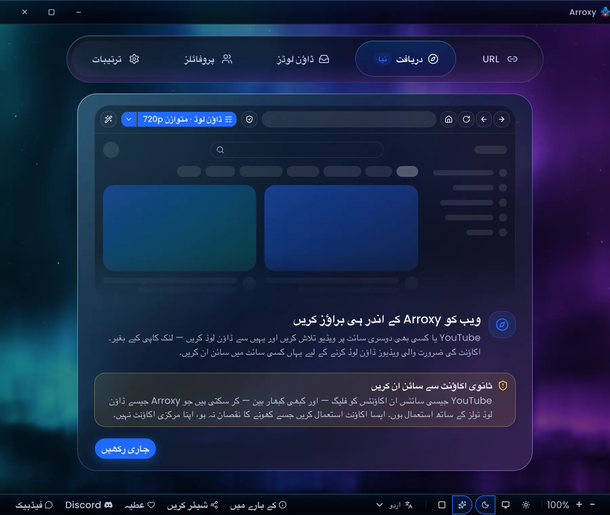<br/> <sub><b>Explore کی پہلی اسکرین</b><br/>Explore پر ایک نظر، اور ثانوی اکاؤنٹ محفوظ سائن ان کیوں ہے</sub></td>
    <td width="50%" valign="top" align="center">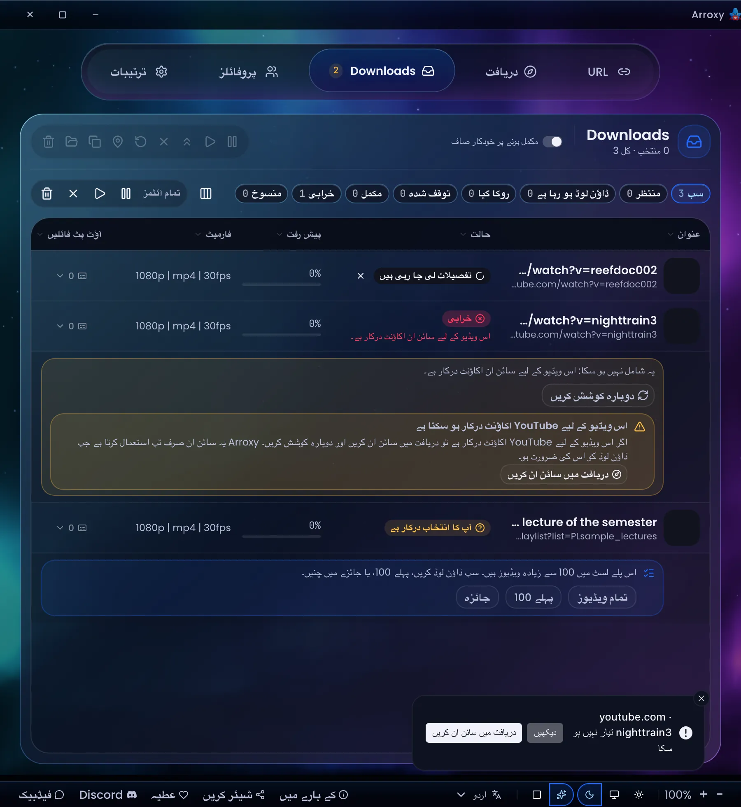<br/> <sub><b>Downloads بتاتا ہے کہ کس چیز کو آپ کی ضرورت ہے</b><br/>لنکس پس منظر میں تیار ہوتے ہیں؛ ناکام لنک حل پیش کرتا ہے، لمبی پلے لسٹ آپ کے انتخاب کا انتظار کرتی ہے</sub></td>
  </tr>
  <tr>
    <td colspan="2" valign="top" align="center">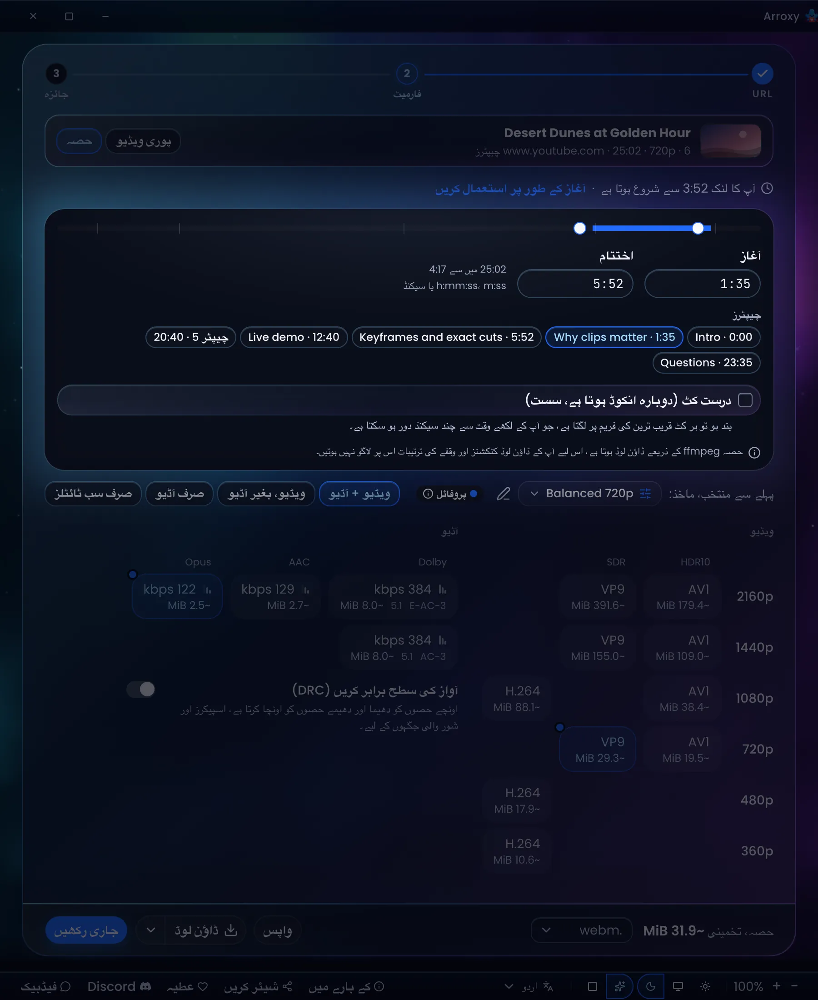<br/> <sub><b>ویڈیو کا صرف ایک حصہ ڈاؤن لوڈ کریں</b><br/>آغاز اور اختتام، یا کوئی باب چنیں — Arroxy صرف وہی حصہ محفوظ کرتا ہے</sub></td>
  </tr>
  <tr>
    <td colspan="2" valign="top" align="center">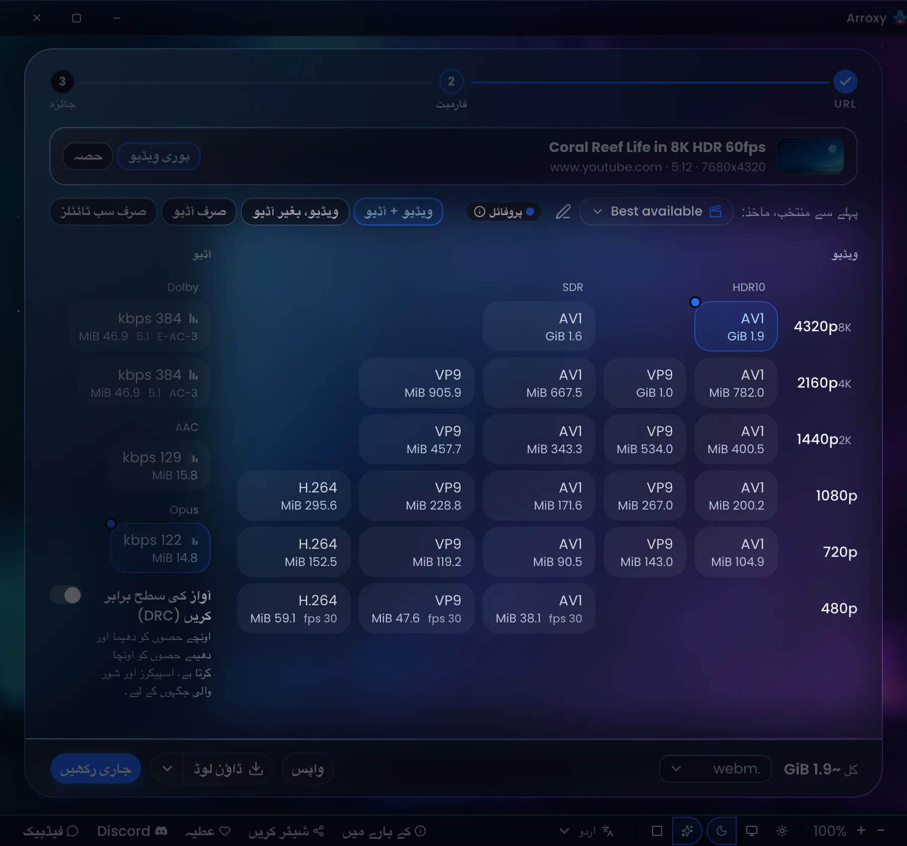<br/> <sub><b>60 fps پر 8K HDR</b><br/>ویڈیو کی ہر ریزولوشن، کوڈیک اور HDR اسٹریم، ساتھ ساتھ</sub></td>
  </tr>
  <tr>
    <td colspan="2" valign="top" align="center">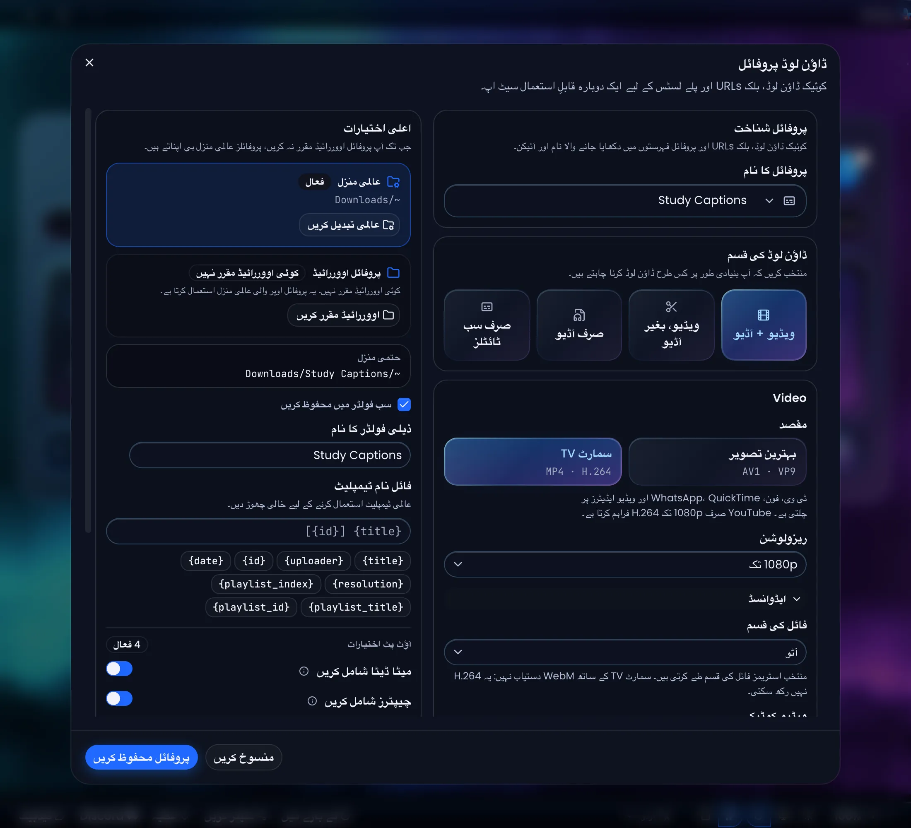<br/> <sub><b>پروفائل ایڈیٹر</b><br/>پروفائل کو ترتیب دیں: فائل کی قسم، ریزولوشن، سب ٹائٹلز، منزل، فائل نام کا سانچہ اور مزید</sub></td>
  </tr>
  <tr>
    <td colspan="2" valign="top" align="center">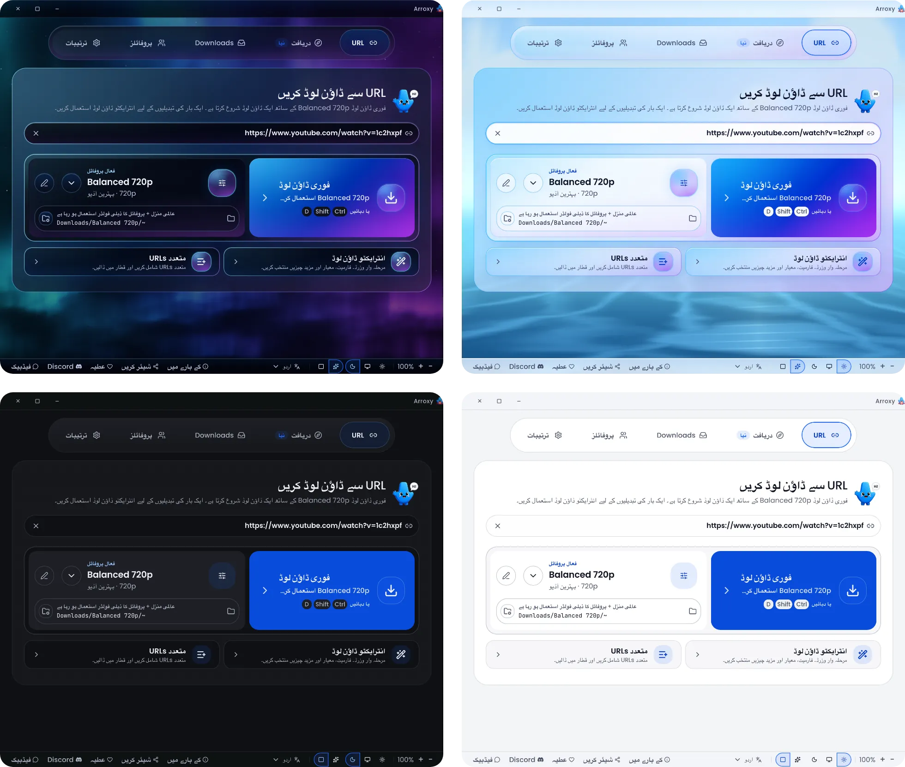<br/><sub><b>گہرا یا روشن، شیشہ یا سادہ</b><br/>منتخب کرنے کے لیے چار انداز: چلتے آسمان پر شیشے کے پینل یا پرسکون سادہ سطحیں، ہر ایک گہرے اور روشن موڈ میں</sub></td>
  </tr>
  <tr>
    <td colspan="2" valign="top" align="center"><picture><source media="(prefers-color-scheme: dark)" srcset="../../build/Global-hotkey-dark.png" /></picture><br/><sub><b>عالمی ڈاؤن لوڈ ہاٹ کی</b><br/>کہیں بھی لنک کاپی کریں، ایک بار دبائیں — یہ قطار میں آ جاتا ہے اور ڈاؤن لوڈ شروع ہو جاتا ہے</sub></td>
  </tr>
  <tr>
    <td colspan="2" valign="top" align="center">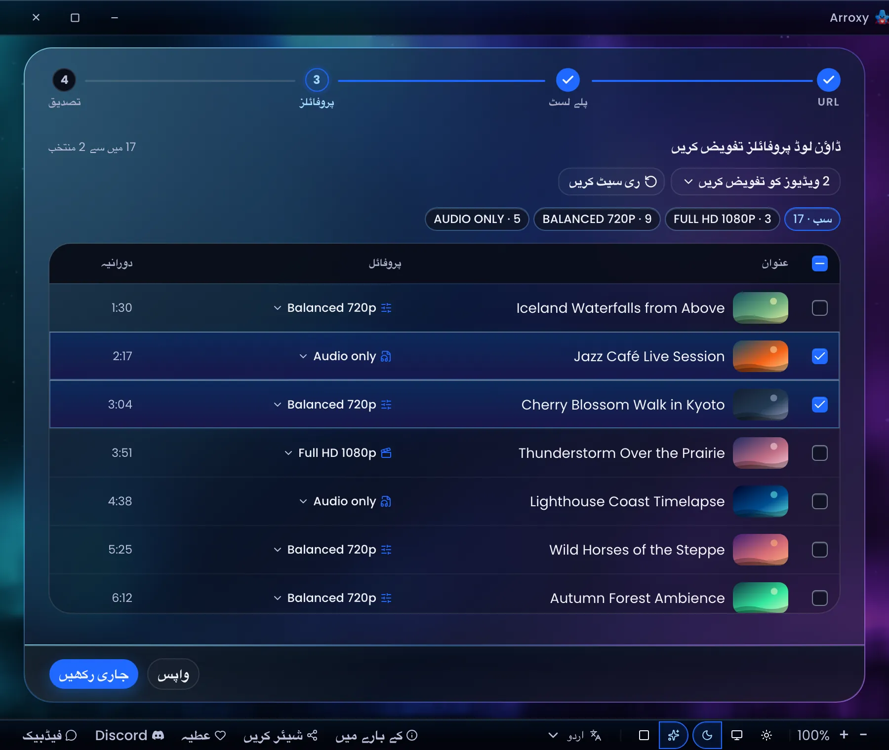<br/><sub><b>پلے لسٹ میں ہر آئٹم کے لیے پروفائل</b><br/>ہر ویڈیو کو اپنا پروفائل دیں — کچھ 4K میں محفوظ کریں، باقی صرف آڈیو کے طور پر محفوظ کریں</sub></td>
  </tr>
  <tr>
    <td width="50%" valign="top" align="center"><br/><sub><b>فوری ڈاؤن لوڈ ہوم</b><br/>URL پیسٹ کریں اور اپنی فعال پروفائل سے فوراً ڈاؤن لوڈ کریں</sub></td>
    <td width="50%" valign="top" align="center">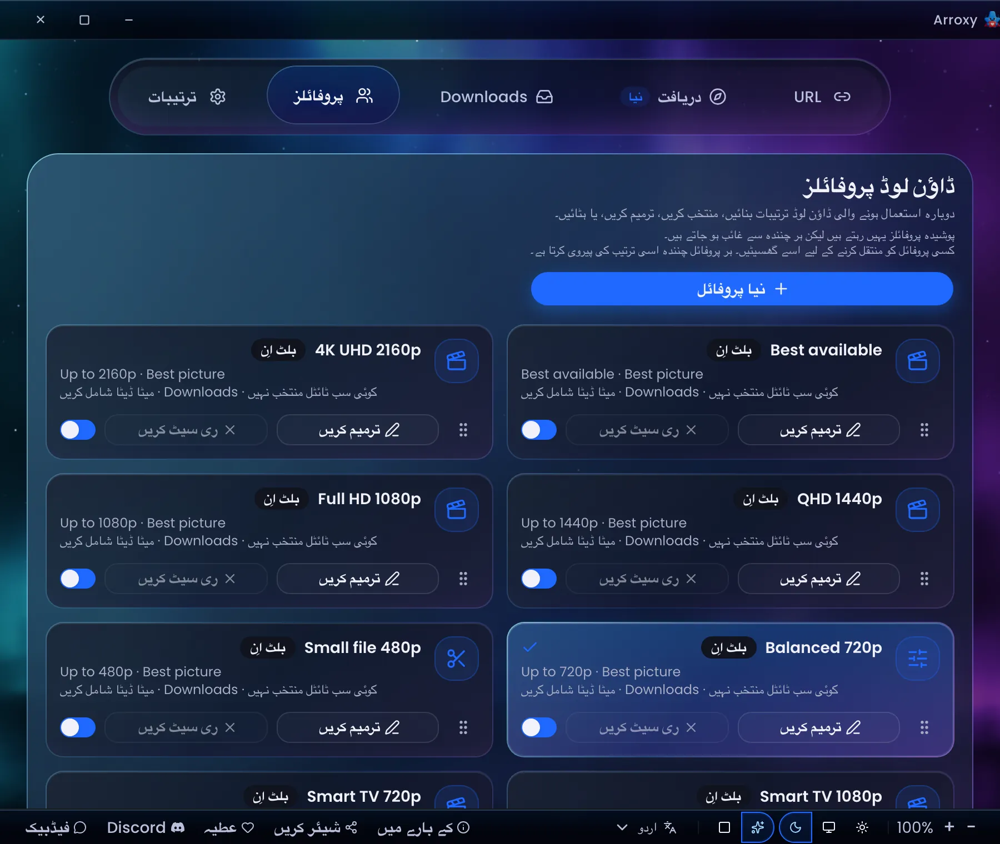<br/><sub><b>دوبارہ قابلِ استعمال ڈاؤن لوڈ پروفائلز</b><br/>فارمیٹ، معیار اور آؤٹ پٹ کو پری سیٹ کے طور پر محفوظ کریں — ہر ڈاؤن لوڈ پر دوبارہ استعمال کریں</sub></td>
  </tr>
  <tr>
    <td width="50%" valign="top" align="center">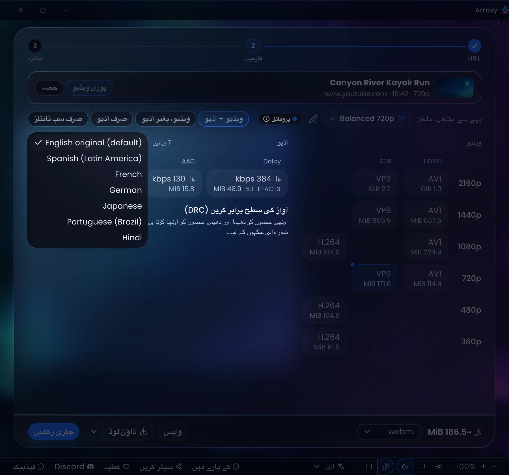<br/><sub><b>کثیر لسانی آڈیو ٹریکس</b><br/>وہ بالکل درست آڈیو زبان منتخب کریں جو ویڈیو میں ہو</sub></td>
    <td width="50%" valign="top" align="center">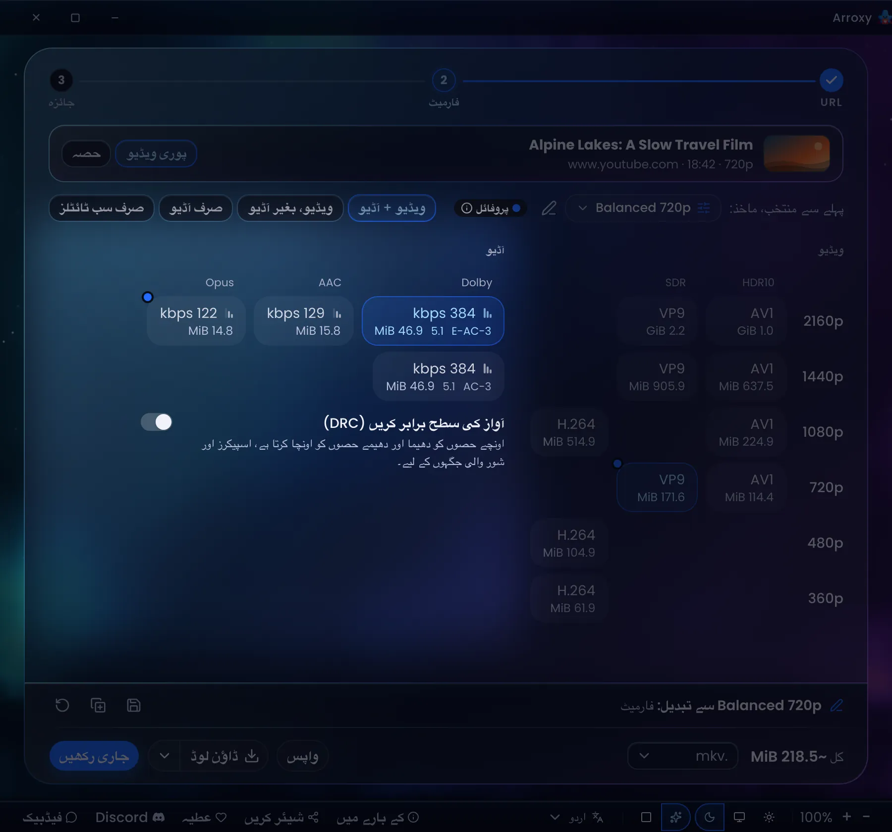<br/><sub><b>سراؤنڈ / Dolby آڈیو</b><br/>5.1 اور Dolby ٹریکس کا پتہ لگا کر محفوظ رکھے جاتے ہیں</sub></td>
  </tr>
  <tr>
    <td width="50%" valign="top" align="center">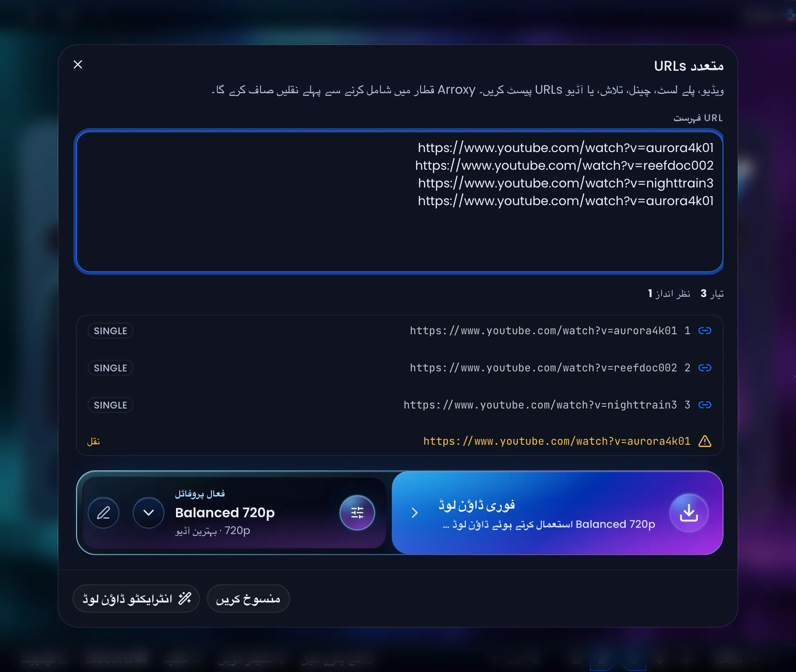<br/><sub><b>بلک URL موڈ</b><br/>فہرست پیسٹ کریں، خودکار طور پر نقول ہٹائیں، سب کو ایک ساتھ قطار میں لگائیں</sub></td>
    <td width="50%" valign="top" align="center">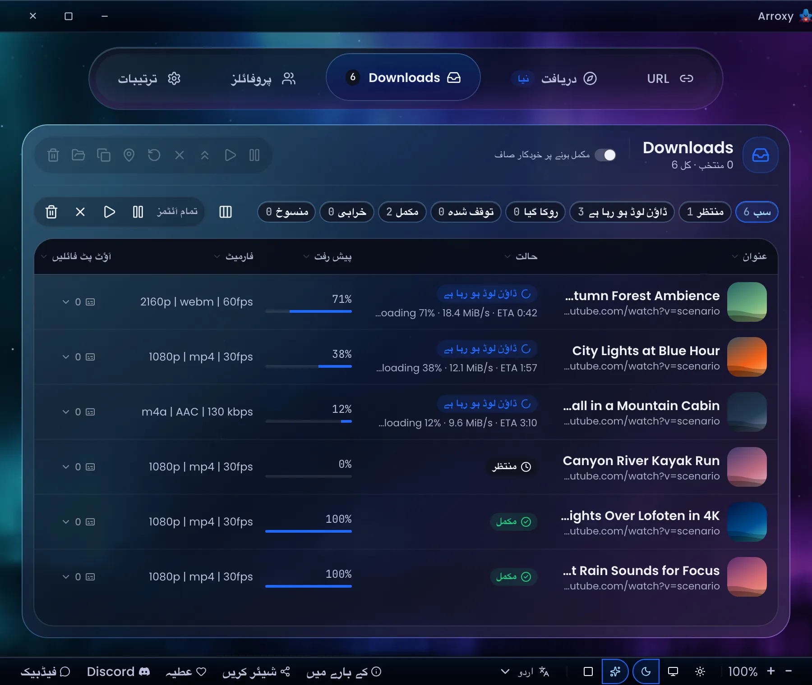<br/><sub><b>متوازی ڈاؤن لوڈ قطار</b><br/>براہِ راست پیش رفت کے ساتھ بیک وقت کئی ڈاؤن لوڈز</sub></td>
  </tr>
</table>

<details open>
<summary><strong>🧭 Explore: Arroxy کے اندر ویب براؤز کریں</strong></summary>

- **Explore ٹیب** — Arroxy کے اندر YouTube یا کوئی بھی دوسری سائٹ براؤز کریں اور جو ملے اسے لنک کاپی کیے بغیر ڈاؤن لوڈ کریں۔ **ڈاؤن لوڈ · *آپ کا پروفائل*** وہ ویڈیو، پلے لسٹ یا چینل قطار میں لگاتا ہے جو آپ دیکھ رہے ہیں؛ اس کے ساتھ والا تیر پروفائل بدلتا ہے، اور جادوئی چھڑی فارمیٹس، سب ٹائٹلز اور مزید چننے کے لیے مرحلہ وار ڈاؤن لوڈ کھولتی ہے
- **رائٹ کلک سے ڈاؤن لوڈ** — Explore میں کسی بھی ویڈیو، پلے لسٹ یا چینل کے لنک پر رائٹ کلک کریں اور اسے اپنے پروفائل سے ڈاؤن لوڈ کریں، **پروفائل سے ڈاؤن لوڈ** سے کوئی اور پروفائل چنیں، مرحلہ وار ڈاؤن لوڈ کھولیں، یا لنک کاپی کریں۔ ہر ویڈیو پہلے کھولنے کی ضرورت نہیں
- **مختصر لے آؤٹ** — Explore کے ٹول بار میں ایک کلک Arroxy کے ٹیبز کو اس میں لے آتا ہے اور صفحے کو زیادہ جگہ دیتا ہے
- **ایڈریس بار** — YouTube پر تلاش کے لیے ٹائپ کریں، یا کوئی بھی ویب ایڈریس درج کر کے وہ سائٹ کھولیں
- **وہ ڈاؤن لوڈز جنہیں اکاؤنٹ چاہیے** — Explore میں ایک بار سائن ان کریں اور Arroxy وہ ویڈیوز ڈاؤن لوڈ کر سکتا ہے جو آپ کا اکاؤنٹ دیکھ سکتا ہے: آپ کی نجی ویڈیوز، عمر کی پابندی والے ویڈیوز اگر اکاؤنٹ کی عمر کی توثیق ہو چکی ہو، اور آپ کی Watch Later اور Liked فہرستیں۔ وہاں دوسری سائٹس پر بھی سائن ان کریں، اور ان کے ڈاؤن لوڈز ضرورت پڑنے پر وہی سائن ان استعمال کرتے ہیں۔ Arroxy اب بھی پہلے سائن آؤٹ حالت میں ڈاؤن لوڈ کرتا ہے اور آپ کا Explore سائن ان صرف تب استعمال کرتا ہے جب ڈاؤن لوڈ ایسی وجہ سے ناکام ہو جسے اکاؤنٹ ٹھیک کر سکے
- **ثانوی اکاؤنٹ استعمال کریں** — Explore کی پہلی اسکرین وجہ بتاتی ہے: اکاؤنٹ کے ساتھ ڈاؤن لوڈ کرنے میں اس اکاؤنٹ پر پابندی لگنے کا کچھ خطرہ ہوتا ہے۔ اپنے سائن ان بھلانا چاہیں تو جب چاہیں Settings سے Explore سے سائن آؤٹ کر لیں
- **اشتہار بلاکر** — بطور ڈیفالٹ بند ہے۔ Explore کے ٹول بار میں شیلڈ پر ایک کلک اس کے صفحات پر اشتہارات اور ٹریکرز بلاک کر دیتا ہے، اور ڈاؤن لوڈز متاثر نہیں ہوتے۔ YouTube سائن ان اکاؤنٹس کے لیے اشتہار بلاکرز کی مزاحمت کر سکتا ہے

</details>

<details>
<summary><strong>🎞️ کوالٹی اور فارمیٹس</strong></summary>

- **8K (4320p)** تک، 4K UHD (2160p)، 1440p، 1080p، 720p، 480p، 360p
- **ہائی فریم ریٹ اور HDR** جیسے ہیں ویسے ہی محفوظ — 60 fps، HDR10
- **آڈیو** — صرف آڈیو کو MP3، M4A/AAC، Opus یا WAV میں ایکسپورٹ کریں۔ انٹرایکٹو ڈاؤن لوڈز میں، دستیاب ہونے پر ماخذ کے نیٹو surround/Dolby ٹریکس (AC-3، E-AC-3، 5.1، DRC) منتخب کریں، یا عالمی ڈیفالٹ **سراؤنڈ / Dolby کو ترجیح دیں** سیٹ کریں
- **مقصد والے پروفائل** — *بہترین تصویر* (AV1 · VP9) یا *سمارٹ TV* (MP4 · H.264)، جو دوبارہ انکوڈ کیے بغیر آٹو، MP4، MKV یا WebM میں محفوظ ہوتے ہیں۔ HDR *آٹو* (صرف جب آپ کی اسکرین اسے دکھا سکے)، *SDR* یا *HDR* ہو سکتا ہے
- **ہر ریزولوشن پر ہر کوڈیک** — مرحلہ وار ڈاؤن لوڈ ہر ریزولوشن پر AV1، VP9 اور H.264 کو ساتھ ساتھ دکھاتا ہے، تاکہ آپ وہ چن سکیں جو آپ کا TV یا ایڈیٹر چلاتا ہے
- **جانیں کہ اسٹریم اصل میں کیا ہے** — وہ سائز جو YouTube نے AI سے اپ اسکیل کیے، AI سے ڈب شدہ آڈیو زبانیں، بہتر بٹ ریٹ والی اسٹریمز، 360° ویڈیوز اور خراب یا واٹرمارک والی کاپیاں نشان زد ہوتی ہیں۔ جب تک آپ اجازت نہ دیں، پروفائل AI سے اپ اسکیل شدہ اسٹریمز کو چھوڑ دیتے ہیں

</details>

<details>
<summary><strong>🛡️ پرائیویسی اور کنٹرول</strong></summary>

- 100% مقامی پراسیسنگ — ڈاؤن لوڈز سیدھے YouTube سے آپ کی ڈسک پر جاتے ہیں
- کوئی لاگ ان نہیں، کوئی کوکیز نہیں، کوئی Google اکاؤنٹ منسلک نہیں
- فائلیں سیدھی آپ کے منتخب کردہ فولڈر میں محفوظ

</details>

<details>
<summary><strong>⚡ ورک فلو</strong></summary>

- **عالمی ڈاؤن لوڈ ہاٹ کی** — کسی بھی ایپ میں لنک کاپی کریں اور `Ctrl+Shift+D` (macOS پر `Cmd+Shift+D`) دبائیں؛ Arroxy اسے ونڈو کھولے بغیر آپ کی فعال پروفائل کے ساتھ قطار میں ڈال دیتا ہے اور اطلاع سے تصدیق کرتا ہے۔ بطور ڈیفالٹ فعال، دوبارہ مقرر کی جا سکتی ہے
- **لچکدار آغاز کے طریقے** — گائیڈڈ سنگل ڈاؤن لوڈ، پلے لسٹ/چینل پکر، bulk URL پیسٹ، محفوظ ڈیفالٹس کے ساتھ Quick Download، یا Explore سے براؤز اور ڈاؤن لوڈ منتخب کریں
- **مرکزی ڈاؤن لوڈ قطار** — ہر سنگل، پلے لسٹ، bulk، یا quick کام پیش رفت، pause، resume، cancel، retry، اور priority کنٹرول کے لیے ایک ہی جگہ آتا ہے
- **کلپ بورڈ واچ** — ویڈیو لنک کاپی کریں اور جب آپ Arroxy پر واپس آئیں تو یہ URL فیلڈ بھر دیتا ہے، اور اگر یہ ارادتاً نہ تھا تو **واپس کریں** دبائیں۔ جب Arroxy مصروف ہو تو لنک اس وقت تک انتظار کرتا ہے جب تک آپ URL ٹیب پر واپس نہ آئیں (ترتیبات میں اسے بند کریں)
- **خودکار صاف URLs** — ٹریکنگ پیرامیٹرز (`si`، `pp`، `utm_*`، `fbclid`، `gclid`) کو ہٹاتا ہے اور `youtube.com/redirect` لنکس کو کھولتا ہے
- **ٹرے موڈ** — ونڈو بند کرنے سے ڈاؤن لوڈز پس منظر میں چلتے رہتے ہیں
- **50 زبانیں** — سسٹم لوکیل کا خود بخود پتہ لگاتا ہے، کسی بھی وقت تبدیل کیا جا سکتا ہے
- **پلے لسٹ سنک** — پہلے سے ڈاؤن لوڈ شدہ ویڈیوز چھوڑنے کے لیے پلے لسٹ کو مقامی فولڈر کے مقابل دوبارہ اسکین کرتا ہے؛ ہر ویڈیو ڈاؤن لوڈ ہونے پر اپ ڈیٹ ہونے والی `.m3u` پلے لسٹ فائل بناتا ہے
- **رفتار اور pacing کنٹرولز** — ڈاؤن لوڈ bandwidth محدود کریں، طے کریں کہ ویڈیو کے کتنے حصے ایک ساتھ ڈاؤن لوڈ ہوں، اور presets (*بند · متوازن · محتاط · حسبِ ضرورت*) کے ساتھ requests کے درمیان delays شامل کریں
- **فائل نام ٹیمپلیٹس** — `{title}`، `{uploader}`، `{id}`، `{date}`، `{year}`، `{resolution}`، `{site}`، `{categories}`، `{artist}`، `{album}`، `{track}` اور `{playlist_index}` کے ساتھ ڈاؤن لوڈ کے نام اپنی مرضی سے رکھیں، عالمی طور پر یا ہر ڈاؤن لوڈ پروفائل کے لیے
- **ایک وقت میں ڈاؤن لوڈز اور خودکار دوبارہ کوشش** — منتخب کریں کہ قطار کے کتنے ڈاؤن لوڈز ایک ساتھ چلیں، اور نیٹ ورک یا سرور کی خرابی کا شکار ڈاؤن لوڈ Arroxy ہر کوشش سے پہلے زیادہ انتظار کرتے ہوئے دوبارہ آزمائے
- **پلے لسٹ میں ہر آئٹم کے لیے پروفائل** — پوری فہرست کے لیے ایک ہی سیٹنگ کے بجائے پلے لسٹ کے ہر ویڈیو کو اپنا ڈاؤن لوڈ پروفائل تفویض کریں، تاکہ ایک ہی مرحلے میں کچھ کو مکمل کوالٹی میں محفوظ کیا جائے اور باقی کو صرف آڈیو کے طور پر محفوظ کیا جائے
- **Quick Download پس منظر میں کام کرتا ہے** — لنک فوراً Downloads میں نظر آتا ہے اور وہیں تیار ہوتا ہے، **View** والا نوٹ اس کی تصدیق کرتا ہے، اور اگلے لنک کے لیے URL فیلڈ صاف ہو جاتا ہے۔ پچھلے تیار ہو رہے ہوں تو جتنے چاہیں شروع کریں
- **Downloads بتاتا ہے کہ کس چیز کو آپ کی ضرورت ہے** — اگر Arroxy کوئی لنک پڑھ نہ سکے تو اس کی قطار وجہ بتاتی ہے اور حل پیش کرتی ہے: دوبارہ کوشش، کوکیز آن کرنا، یا Explore میں سائن ان۔ کوکیز بند ہونے پر، آپ کے سائن ان کرنے کے بعد **Explore کے ساتھ سائن ان** اسے آپ کے لیے دوبارہ آزماتا ہے۔ آپ کی لوڈ حد سے لمبی پلے لسٹ اپنی قطار میں انتظار کرتی ہے کہ آپ پوری، ابتدائی چند، یا جائزہ چنیں۔ Downloads ٹیب ان قطاروں کی گنتی دکھاتا ہے جو آپ کی منتظر ہیں
- **ویڈیو کا صرف ایک حصہ ڈاؤن لوڈ کریں** — Format اسکرین پر آغاز اور اختتام یا کوئی چیپٹر چنیں اور Arroxy صرف وہی حصہ محفوظ کرتا ہے، جس کے نام میں ویڈیو آئی ڈی کے بعد دورانیہ شامل ہوتا ہے۔ کٹ قریب ترین کی فریم پر لگتے ہیں؛ اس کے بجائے دوبارہ انکوڈ کرنے کے لیے درست کٹ آن کریں
- **مکمل ڈاؤن لوڈز خودکار طور پر ہٹائیں** — اختیاری: مکمل ہونے والا ڈاؤن لوڈ 5 سیکنڈ بعد فہرست سے ہٹ جاتا ہے۔ اس کی فائلیں ڈسک پر رہتی ہیں، اور ناکام ڈاؤن لوڈز فہرست میں رہتے ہیں
- **Downloads میں سائز اور غائب** — ترتیب دیا جا سکنے والا **سائز** کالم بتاتا ہے کہ ہر ڈاؤن لوڈ کتنی جگہ لیتا ہے، اور **غائب** ان فائلوں کی نشاندہی کرتا ہے جو Arroxy سے باہر منتقل یا حذف کی گئیں
- **Aurora یا سادہ، ڈارک یا لائٹ** — چلتے آسمان پر شیشے کے پینل، یا خاموش ٹھوس سطحیں؛ فوٹر سے بدلیں۔ گرافکس ایکسیلریشن کے بغیر کمپیوٹرز کو خودکار طور پر سادہ ملتا ہے
- **Mac مینو بار** — macOS پر مینو بار سے ترتیبات (`Cmd+,`) کھولیں، ڈاؤن لوڈ رفتار کی حد مقرر کریں، اسٹائل اور تھیم بدلیں، اور لاگز کھولیں یا تشخیصی فائل محفوظ کریں
- **کسی بھی ڈاؤن لوڈ سے پروفائل بدلیں** — ڈاؤن لوڈ میں تبدیلی کریں، پھر جس پروفائل سے وہ شروع ہوا تھا اسے اپ ڈیٹ کریں (تبدیلیوں کے پیش منظر کے ساتھ) یا سیٹنگز کو نئے پروفائل کے طور پر محفوظ کریں۔ پروفائل بدلنے پر پوچھا جاتا ہے کہ آیا آپ کی ترامیم برقرار رکھی جائیں

</details>

<details>
<summary><strong>📝 سب ٹائٹلز اور پوسٹ پراسیسنگ</strong></summary>

- **سب ٹائٹلز** SRT، VTT یا ASS میں — دستی یا خود کار طریقے سے بنائے گئے، کسی بھی دستیاب زبان میں
- ویڈیو کے ساتھ محفوظ کریں، `.mkv` میں ایمبیڈ کریں، یا `Subtitles/` سب فولڈر میں منظم کریں
- **صرف سب ٹائٹل بیچ** — URLs کی فہرست پیسٹ کریں یا پلے لسٹ کھولیں، سب ٹائٹلز منتخب کریں، اور ہر ویڈیو کے لیے صرف کیپشن فائلیں حاصل کریں
- **SponsorBlock** — اسپانسرز، انٹروز، آؤٹروز اور سیلف پروموز کو سکپ کریں یا چیپٹر مارک کریں
- **ایمبیڈڈ میٹا ڈیٹا** — ٹائٹل، اپ لوڈ کی تاریخ، چینل، تفصیل، تھمب نیل اور چیپٹر مارکرز فائل میں لکھے جاتے ہیں

</details>

<details>
<summary><strong>🌐 YouTube + 2000 سائٹس</strong></summary>

- **YouTube، مکمل** — Videos، Shorts، Channels، Playlists، YouTube Music اور Podcasts کو فرسٹ-کلاس ذرائع کے طور پر ہینڈل کیا جاتا ہے
- **2000+ دیگر سائٹس** yt-dlp کے ذریعے — Twitch، TikTok، Dailymotion، VK، SoundCloud، Bandcamp، archive.org، Streamable اور بہت کچھ
- **صرف آڈیو اور سب ٹائٹلز** ہر معاون سائٹ پر کام کرتے ہیں، نہ صرف YouTube پر
- اگر کوئی سائٹ بدلتی ہے تو yt-dlp ہر ہفتے فکس جاری کرتا ہے اور Arroxy لانچ پر بائنری خودکار طور پر اپ ڈیٹ کرتا ہے

</details>

---

## <a id="install"></a>📥 انسٹال اور پہلی بار لانچ

**تقاضے:** Windows 10/11 · macOS 13+ (Intel یا Apple Silicon) · Linux (AppImage، Flatpak یا tar.gz)۔

**Windows**

```bash
winget install AntonioOrionus.Arroxy
```

**macOS**

```bash
brew install --cask antonio-orionus/arroxy/arroxy
```

**Linux**

AppImage:

```bash
curl -fsSL https://raw.githubusercontent.com/antonio-orionus/Arroxy/main/scripts/install.sh | sh -s -- --appimage
```

Flatpak:

```bash
curl -fsSL https://raw.githubusercontent.com/antonio-orionus/Arroxy/main/scripts/install.sh | sh -s -- --flatpak
```

بلڈز صرف x86_64 کے لیے ہیں۔ `curl` نہیں ہے؟ `curl -fsSL` کی جگہ `wget -qO-` استعمال کریں۔

| پلیٹ فارم | فارمیٹ |
| --- | --- |
| Windows | [](https://github.com/antonio-orionus/Arroxy/releases/latest/download/Arroxy-win-x64-Setup.exe) [](https://github.com/antonio-orionus/Arroxy/releases/latest/download/Arroxy-win-x64-Portable.exe) |
| macOS | [](https://github.com/antonio-orionus/Arroxy/releases/latest/download/Arroxy-mac-arm64.dmg) [](https://github.com/antonio-orionus/Arroxy/releases/latest/download/Arroxy-mac-x64.dmg) |
| Linux | [](https://github.com/antonio-orionus/Arroxy/releases/latest/download/Arroxy-linux-x64.AppImage) [](https://github.com/antonio-orionus/Arroxy/releases/latest/download/Arroxy-linux-x64.flatpak) [](https://github.com/antonio-orionus/Arroxy/releases/latest/download/Arroxy-linux-x64.tar.gz) |
| Verify | [](https://github.com/antonio-orionus/Arroxy/releases/latest/download/SHA256SUMS) |

[**تازہ ترین ریلیز حاصل کریں →**](https://github.com/antonio-orionus/Arroxy/releases/latest)

<details>
<summary><strong><a id="windows-first-launch"></a>🪟 Windows پر پہلی بار لانچ</strong></summary>

پہلی بار لانچ پر آپ کو **"Windows protected your PC"** یا **"Unknown publisher"** نظر آ سکتا ہے۔ یہ `Arroxy-win-x64-Setup.exe` اور `Arroxy-win-x64-Portable.exe` دونوں پر لاگو ہوتا ہے۔ Arroxy مفت اور اوپن سورس ہے اور Windows بلڈز کو ادائیگی والے سرٹیفکیٹ سے کوڈ سائن نہیں کیا گیا، اسی لیے SmartScreen انہیں فلیگ کرتا ہے۔ اس کا مطلب **نہیں** کہ Arroxy خود بخود غیر محفوظ ہے۔ جاری رکھنے کے لیے:

<div align="center">
  
  
</div>

1. **More info** پر کلک کریں۔
2. **Run anyway** پر کلک کریں۔

#### اگر Windows Defender فائل کو فلیگ کرے یا ہٹا دے

Defender کے ہیورسٹکس کبھی کبھی غیر سائنڈ NSIS انسٹالرز اور Electron پورٹیبلز کو مشکوک قرار دیتے ہیں۔ اگر Defender نے `Arroxy-win-x64-Setup.exe` یا `Arroxy-win-x64-Portable.exe` کو قرنطینہ میں ڈالا ہو، تو اسے **Windows Security → Virus & threat protection → Protection history** سے بحال کریں، پھر Arroxy ایگزیکیوٹیبل کو **Manage settings → Add or remove exclusions** کے تحت اجازت یافتہ آئٹم کے طور پر شامل کریں۔ SmartScreen کی طرح، وجہ غائب پبلشر دستخط ہے، کوئی دریافت شدہ میلویئر نہیں۔

> Arroxy صرف آفیشل GitHub Releases صفحے سے ڈاؤن لوڈ کریں۔ اگر آپ کو فائل کسی دوسری ویب سائٹ سے ملی ہے یا کسی نے بھیجی ہے، تو اسے ڈیلیٹ کریں اور آفیشل ماخذ سے تازہ کاپی ڈاؤن لوڈ کریں۔ سورس کوڈ عوامی ہے، اس لیے آپ خود اسے جانچ یا Arroxy بنا سکتے ہیں۔

Scoop ترجیح دیتے ہیں؟ `scoop bucket add arroxy https://github.com/antonio-orionus/scoop-bucket && scoop install arroxy`

</details>

<details>
<summary><strong><a id="macos-first-launch"></a>🍎 macOS پر پہلی بار لانچ</strong></summary>

Arroxy ابھی macOS کے لیے کوڈ سائنڈ نہیں ہے، اس لیے DMG سے انسٹال کرنے کے بعد Gatekeeper خوفناک *"Arroxy.app is damaged and can't be opened"* ڈائیلاگ دکھا سکتا ہے۔ اس پیغام کا مطلب ہے کہ macOS نے ایک unsigned app کو quarantine کیا ہے؛ اس کا مطلب یہ نہیں کہ app files واقعی خراب ہیں۔ موجودہ macOS پر قابل اعتماد حل Terminal ہے:

<div align="center">
  
</div>

1. نصب شدہ DMG سے `Arroxy.app` کو `/Applications` میں گھسیٹیں۔
2. Terminal کھولیں اور یہ دو commands چلائیں:

```bash
xattr -dr com.apple.quarantine /Applications/Arroxy.app
open /Applications/Arroxy.app
```

پہلی command آپ کی installed Arroxy copy سے quarantine attribute ہٹاتی ہے۔ دوسری app launch کرتی ہے۔ `sudo` آپ کے Mac کا password مانگ سکتا ہے؛ Terminal typing کے دوران characters نہیں دکھاتا۔

**Apple Silicon بمقابلہ Intel:** M-سیریز Mac پر (M1 / M2 / M3 / M4)، `arm64` DMG ڈاؤن لوڈ کریں۔ Intel Macs پر، `x64` DMG ڈاؤن لوڈ کریں۔ غلط بلڈ چلانا Rosetta کے ذریعے کام کرتا ہے لیکن نمایاں طور پر سست ہے۔

> macOS بلڈز Apple Silicon اور Intel رنرز پر CI کے ذریعے تیار کیے جاتے ہیں۔ اگر آپ کو مسائل پیش آئیں، تو براہ کرم [ایک issue کھولیں](../../../../issues) — macOS صارفین سے ملنے والی فیڈ بیک macOS ٹیسٹنگ سائیکل کو فعال طور پر تشکیل دیتی ہے۔

</details>

<details>
<summary><strong><a id="why-warning"></a>⚠️ آپ کو وارننگ کیوں نظر آ سکتی ہے</strong></summary>

Arroxy اوپن سورس اور GPLv3 لائسنس یافتہ ہے۔ Windows اور macOS بلڈز **کوڈ سائنڈ نہیں ہیں** — Apple Developer ID اور Windows EV کوڈ سائننگ سرٹیفکیٹس میں سے ہر ایک سالانہ سینکڑوں ڈالر لاگت آتی ہے، جو ایک انڈی پروجیکٹ اپنی جیب سے ادا کرتا ہے۔ ان دستخطوں کے بغیر، Windows SmartScreen اور macOS Gatekeeper پہلی بار لانچ پر آپ کو تنبیہ کریں گے۔ یہ تنبیہات اس بات کی علامت ہیں کہ *آپ کا OS ناشر کو نہیں پہچانتا* — یہ اس بات کی علامت نہیں کہ Arroxy میلویئر ہے۔

Arroxy کو خود جانچنے کے تین طریقے، بڑھتی ہوئی سختی کے ساتھ:

- **سورس پڑھیں۔** ہر لائن [GitHub](https://github.com/antonio-orionus/Arroxy) پر موجود ہے اور آپ [سورس سے بلڈ](#tech) کر سکتے ہیں۔
- **SHA256 چیک کریں۔** اپنی فائل کو شائع شدہ [`SHA256SUMS`](../../../../releases/latest) سے ملائیں — نیچے [اپنا ڈاؤن لوڈ تصدیق کریں](#verify) دیکھیں۔
- **تھرڈ پارٹی اسکین چلائیں۔** فائل کو [VirusTotal](https://www.virustotal.com) پر اپ لوڈ کریں۔

</details>

<details>
<summary><strong><a id="linux-first-launch"></a>🐧 Linux پر پہلی بار لانچ</strong></summary>

AppImages براہ راست چلتے ہیں — کوئی انسٹالیشن نہیں۔ آپ کو صرف فائل کو ایگزیکیوٹیبل مارک کرنا ہوگا۔

**فائل مینیجر:** `.AppImage` پر دائیں کلک کریں → **Properties** → **Permissions** → **Allow executing file as program** کو فعال کریں، پھر ڈبل کلک کریں۔

**ٹرمینل:**

```bash
chmod +x Arroxy-linux-x64.AppImage
./Arroxy-linux-x64.AppImage
```

اگر پھر بھی نہ چلے تو اسے ماؤنٹ کیے بغیر چلائیں — FUSE پیکیج کی ضرورت نہیں:

```bash
./Arroxy-linux-x64.AppImage --appimage-extract-and-run
```

**اختیاری ڈیسک ٹاپ انٹیگریشن:** [AppImageLauncher](https://github.com/TheAssassin/AppImageLauncher) ایک بار انسٹال کریں، اور جس بھی AppImage کو آپ ڈبل کلک کریں گے وہ خود بخود آپ کے لانچر مینو میں رجسٹر ہو جائے گا — کوئی دستی `.desktop` فائل نہیں چاہیے۔

**سادہ ٹاربال (نہ FUSE، نہ انسٹال):**

`.tar.gz` بلڈ وہی ایپ ہے، بس AppImage ریپر کے بغیر — کہیں بھی ایکسٹریکٹ کریں اور چلائیں۔ نہ انسٹالر چاہیے، نہ FUSE پیکیج۔

```bash
tar xzf Arroxy-linux-x64.tar.gz
./Arroxy-linux-x64/arroxy
```

**ریلیز پیج پر Linux ڈاؤن لوڈز صرف x86_64 کے لیے ہیں۔** ARM64 مشینوں (Raspberry Pi، Asahi Linux) پر Flatpak انسٹال تو ہو جاتا ہے مگر لانچ پر `bwrap: execvp ldconfig: Exec format error` کے ساتھ ناکام ہو جاتا ہے۔

</details>

<details>
<summary><strong><a id="verify"></a>🔐 اپنا ڈاؤن لوڈ تصدیق کریں (SHA256)</strong></summary>

ہر ریلیز بائنریز کے ساتھ `SHA256SUMS` فائل بھی شائع کرتی ہے۔ یہ جانچنے کے لیے کہ آپ کا ڈاؤن لوڈ ٹرانسمیشن میں خراب یا تبدیل نہیں ہوا، اپنی فائل کو مقامی طور پر ہیش کریں اور `SHA256SUMS` کی لائن سے ملائیں۔ تازہ ترین ریلیز پیج کھولیں → **Assets** → `SHA256SUMS` ڈاؤن لوڈ کریں۔

**Windows (PowerShell یا Command Prompt):**

```powershell
certutil -hashfile Arroxy-win-x64-Setup.exe SHA256
```

**macOS (Terminal):**

```bash
shasum -a 256 Arroxy-mac-arm64.dmg
```

**Linux (Terminal):**

```bash
sha256sum Arroxy-linux-x64.AppImage
```

تھرڈ پارٹی میلویئر اسکین چاہتے ہیں؟ فائل کو [VirusTotal](https://www.virustotal.com) پر اپ لوڈ کریں۔ چھوٹے انجنوں سے چند عام ہیورسٹک فلیگز غیر سائنڈ Electron ایپس کے لیے معمول ہیں؛ بڑے انجنوں سے وسیع پیمانے پر دریافت واقعی تشویش کا باعث ہوگی۔

</details>

<details>
<summary><strong>📦 Windows: انسٹالر بمقابلہ پورٹیبل</strong></summary>

|               | NSIS انسٹالر | پورٹیبل `.exe` |
| ------------- | :----------------------: | :---------------------: |
| انسٹالیشن ضروری | ہاں  | نہیں — کہیں سے بھی چلائیں  |
| خودکار اپ ڈیٹس | ✅ ایپ کے اندر  | ❌ دستی ڈاؤن لوڈ  |
| اسٹارٹ اپ سپیڈ | ✅ تیز  | ⚠️ کولڈ اسٹارٹ سست  |
| اسٹارٹ مینو میں شامل |            ✅            |           ❌            |
| آسان ان انسٹال |            ✅            | ❌ بس فائل ڈیلیٹ کر دیں  |

**تجویز:** خودکار اپ ڈیٹس اور تیز اسٹارٹ اپ کے لیے NSIS انسٹالر استعمال کریں۔ بغیر انسٹالیشن، بغیر رجسٹری آپشن کے لیے پورٹیبل `.exe` استعمال کریں۔

</details>

---

## <a id="why"></a>⚖️ Arroxy کیوں

سب سے عام متبادل کے ساتھ ساتھ ساتھ موازنہ:

|            | Arroxy | Typical free yt-dlp GUI | 4K Video Downloader | JDownloader |     Online converters      | Browser extensions |
| ---------- | :----: | :---------------------: | :-----------------: | :---------: | :------------------------: | :----------------: |
| بلٹ ان براؤزر (براؤز کریں، سائن ان کریں، ڈاؤن لوڈ کریں) |   ✅   |           ❌            |         ⚠️          |     ❌      |             ❌             |        N/A         |
| وہ ویڈیوز جو آپ کا اپنا اکاؤنٹ دیکھ سکتا ہے، کوکیز ایکسپورٹ کیے بغیر |   ✅   |           ⚠️            |         ⚠️          |     ⚠️      |             ❌             |         ⚠️         |
| مفت، کوئی پریمیم سطح نہیں |   ✅   |           ✅            |         ⚠️          |     ✅      |             ⚠️             |         ⚠️         |
| اوپن سورس |   ✅   |           ✅            |         ❌          |     ❌      |             ❌             |         ⚠️         |
| صرف مقامی پراسیسنگ |   ✅   |           ✅            |         ✅          |     ✅      |             ❌             |         ✅         |
| استعمال کی کوئی حد نہیں |   ✅   |           ✅            |         ⚠️          |     ✅      |             🚫             |         ⚠️         |
| کراس پلیٹ فارم ڈیسک ٹاپ ایپ |   ✅   |           ⚠️            |         ✅          |     ✅      |            N/A             |         ❌         |
| سب ٹائٹلز + SponsorBlock |   ✅   |           ⚠️            |         ⚠️          |     ❌      |             ❌             |         ❌         |

⚠️ = جزوی طور پر، یا صرف ادا شدہ پلان میں۔ 4K Video Downloader میں نجی ویڈیوز کے لیے ایپ کے اندر سائن ان ایک ادا شدہ فیچر ہے؛ زیادہ تر مفت yt-dlp GUIs صرف کوکیز فائل قبول کرتے ہیں یا آپ کے ویب براؤزر کی کوکیز پڑھتے ہیں۔

Arroxy ایک ہی کام کے لیے بنایا گیا ہے: ایک صاف ستھری مقامی فائل، چاہے آپ URL پیسٹ کریں یا ویڈیو Explore میں ڈھونڈیں۔ کوئی اپ سیلز نہیں، کوئی ڈیٹا کلیکشن نہیں۔

### <a id="why-explore"></a>🧭 جو ایک سادہ yt-dlp ریپر نہیں کر سکتا: Explore ٹیب

زیادہ تر مفت YouTube ڈاؤن لوڈرز yt-dlp کے اوپر بس ایک URL باکس ہوتے ہیں۔ Arroxy بھی yt-dlp استعمال کرتا ہے، لیکن اس میں **Explore** بھی ہے، ایپ کے اندر بنا ہوا براؤزر جو YouTube یا کوئی بھی دوسری سائٹ کھولتا ہے۔ Explore وہ کچھ شامل کرتا ہے جو ایک URL باکس نہیں کر سکتا:

- **وہ ویڈیوز جو آپ کا اکاؤنٹ دیکھ سکتا ہے، کوکیز ایکسپورٹ کیے بغیر** — آپ کی نجی ویڈیوز، آپ کی Watch Later اور Liked فہرستیں، عمر کی پابندی والے ویڈیوز (عمر کی توثیق شدہ اکاؤنٹ پر)، اور دوسری سائٹس کے وہ صفحات جنہیں آپ کا سائن ان چاہیے۔ ایک سادہ ریپر کو cookies.txt ایکسپورٹ چاہیے یا اسے آپ کے ویب براؤزر کی کوکیز پڑھنی پڑتی ہیں۔ Arroxy میں آپ Explore میں ایک بار سائن ان کرتے ہیں اور باقی کام وہ خود کر لیتا ہے
- **لنک کاپی کرنے کی ضرورت نہیں** — Explore میں کوئی ویڈیو، پلے لسٹ یا چینل ڈھونڈیں اور ایک کلک میں ڈاؤن لوڈ کریں، یا صفحے پر کسی بھی لنک پر رائٹ کلک کریں
- **ضرورت ہو تو اشتہار بلاکر** — شیلڈ پر ایک کلک سے Explore کے صفحات پر اشتہارات اور ٹریکرز بلاک ہو جاتے ہیں

---

## <a id="privacy"></a>🔒 پرائیویسی

ڈاؤن لوڈز [yt-dlp](https://github.com/yt-dlp/yt-dlp) کے ذریعے براہ راست YouTube سے آپ کے منتخب کردہ فولڈر میں آتے ہیں — کسی تھرڈ پارٹی سرور سے نہیں گزرتے۔ دیکھنے کی تاریخ، ڈاؤن لوڈ تاریخ، URLs اور فائل کے مواد آپ کے ڈیوائس پر ہی رہتے ہیں۔

**کوئی ٹریکنگ نہیں۔** Arroxy صرف گمنام رپورٹس بھیجتا ہے جو صارفین کی گنتی اور مسائل حل کرنے میں ہماری مدد کرتی ہیں—آپ کے لنکس، ویڈیوز، فائلیں یا اکاؤنٹس کبھی نہیں بھیجتا۔ آپ انہیں ترتیبات میں کنٹرول کر سکتے ہیں۔

دریافت اپنے سائن ان کی معلومات آپ کے براؤزر سے الگ رکھتا ہے، اور آپ ہمیشہ سائٹ کے اپنے صفحے پر سائن ان کرتے ہیں۔ ڈاؤن لوڈ سائن ان کو صرف اسی سائٹ کے لیے استعمال کرتا ہے، ہر بار اس کی معلومات نئے سرے سے پڑھتا ہے اور بعد میں اپنی کاپی حذف کر دیتا ہے۔ ترتیبات میں دریافت سے سائن آؤٹ کرنے پر محفوظ سائن ان کی معلومات مٹ جاتی ہیں۔

---

## <a id="faq"></a>❓ اکثر پوچھے گئے سوالات

<details>
<summary><strong>کیا یہ واقعی مفت ہے؟</strong></summary>

ہاں — GPLv3 لائسنس یافتہ، کوئی پریمیم سطح نہیں، کوئی فیچر گیٹنگ نہیں۔

</details>

<details>
<summary><strong>Arroxy دوسرے yt-dlp GUIs سے کیسے مختلف ہے؟</strong></summary>

زیادہ تر مفت yt-dlp GUIs ایسے ریپرز ہیں جو صرف لنک لیتے ہیں۔ Arroxy میں **Explore** شامل ہے، ایپ کے اندر بنا ہوا براؤزر جو YouTube یا کوئی بھی دوسری سائٹ کھولتا ہے: آپ لنک کاپی کیے بغیر براؤز اور ڈاؤن لوڈ کرتے ہیں، اور وہاں ایک بار سائن ان کر کے وہ ویڈیوز ڈاؤن لوڈ کرتے ہیں جو آپ کا اکاؤنٹ دیکھ سکتا ہے، جیسے آپ کی نجی ویڈیوز اور Watch Later اور Liked فہرستیں، کوکیز ایکسپورٹ کیے بغیر۔ دیکھیں [Arroxy کیوں](#why)۔

</details>

<details>
<summary><strong>میں کن ویڈیو کوالٹیز میں ڈاؤن لوڈ کر سکتا ہوں؟</strong></summary>

جو بھی YouTube فراہم کرتا ہے: 8K (4320p)، 4K UHD (2160p)، 1440p، 1080p، 720p، 480p، 360p، اور صرف آڈیو۔ 60 fps اور HDR اسٹریمز جیسے ہیں ویسے ہی محفوظ ہوتے ہیں، اور مرحلہ وار ڈاؤن لوڈ آپ کو ہر ریزولوشن پر AV1، VP9 یا H.264 چننے دیتا ہے۔

</details>

<details>
<summary><strong>کیا میں صرف آڈیو کو MP3 کے طور پر نکال سکتا ہوں؟</strong></summary>

جی ہاں۔ فارمیٹ مینو میں *صرف آڈیو* منتخب کریں اور پھر MP3، M4A/AAC، Opus یا WAV چنیں۔

</details>

<details>
<summary><strong>جن ویڈیوز کو YouTube اکاؤنٹ چاہیے انہیں کیسے ڈاؤن لوڈ کروں؟</strong></summary>

Explore ٹیب میں ایک بار سائن ان کریں۔ اس کے بعد Arroxy وہ ویڈیوز ڈاؤن لوڈ کر سکتا ہے جو آپ کا اکاؤنٹ دیکھ سکتا ہے: آپ کی نجی ویڈیوز، عمر کی پابندی والے ویڈیوز اگر اکاؤنٹ کی عمر کی توثیق ہو چکی ہو، اور آپ کی Watch Later اور Liked فہرستیں۔ یہ سائن ان صرف تب استعمال ہوتا ہے جب ڈاؤن لوڈ ایسی وجہ سے ناکام ہو جسے اکاؤنٹ ٹھیک کر سکے؛ باقی سب کچھ پہلے کی طرح ڈاؤن لوڈ ہوتا ہے۔ یہ **Explore سائن ان** کا انتخاب ہے، جو Cookies کی ترتیبات میں سب سے اوپر درج اور Recommended کے نشان کے ساتھ ہے، اور Explore پہلی بار کھولنے پر Arroxy اسے خود چن لیتا ہے۔ yt-dlp کی وکی میں نوٹ کیا گیا ہے کہ [سائن ان کے ساتھ آٹومیشن Google اکاؤنٹ کو فلیگ کر سکتی ہے](https://github.com/yt-dlp/yt-dlp/wiki/Extractors#exporting-youtube-cookies)، اس لیے ثانوی اکاؤنٹ زیادہ محفوظ انتخاب ہے۔

</details>

<details>
<summary><strong>جب YouTube کچھ تبدیل کرے تو کیا یہ کام کرتا رہے گا؟</strong></summary>

yt-dlp لانچ پر خود بخود اپ ڈیٹ ہو جاتا ہے، اور جب YouTube کچھ تبدیل کرتا ہے تو Arroxy فوری طور پر فکس فراہم کرتا ہے۔ جب کسی ڈاؤن لوڈ کو سائن ان کی ضرورت ہو تو، اگر آپ نے Explore میں سائن ان کیا ہو، Arroxy آپ کا Explore سائن ان استعمال کرتا ہے، اور فائل یا براؤزر سے کوکیز Cookies کی ترتیبات میں دستیاب ہیں۔

</details>

<details>
<summary><strong>Arroxy کن زبانوں میں دستیاب ہے؟</strong></summary>

50 زبانیں فوراً دستیاب ہیں: Afaan Oromoo · Bahasa Indonesia · Català · Čeština · Dansk · Deutsch · Eesti · English · Español · Euskara · Français · Galego · Hrvatski · Italiano · Kiswahili · Latviešu · Lietuvių · Magyar · Nederlands · Norsk bokmål · O'zbekcha · Polski · Português · Română · Slovenčina · Slovenščina · Suomi · Svenska · Tiếng Việt · Türkçe · አማርኛ · עברית · العربية · اردو · پښتو · فارسی · বাংলা · हिन्दी · ไทย · မြန်မာဘာသာ · ខ្មែរ · Ελληνικά · Български · Русский · Српски · Українська · 中文 · 日本語 · 한국어 · 繁體中文۔ Arroxy پہلی بار چلنے پر آپ کے آپریٹنگ سسٹم کی زبان خود بخود پہچانتا ہے، اور آپ ٹول بار کے زبان چننے والے سے کسی بھی وقت زبان بدل سکتے ہیں۔ Runtime locale JSON src/shared/i18n/locales/ میں ہے، اور مترجمین کے لیے PO catalog i18n/locales/ میں ہے — تعاون کے لیے GitHub پر PR کھولیں۔

</details>

<details>
<summary><strong>کیا مجھے کچھ اور انسٹال کرنا ہوگا؟</strong></summary>

نہیں۔ yt-dlp، ffmpeg اور ffprobe پہلی بار لانچ پر خود بخود ڈاؤن لوڈ ہو کر آپ کی مشین پر کیش ہو جاتے ہیں۔ اس کے بعد کسی اضافی سیٹ اپ کی ضرورت نہیں۔

</details>

<details>
<summary><strong>کیا میں پلے لسٹس یا پورے چینلز ڈاؤن لوڈ کر سکتا ہوں؟</strong></summary>

ہاں — دونوں۔ پلے لسٹ یا چینل URL پیسٹ کریں (مثلاً `youtube.com/@handle`, `/channel/UC…`, `/c/Name`, `/user/Old`)؛ منتخب کریں کہ کتنی entries scan کرنی ہیں، پھر پوری فہرست queue کریں یا مخصوص ویڈیوز چنیں۔ date-range filters جلد آ رہے ہیں۔

</details>

<details>
<summary><strong>macOS کہتا ہے "ایپ خراب ہے" — میں کیا کروں؟</strong></summary>

یہ macOS Gatekeeper ایک unsigned app کو block کر رہا ہے، اصل نقصان نہیں ہے۔ quarantine ہٹانے اور Arroxy launch کرنے والی Terminal commands کے لیے [macOS first launch](#macos-first-launch) دیکھیں۔

</details>

<details>
<summary><strong>کیا YouTube ویڈیوز ڈاؤن لوڈ کرنا قانونی ہے؟</strong></summary>

یہ آپ کے ملک اور آپ کے ڈاؤن لوڈ کیے جانے والے مواد پر منحصر ہے۔ صرف وہی مواد ڈاؤن لوڈ کریں جو آپ کی ملکیت ہو، جسے ڈاؤن لوڈ کے لیے لائسنس حاصل ہو، یا جسے کاپی کرنے کی اجازت آپ کے ملک کا قانون دیتا ہو۔ YouTube کی [Terms of Service](https://www.youtube.com/t/terms) اور اپنے مقامی کاپی رائٹ قوانین کی پابندی کے ذمہ دار آپ ہیں۔ دیکھیں [استعمال کی شرائط](#terms)۔

</details>

---

## <a id="roadmap"></a>🗺️ روڈ میپ

ابھی بھی منصوبہ بند — تقریباً ترجیحی ترتیب سے:

| خصوصیت    | تفصیل    |
| ---------------- | ---------------- |
| **پلے لسٹ اور چینل فلٹرز** | پلے لسٹ یا چینل enumerate کرتے وقت date-range filters |
| **YouTube آڈیو ٹریک ترجیحات** | جب YouTube متعدد آڈیو ٹریک دے تو پوری app کے لیے بولی جانے والی زبان کا audio track preference مقرر کریں، اور ہر profile میں override کریں |
| **مضبوط retry recovery** | غیر معتبر یا مسئلہ پیدا کرنے والے internet connection سے رکی ہوئی ڈاؤن لوڈز کے لیے نیا retry راستہ |
| **مکمل download manager drawer** | queue drawer کو زیادہ مکمل manager میں بدلنا، queued items کے لیے destination folder تبدیل کرنے سمیت |
| **شیڈیولڈ ڈاؤن لوڈز** | مقررہ وقت پر قطار شروع کریں (رات بھر کے رنز) |
| **AUR پیکج** | `yay -S arroxy-bin` کے ذریعے Arch Linux اور Omarchy پر انسٹال کریں |

ذہن میں کوئی فیچر ہے؟ [ایک درخواست کھولیں](../../../../issues) — کمیونٹی کی رائے ترجیح کو تشکیل دیتی ہے۔

---

## <a id="support"></a>💖 Arroxy کی معاونت کریں

Arroxy مفت اور GPLv3 لائسنس یافتہ ہے — نہ اشتہارات، نہ ٹریکنگ، نہ کوئی ادائیگی والا ورژن۔ اگر یہ آپ کا وقت بچاتا ہے تو آپ اس کی ترقی میں Bitcoin، Tron یا Ethereum کے ذریعے تعاون کر سکتے ہیں: پتے [DONATE.md](../../DONATE.md) میں درج ہیں، جو ان کا واحد سرکاری ذریعہ ہے۔ Arroxy آپ کو کبھی ای میل یا ڈائریکٹ میسج کے ذریعے پتہ نہیں بھیجے گا۔ ریپو کو ستارہ دینا، خامیوں کی اطلاع دینا اور تراجم بہتر بنانا بھی اتنی ہی مدد کرتا ہے۔

<a href="../../DONATE.md"></a> <a href="../../DONATE.md"></a> <a href="../../DONATE.md"></a>

---

## <a id="tech"></a>🛠️ ان چیزوں سے بنایا گیا

<details>
<summary><strong>Stack</strong></summary>

- **Electron** — کراس پلیٹ فارم ڈیسک ٹاپ شیل
- **React 19** + **TypeScript** — UI
- **Tailwind CSS v4** — اسٹائلنگ
- **Zustand** — اسٹیٹ مینجمنٹ
- **yt-dlp** + **ffmpeg** — ڈاؤن لوڈ اور مکس انجن (دونوں runtime پر حاصل ہوتے ہیں: yt-dlp اپ ٹو ڈیٹ رکھا جاتا ہے، ffmpeg/ffprobe ایک بار انسٹال ہو کر اپ ڈیٹس کے بعد بھی برقرار رہتے ہیں)
- **Vite** + **electron-vite** — بلڈ ٹولنگ
- **Vitest** + **Playwright** — یونٹ اور اینڈ ٹو اینڈ ٹیسٹ

</details>

<details>
<summary><strong>سورس سے بلڈ کریں</strong></summary>

### تمام پلیٹ فارمز کے لیے ضروریات

| ٹول    | ورژن | انسٹال |
| ------- | ------- | ------- |
| Git     | کوئی بھی | [git-scm.com](https://git-scm.com) |
| Node.js | 24.21.0 | `mise install` یا `.node-version` |
| Bun     | 1.4.2  | `mise install` یا `package.json` `packageManager` |

تجویز کردہ: `mise` انسٹال کریں، پھر checkout میں `mise install` چلائیں۔ mise کے بغیر، `bun run bootstrap` سے پہلے `.node-version` سے Node.js اور `package.json` سے Bun کو دستی طور پر فعال کریں۔

### Windows

```powershell
powershell -c "irm bun.sh/install.ps1 | iex"
```

نیٹو rebuilds کے لیے Visual Studio Build Tools اور Python درکار ہو سکتے ہیں۔

### macOS

```bash
brew install mise
xcode-select --install
```

کلون کرنے کے بعد checkout میں `mise trust && mise install` چلائیں۔ اگر آپ کا shell پہلے ہی `fnm`، `nvm`، یا Homebrew Bun استعمال کرتا ہے، تو `~/.zshrc` میں mise فعال کریں تاکہ Arroxy کو Node.js 24.21.0 اور Bun 1.4.2 ملیں:

```bash
printf '
# mise
if command -v mise >/dev/null 2>&1; then
  eval "$(mise activate zsh)"
fi
' >> ~/.zshrc
exec zsh
```

### Linux (Ubuntu / Debian)

```bash
curl -fsSL https://bun.sh/install | bash

# build اور Electron رن ٹائم ڈپینڈنسیز
sudo apt install -y build-essential python3 tar libgtk-3-0 libnss3 libasound2t64

# صرف E2E ٹیسٹ کے لیے (Electron کو ڈسپلے درکار ہوتا ہے)
sudo apt install -y xvfb
```

### کلون اور رن کریں

```bash
git clone https://github.com/antonio-orionus/Arroxy
cd Arroxy
mise trust
mise install           # تجویز کردہ؛ اگر pinned tools دستی طور پر فعال ہیں تو چھوڑ دیں
bun run bootstrap
bun run doctor
bun run dev            # Vite renderer کے ساتھ Electron app
```

### تقسیم کے قابل بلڈ بنائیں

```bash
bun run build        # ٹائپ چیک + کمپائل
bun run dist         # موجودہ OS کے لیے پیکج
bun run dist:win     # supported host پر Windows targets پیکج کریں
```

> `bun run bootstrap` dependencies انسٹال کرتا ہے، Electron app dependencies کو rebuild کرتا ہے، Electron کی تصدیق کرتا ہے، development کے لیے embedded ffmpeg/ffprobe تیار کرتا ہے، اور Playwright Chromium انسٹال کرتا ہے۔ Release builds میں yt-dlp، ffmpeg اور ffprobe runtime پر app data folder میں manage ہوتے ہیں؛ ان میں سے کوئی بھی installer کے اندر شامل نہیں ہوتا۔

</details>

---

## <a id="troubleshooting"></a>🩺 Troubleshooting

<details>
<summary><strong>🖥️ App won't open / no window appears</strong></summary>

The Arroxy process starts but no window shows up. Most often this is a GPU driver hang during startup. Try, in order:

**1. Check the log.** It records startup, GPU info, and any crash. Path:

| Platform | Path                             |
| -------- | -------------------------------- |
| Windows  | `%APPDATA%\arroxy\logs\main.log` |
| macOS    | `~/Library/Logs/arroxy/main.log` |
| Linux    | `~/.config/arroxy/logs/main.log` |

**2. Launch with hardware acceleration disabled.** Open a terminal / Command Prompt and run the executable with a flag:

```bash
# Windows (Portable) — PowerShell, run from the folder containing the exe
.\Arroxy-win-x64-Portable.exe --disable-gpu

# Windows (Portable) — Command Prompt (cmd.exe), from the same folder
Arroxy-win-x64-Portable.exe --disable-gpu

# Windows (Installed) — works in both PowerShell and cmd.exe
"%LOCALAPPDATA%\Programs\Arroxy\Arroxy.exe" --disable-gpu

# macOS
/Applications/Arroxy.app/Contents/MacOS/Arroxy --disable-gpu

# Linux (AppImage)
./Arroxy-linux-x64.AppImage --disable-gpu
```

If that works, the GPU/driver is the cause. Make the change permanent (next step).

**3. Persist the flag via `argv.json`.** Create the file at:

| Platform | Path                                             |
| -------- | ------------------------------------------------ |
| Windows  | `%APPDATA%\arroxy\argv.json`                     |
| macOS    | `~/Library/Application Support/arroxy/argv.json` |
| Linux    | `~/.config/arroxy/argv.json`                     |

On Flatpak, both `main.log` and `argv.json` live under
`~/.var/app/io.github.antonio_orionus.Arroxy/config/arroxy/`
(for example `logs/main.log`).

With contents:

```json
{ "disable-hardware-acceleration": true }
```

Arroxy reads this before opening any window, so it works even when the window never appeared.

**4. Other flags worth trying** (combine if needed): `--disable-software-rasterizer`, `--disable-gpu-sandbox`, `--in-process-gpu`.

**5. Stale window position.** If the window may be opening off-screen (multi-monitor change since last run), delete `<userData>\window-state.json` and relaunch.

**6. Still stuck?** Open an issue with your OS version and any output from running with `--enable-logging --v=1`. If the app window does open, attach the file from **Settings → Save diagnostics file**: it holds both logs and your app details, with your user folder name removed. Otherwise attach `main.log`.

</details>

---

## <a id="terms"></a>📜 استعمال کی شرائط

Arroxy صرف ذاتی، نجی استعمال کے لیے ایک ٹول ہے۔ آپ اس بات کو یقینی بنانے کے واحد ذمہ دار ہیں کہ آپ کے ڈاؤن لوڈز YouTube کی [Terms of Service](https://www.youtube.com/t/terms) اور آپ کے دائرہ اختیار کے کاپی رائٹ قوانین کی پابندی کرتے ہیں۔ Arroxy کو ایسے مواد کو ڈاؤن لوڈ، دوبارہ تیار یا تقسیم کرنے کے لیے استعمال نہ کریں جس کے استعمال کا حق آپ کے پاس نہیں ہے۔ ڈویلپرز کسی بھی غلط استعمال کے ذمہ دار نہیں ہیں۔

## Star History

<a href="https://www.star-history.com/?repos=antonio-orionus%2FArroxy&type=timeline&legend=top-left">
 <picture>
   <source media="(prefers-color-scheme: dark)" srcset="https://api.star-history.com/chart?repos=antonio-orionus/Arroxy&type=timeline&theme=dark&legend=top-left" />
   <source media="(prefers-color-scheme: light)" srcset="https://api.star-history.com/chart?repos=antonio-orionus/Arroxy&type=timeline&legend=top-left" />
   
 </picture>
</a>

<div align="center">
  <sub>GPLv3 لائسنس · <a href="https://x.com/OrionusAI">@OrionusAI</a> کی جانب سے محبت سے بنایا گیا</sub>
</div>
